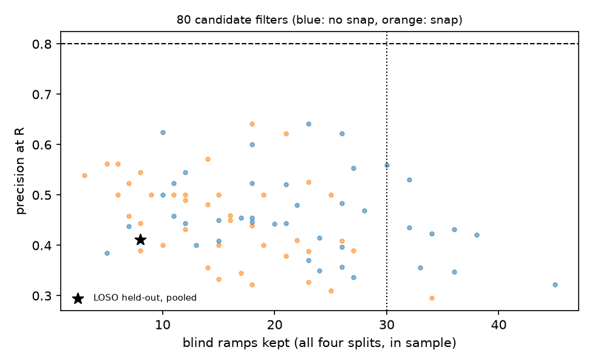

# Argon as a teacher for RampNet's open-rig misses: Stage 0

**Plan:** `argon-teacher-2026-11-15` (revised after review), Stage 0 only; its Stage 0 text is
in the [appendix](#appendix-the-plans-stage-0-text). **Run date:** 2026-11-15.
**Script:** `scripts/analysis/argon_teacher_s0.py` (tests: `tests/test_argon_teacher_s0.py`).
**Outputs:** `analysis_out/argon_teacher_s0/results.json`, plus two derived inputs in the same
directory (`neighbours.json`, `heatmap_features.json`); `docs/figures/argon_teacher/` (two PNGs).
**Compute:** one RampNet forward pass per benchmark pano (469 panos) on the local RTX 3070,
about 10 minutes (a timed re-run on 2026-11-24: 565 s for the pano loop, 1.2 s per pano, row
`argon-teacher-s0:extract-heatmaps` in `analysis_out/usage_log.jsonl`, `paid: false`); everything
else on the CPU in under 10 seconds. No model API call, no remote host, no spend. Lyon was not read.
**Status:** Stage 0. The gate bars are the plan's, fixed in the plan before this script was
written. The plan says they were set after the per-split Argon-only precisions were published
(plan section 3, appendix), and the plan was marked "proposed", not approved. Nothing was tuned
here. Stage 1 was not started.

## Result

**Gate B passes. Gates P, Y and S all fail at their kill bars. Under the plan, the teacher run
stops here.**

| Gate | Plan bar (go / kill) | Measured | Verdict |
|---|---|---|---|
| B, leak | H2 ≤ 5%, else E ≤ 5%, else stop | H2 0.6% (7 / 1,147), with `budapest_district5` as an upper bound; H alone 3.0% | **go** (via H2) |
| P, precision | ≥ 0.80, no split with 10+ boxes under 0.60 / < 0.65 | 0.41 (7 TP / 10 FP), held out | **kill** |
| Y, yield | ≥ 30 / < 20 of the 65 reached blind ramps kept | 8 | **kill** |
| S, strict-silent | ≥ 10 kept and ≥ 25% of those Argon reaches / fewer | 8 of 42 (19%) | **kill** |

At R, the plan's match radius, the filter result is not a near miss, and it does not depend on
the leave-one-split-out mechanics. **At R, no candidate reaches even the 0.65 kill bar in
sample.** The best of the 80, scored on all four splits at once, is `f2<=3m & f4_yolo` at 0.64
(25 TP / 14 FP, 23 blind ramps kept). Under the selection rule, three of the four folds find no
candidate at precision ≥ 0.80 on their training splits. Only the `bayonne` fold selects one
(`f2<=3m & f4_yolo +snap`, 0.82 in training), and it scores 0.41 on `bayonne`.

**At 2R the picture is different, and the stop rests on gate P alone.** Matched at 2R (score and
"kept box within 2R of the ramp"; a sensitivity read, not a gate), every fold has an eligible
candidate. Held out and pooled, the filter keeps 45 TP / 38 FP (0.54), 38 blind ramps and 28 of
the 42 strict-silent ramps (67%). Y and S would read go. P still reads kill: 0.54 is under 0.65,
and `bayonne` (26 / 25) and `budapest_district5` (8 / 11) are each under 0.60 with 10+ boxes. In
sample at 2R, 8 of the 80 candidates are at ≥ 0.80. One clears the P and Y go bars together,
`f2<=5m & f4_yolo` at 0.84 (37 / 7, 31 blind ramps kept), and the best is 0.875. So once
localisation is loosened, what survives is "precision does not carry from one split to the
next", not "no filter separates the boxes". R is the plan's radius and the right one for a point
label, so the verdict does not change.

**What the plan says happens next:** gate B alone does not keep the plan alive. The plan stops
when a filter gate is at kill. "Between go and kill on P, the default is stop; Jon may choose
rating R0" applies only to the band between the bars, and P is below it. Stage 1 and Stage 2 do
not start.


*Figure 1. Gate B. Share of sure ramps left in background, by rule. `budapest_district5` has no
labeler run with stored peaks, so its H2 bar equals its H + far band bar (an upper bound). E is
0 wherever it is drawn, and `budapest_district5` has no matched empty pano. Regenerate with
`argon_teacher_s0.py figures`.*



*Figure 2. Gates P and Y. Every candidate scored at R in sample on all four splits (pooled),
against the go lines. No dot reaches 0.65. The star is the held-out result the gates read. The
2R read is not drawn; its numbers are in the Result section and `filters_at_2R`.*

## Gate B: background leak

"Sure ramp" means a GT point (a reviewer-confirmed RampNet detection, or a missed mark not
flagged unsure) on a recall-confirmed pano. All 469 panos are recall-confirmed, so the
denominator is the plan's 1,147.

| split | GT | H | H, both Argon legs | H + far band | H + neighbours | H2 | E: matched empties (with a ramp) |
|---|---:|---:|---:|---:|---:|---:|---:|
| laurens_mapillary | 249 | 4 (1.6%) | 2 (0.8%) | 3 (1.2%) | 0 (0.0%) | 0 (0.0%) | 6 (0) |
| juneau | 297 | 6 (2.0%) | 2 (0.7%) | 2 (0.7%) | 1 (0.3%) | 0 (0.0%) | 11 (0) |
| bayonne | 301 | 17 (5.6%) | 12 (4.0%) | 7 (2.3%) | 5 (1.7%) | 2 (0.7%) | 1 (0) |
| budapest_district5 | 300 | 7 (2.3%) | 5 (1.7%) | 5 (1.7%) | no data | 5 (1.7%), upper bound | 0 |
| **pooled** | 1,147 | 34 (3.0%) | 21 (1.8%) | 17 (1.5%) | – | **7 (0.6%)** | 18 (0) |

- **H passes as well, against the plan's expectation.** The review estimated "about 10%" from
  counts made at radius R with YOLO at conf 0.25. The plan's H uses 2R discs and YOLO boxes down
  to 0.05, and that is what is measured here. With one YOLO arm instead of the union, H is 3.1-3.6%
  (`y26_pano` 35, `y11x_pano_h200` 40, `y11l_pano` 41 leaked).
- **H2 is read twice.** Over all four splits, with `budapest_district5` at its H + far band value,
  it is 0.6%. Over the three splits with neighbour data it is 0.2% (2 / 847). Both reads pass, so
  the gate does not have to fall through to E.
- **The far band does most of the work between H and H2.** 195 of the 1,147 sure ramps (17%) lie
  less than 6° below the horizon (`laurens_mapillary` 9, `juneau` 57, `bayonne` 64,
  `budapest_district5` 65). H2 counts them as not leaked, as the plan's rule says. Of the 27 ramps
  between H (34) and H2 (7), the far band removes 17 and the neighbour discs 10.
- **No verdict depends on `neighbours.json`.** H alone (3.0%) and H + far band (1.5%) pass gate B
  without it, and the filter gates all read kill with feature 2 removed (below).
- **E is uninformative.** It is 0 of 18 matched empty panos. Eighteen panos is too few to bound a
  5% leak, and E's weakness (easy scenes only) is stated in the plan. It is reported, not used.

## Gates P, Y, S: filtering Argon-only boxes

**Box funnel** (zero-shot Argon leg, recall-confirmed panos): 915 boxes; 236 with no RampNet
peak ≥ 0.05 within R (Argon-only); 10 dropped by the rig mask and 51 within 2R of a peak ≥ 0.30;
**175 boxes** carry features (`laurens_mapillary` 28, `juneau` 19, `bayonne` 68,
`budapest_district5` 60).

**Ceilings.** Gate Y's 65 and gate S's 42 count the ramps any zero-shot box reaches within R.
The filter only sees the 175 boxes left after the rig mask and the 0.30-within-2R drop, and with
no filter at all those keep 48 blind ramps and 38 strict-silent ones (51 TP / 119 FP / 5
ignored, 0.30; with the snap, 36 and 34). A filter keeps a subset of these boxes, so it can keep
at most 48 of the 65 and 38 of the 42. Gate Y's go bar is therefore 30 of an attainable 48. The 17
other reached blind ramps are reached only by boxes that the plan's own definitions remove. The
verdict, at 8, is unaffected.

**Leave-one-split-out** (80 candidates; held out at R):

| held-out split | selected on the other three (training TP / FP, blind kept) | eligible | held-out TP / FP / ignored | precision | blind kept | strict-silent kept |
|---|---|---:|---|---:|---:|---:|
| laurens_mapillary | none | 0 | 0 / 0 / 0 | – | 0 | 0 |
| juneau | none | 0 | 0 / 0 / 0 | – | 0 | 0 |
| bayonne | `f2<=3m & f4_yolo +snap` (18 / 4, 10) | 6 | 7 / 10 / 0 | 0.412 | 8 | 8 |
| budapest_district5 | none | 0 | 0 / 0 / 0 | – | 0 | 0 |
| **pooled** | | | **7 / 10 / 0** | **0.412** | **8** | **8** |

The `bayonne` fold's choice scores 0.89 on `laurens_mapillary` (16 / 2), 0.50 on `juneau`
(2 / 2) and keeps nothing on `budapest_district5`, which has no feature 2. Precision on one
split does not carry to the next.

**Without feature 2.** Feature 2 is unavailable on `budapest_district5`, so every box there
fails it. With the 32 feature-2 candidates removed, no fold has an eligible candidate, and all
three gates fail at kill with nothing kept. The verdict is the same either way.

**Which features help.** The highest in-sample precisions all pair feature 4 (a YOLO box ≥ 0.05
within 2R) with feature 2 (support from a neighbouring pano) or feature 3 (Argon's own
confidence). Features 2 and 4 depend on RampNet and on YOLO, which was trained on RampNet's data.
Feature 3 is the only independent feature that appears there, and only paired with feature 4.
Feature 5 alone (elevation in range) is close to no filter: 0.32 (48 / 101).

## Method

Inputs, all committed except the labeler runs behind `neighbours.json`:

- GT: `benchmark/<split>/` via `cascade_cost_35.load_gts`. RampNet peaks: `analysis_out/op_cache/`
  (floor 0.05). Argon: `benchmark/model_detections/gemini-4-argon__<split>.json` (box centres) and
  `gemini-4-argon-confidence-on__<split>.json` (feature 3's scores). YOLO: the three `*_pano`
  arms in the same directory, published down to 0.05.
- `heatmap_features.json`: one forward pass of the published RampNet checkpoint per pano, with
  the op_cache's preprocessing and decode (`threshold_sweep.heatmap_for`, `peaks_to_dets`). Every
  image is checked against `imagery_manifest.json`'s sha256. It reproduces all 1,959 op_cache
  peaks of the four splits to within one pixel. It keeps, per zero-shot Argon box, the raw
  heatmap maximum within R and 2R, plus the heatmap modes ≥ 0.01 lying within 2R of some box.
- `neighbours.json`: for each benchmark pano with a labeler run, every stored peak (floor 0.10)
  of every other pano within 50 m, raycast to flat ground at 2.6 m and projected into this pano
  with the labeler's own `geo.detection_ground_point` / `geo.ground_point_to_pano`. Every fused
  site is projected the same way. It also keeps each zero-shot Argon box's distance from its
  ground point to the nearest other-pano peak, or to a site with a member from another pano
  (feature 2).

Rules, as the plan states them:

- **R** = 0.022 of pano width; distances wrap at the seam (`rampnet.geometry.dist_sq`).
- **H**: a sure ramp leaks if no disc of radius 2R holds it. Discs are centred on RampNet peaks
  ≥ 0.05, zero-shot Argon boxes, and YOLO boxes ≥ 0.05 from any of the three arms.
- **H2**: H plus 2R discs at every projected neighbour peak and fused site. A ramp less than 6°
  below the horizon (y < 0.5 + 6/180) is ignored. At 2.6 m, 6° below the horizon is 24.7 m out,
  so the far band starts about where the 25 m raycast ends.
- **E**: "empty" means no RampNet peak ≥ 0.05, no zero-shot Argon box and no YOLO box ≥ 0.05
  (rig region included). An empty pano is matched when its `(sequence_id, camera_model)` also
  holds a non-empty pano of the split.
- **Gate B**: H2 ≤ 5%, else E ≤ 5%, else stop.
- **Features** (per Argon-only box, after the rig mask, dip > 49°, and the ≥ 0.30-within-2R drop):
  (1) heatmap max within R ≥ 0.01 / 0.02 / 0.03; (2) support within 3 / 5 m;
  (3) score of the nearest confidence-leg box within R ≥ the median (0.68) / upper quartile
  (0.76) of all 1,360 confidence-leg scores; (4) a YOLO box ≥ 0.05 within 2R;
  (5) y inside the 5-95% range of all 915 zero-shot boxes (0.526-0.715); (6) snap to the nearest
  heatmap mode ≥ 0.01 within 2R, where one exists.
- **Candidates**: the 9 single tests and the 31 AND-pairs of tests from different features, each
  with and without the snap (80).
- **Selection** per held-out split: among candidates whose pooled precision on the other three
  splits is ≥ 0.80, take the one keeping the most blind ramps there. Ties go to higher precision,
  then a single test over a pair, then no snap. The choice is scored at R on the held-out split
  with `score_pano`. A fold with no eligible candidate keeps nothing.
- **Gates** read the four held-out results pooled. Y counts blind ramps (no peak ≥ 0.05 within R)
  with a kept box within R. S counts strict-silent ramps (none within 2R) kept, against the 42
  strict-silent ramps any zero-shot box reaches. Y can exceed TP on the same boxes (8 against 7
  here): Y counts every ramp within R of any kept box, while TP counts one-to-one greedy matches,
  so one box near two ramps adds two to Y and at most one to TP.

## Amendments

Places where the plan was ambiguous or did not fit the data, the reading taken, and whether the
other reading changes a verdict.

1. **"Argon box" means the zero-shot leg**, the leg behind the plan's 65 (reproduced: 14 + 6 +
   32 + 13). The confidence leg supplies feature 3's score only. H with both legs is reported
   (1.8%). No verdict changes.
2. **"YOLO box" means any of the three YOLO pano arms** (union), for H, E and feature 4. H with
   one arm is 3.1-3.6%. Gate B does not change.
3. **Feature 5 is elevation only.** The published Argon outputs, and the local detector cache,
   keep box centres, not box extents, so box size cannot be computed. The H discs are centred on
   box centres for the same reason.
4. **Feature 3**: a zero-shot box takes the score of the nearest confidence-leg box within R, and
   fails if there is none. The median and upper quartile, and feature 5's range, are taken over
   all four splits rather than per fold. They are statistics of Argon's output alone and use no GT.
5. **Pairs are ANDs.** The plan says "in pairs" without an operator. The OR reading is scored in
   sample on all four splits (`filters_or_pairs`, 62 pair candidates with and without the snap):
   the best OR pair is `f3>=q75 | f4_yolo` at 0.48 (37 / 40), and none reaches 0.65. The verdict
   does not change.
6. **The selection rule's objective.** The plan fixes the 0.80 eligibility bar but not what to
   maximise among eligible candidates. Blind ramps kept (gate Y's quantity) was used, with the
   tie-breaks above. Three folds have no eligible candidate, so the objective only matters for the
   `bayonne` fold.
7. **P's kill reading.** "With every unmatched box counted true" taken literally makes every
   precision 1, and then the kill could never fire. It is read as: boxes the scorer ignores (near
   a reviewer's unsure mark) count as true. There are none among the kept boxes, so both
   precisions are 0.41.
8. **Neighbour data.** `budapest_district5` has no usable labeler run: its `results.jsonl` holds
   300 panos at the old 0.55 floor, 2 of them benchmark panos. H2 is therefore read two ways,
   above, and feature 2 fails on every box there (sensitivity read without feature 2, above). The
   `juneau` run was read from the labeler worktree `sal-juneau`, because the main checkout's
   `runs/juneau/` holds only submission records. Fused sites existed only for Laurens, made with
   older parameters, so all three were re-fused with the labeler's current `fuse_sites.py`
   defaults into scratch (not committed; hashes below).
9. **The far band** is measured in the pano frame (y < 0.5 + 6/180), with no tilt correction, and
   it includes everything above the horizon.
10. **E's "empty"** uses the same 0.05 floors as H and counts detections in the rig region, which
    is the stricter reading.
11. **Gate S** has no in-between band in the plan ("fewer" is the kill), so it reads go or kill.

## Caveats

- **The gates score at R.** [`cascade_argon_35.md`](cascade_argon_35.md) shows Argon's box
  centres are looser than YOLO's. The plan fixes R, and feature 6 (the snap) is the plan's answer
  to localisation; the snapped variants do no better in sample. A 2R match (`filters_at_2R`,
  Result section) raises the held-out precision to 0.54 and turns Y and S to go, so at 2R the stop
  rests on P alone. The 2R gates read the plan's R denominators (65 and 42). Counted within 2R,
  Argon reaches 112 blind and 58 strict-silent ramps; S would still read go (28 of 58, 48%), and Y's
  bar is a count.
- **FPs are upper bounds.** GT is RampNet's reviewed detections plus the reviewer's missed marks,
  so a real ramp that neither marked counts as an FP. This holds for every split and every
  candidate alike.
- **Small held-out counts.** The 175 featured boxes split 28 / 19 / 68 / 60. No interval is
  computed, and the plan's gates are on point values.
- **E rests on 18 panos**, too few to bound a 5% leak. Gate B passes on H2 regardless.
- **One Argon run per leg**, as in the cascade read.

## Replication

Commit: the merge of PR #294 into `main`.

**What a clone can and cannot rebuild.** Step 1 below needs only committed files, and `--check`
covers it. The two derived inputs in step 2 cannot be rebuilt from a clone today:

- `neighbours.json` needs three labeler run files (`runs/laurens/results.jsonl`,
  `runs/bayonne/results.jsonl`, and `runs/juneau/results.jsonl` from the `sal-juneau` worktree of
  the labeler repo). All three are git-ignored there (`runs/**`) and not published; the copies
  used were on the desktop that ran this. The three re-fused site files were written to a scratch
  directory and not kept. Publishing the three
  run files (or the archive that holds them) would unblock it, since the site files can be
  re-fused from them with the commands below; the hashes in the table check the result. No
  verdict depends on this file (Gate B section).
- `heatmap_features.json` needs the benchmark panos of all four splits. Per
  [`replication.md`](replication.md), `budapest_district5` is on the `rampnet-benchmark` Hugging
  Face dataset, but `laurens_mapillary`, `bayonne` and `juneau` are not uploaded yet (`bayonne`
  and `juneau` are in the makelab2 archive). Uploading those three would unblock it. Every image is
  checked against the committed `imagery_manifest.json` sha256 before use.
- The weights: `extract-heatmaps` loads `projectsidewalk/rampnet-model` from the Hub without a
  pinned revision. On this desktop that resolves to revision
  `606a11956743f7eb328d9207769034752f6191f4` (`model.safetensors` sha256 `f2119e3becb0b551…`). The
  file itself records only the repo name, and the op_cache records no revision either. The
  1,959 / 1,959 peak match ties it to the op_cache's checkpoint in practice, and
  [`decode_e2e_221.md`](decode_e2e_221.md) found the Hub's two revisions (1078bcd, 606a119)
  tensor-identical.

```bash
# 1. CPU, committed inputs only: leak + features + filters -> results.json, then the check
python scripts/analysis/argon_teacher_s0.py run
python scripts/analysis/argon_teacher_s0.py --check      # byte-compares results.json (~1 s)
python scripts/analysis/argon_teacher_s0.py leak         # or: features, filters (print tables)
python scripts/analysis/argon_teacher_s0.py figures      # needs matplotlib
pytest -q tests/test_argon_teacher_s0.py

# 2. Derived inputs (only to rebuild them; both are committed)
#    neighbours.json: needs the labeler runs; sites re-fused first with the labeler at 1e0e96e
python <labeler>/scripts/fuse_sites.py <labeler>/runs/laurens/results.jsonl --out <tmp>/laurens_mapillary.sites.jsonl
python <labeler>/scripts/fuse_sites.py <labeler>/runs/bayonne/results.jsonl --out <tmp>/bayonne.sites.jsonl
python <labeler>/scripts/fuse_sites.py <sal-juneau>/runs/juneau/results.jsonl --out <tmp>/juneau.sites.jsonl
python scripts/analysis/argon_teacher_s0.py extract-neighbours --labeler-root <labeler> --sites-dir <tmp>
#    heatmap_features.json: GPU, the benchmark panos (checked against imagery_manifest.json).
#    Appends a paid:false time row to the main checkout's analysis_out/usage_log.jsonl
#    (--usage-log to change it). --out-dir writes elsewhere, to byte-compare with the committed file.
python scripts/analysis/argon_teacher_s0.py extract-heatmaps --panos-root <dir holding <split>/panos/>
```

Input hashes (sha256, first 16 hex). `results.json` records the full hashes of its two derived
inputs. `neighbours.json` records the full hashes of the run and site files.

| input | sha256 |
|---|---|
| `analysis_out/argon_teacher_s0/neighbours.json` | `88ffb71e7449a147` |
| `analysis_out/argon_teacher_s0/heatmap_features.json` | `7676c6a739f9dcdf` |
| labeler `runs/laurens/results.jsonl` (4,495 panos) | `16c5a348b739274b` |
| labeler `runs/bayonne/results.jsonl` (50,409 panos) | `cb03768cc4cefd0b` |
| `sal-juneau` `runs/juneau/results.jsonl` (4,999 panos; worktree at `2e3f238`) | `5f7822fb3f977d74` |
| re-fused sites: laurens_mapillary (813) / bayonne (14,644) / juneau (1,335) | `cf0e07b120f88591` / `2ff67c08c4dc62f4` / `8f7f83b9f4ecb116` |
| `benchmark/model_detections/gemini-4-argon__{laurens_mapillary,juneau,bayonne,budapest_district5}.json` | `21a622145d797982` / `49d8fe9db2659e4e` / `9bfde72653caea44` / `8075badffc4e0d2d` |

`--check` (also `check_all.py --only argon_teacher_s0`) covers every number in this note except
the two derived inputs, which need the labeler runs or the GPU, and the timing, which is in the
ledger. The figures are not byte-compared.

## Where each number lives

All keys are in `analysis_out/argon_teacher_s0/results.json` unless stated.

| number | key |
|---|---|
| 469 panos, 1,147 GT, 196 blind, 65 reached, 105 strict-silent, 42 reached | `counts.pooled` (`n_panos`, `n_gt`, `n_blind`, `blind_reached`, `n_strict_silent`, `ss_reached`); per split in `counts.per_split` |
| leak table (H, both legs, far band, neighbours, H2, E) | `leak.per_split.<split>.*`, `leak.pooled.*` |
| H with one YOLO arm | `leak.pooled.H_yolo_<arm>_only` |
| H2 over the splits with data | `leak.pooled.H2_splits_with_neighbours` |
| gate B verdict | `leak.gate_B` |
| feature thresholds (0.68, 0.76, 0.526-0.715) | `thresholds` |
| box funnel (915 / 236 / 10 / 51 / 175) | `feature_drops.<split>` |
| per-box features | `features[]` (also `argon_teacher_s0.py features`) |
| every candidate on every split | `filters.candidates.<name>.<split>` |
| LOSO choices and held-out rows | `filters.loso.<split>` |
| pooled held-out row, gates P / Y / S | `filters.held_out_pooled`, `filters.gates` |
| sensitivity without feature 2 | `filters_without_f2` |
| best in sample at R (0.64), none at ≥ 0.65 | `filters.in_sample` |
| 2R read (45 / 38 held out, 38 blind, 28 strict-silent; 8 at ≥ 0.80 in sample, 0.84, 0.875; 112 / 58 reached within 2R) | `filters_at_2R` (`held_out_pooled`, `gates`, `in_sample`, `reached_within_2R`) |
| OR pairs (0.48, 37 / 40) | `filters_or_pairs.in_sample` |
| ceilings (48 of 65, 38 of 42; 51 / 119 / 5; snap 36 and 34) | `filter_ceilings` |
| far band (195; 9 / 57 / 64 / 65) | `leak.pooled.n_far_band`, `leak.per_split.<split>.n_far_band` |
| op_cache peaks reproduced (1,959 / 1,959) | `heatmap_sanity`; source `heatmap_features.json` |
| GPU time (565 s, 1.2 s per pano) | `analysis_out/usage_log.jsonl`, label `argon-teacher-s0:extract-heatmaps` |
| figures | `docs/figures/argon_teacher/{leak,filters}.png`, from `leak` and `filters.candidates` |

## Appendix: the plan's Stage 0 text

From `argon-teacher-2026-11-15` (revised after review, dated 2026-11-15), which is not otherwise
in the repo. Copied verbatim: its definitions line and section 3 (Stage 0) only; the other
sections are about Stages 1 and 2 and are not reproduced. "Section 6" in the last line refers to
the plan's rating section, which is not included. The eleven amendments above are written
against this wording.

> Status: proposed, nothing run. Claude (Fable 5.2, `claude-fable-5-2`); reviewed by Opus 5.5 (`argon-teacher-2026-11-15.review.md`). Argon outputs: RampNet worktree `cascade-argon` ([RampNet#289](https://github.com/ProjectSidewalk/RampNet/pull/289)). **R** = match radius, 0.022 of pano width. **Blind ramp** = ground-truth ramp with no RampNet peak ≥ 0.05 within R; **strict-silent** = none within 2R. **Argon-only box** = Argon box with no such peak within R.
>
> ## 3. Stage 0 ($0; CPU, under 1 local GPU-hour)
>
> Splits: laurens_mapillary, bayonne, juneau, budapest_district5 (469 panoramas, 1,147 ramps, 196 blind; GoPro Max and Trimble only).
>
> **First, the background leak:** the share of sure ramps that land in background.
> - H: ignore discs of 2R at every RampNet peak ≥ 0.05, Argon box and YOLO box ≥ 0.05. The reviewer's arithmetic puts H near 10% (118 of 1,147 or more). **Expect H to fail.**
> - H2: H plus discs at every fused site and stored peak projected from neighbouring panoramas of the labeler run, plus the far band (less than 6° below the horizon) ignored.
> - E: labelled panoramas `sparse`; whole-frame background only from panoramas all three models call empty, matched to labelled panoramas by sequence and rig. Leak = share of such panoramas holding a sure ramp. Weakness: easy scenes only.
> - **Gate B:** H2 ≤ 5%, else E ≤ 5%, else stop. The 5% is the crosswalk plan's level.
>
> **Filter features per Argon-only box** (after the rig mask and dropping boxes within 2R of a peak ≥ 0.30):
> 1. RampNet raw heatmap maximum within R (0.01, 0.02, 0.03). *RampNet-dependent.*
> 2. Support within 3 or 5 m from another panorama's fused site or peak. *RampNet-dependent.*
> 3. Argon confidence-leg score (median, upper quartile). *Independent.*
> 4. YOLO box ≥ 0.05 within 2R. *Trained on RampNet's data.*
> 5. Box size and elevation inside the 5–95% range of all Argon boxes. *Independent.*
> 6. Snap to the nearest heatmap mode ≥ 0.01 within 2R, where one exists.
>
> Candidates: features 1–5 alone and in pairs, with and without the snap, chosen leave-one-split-out at precision ≥ 0.80 and scored at R on the held-out split. The 0.80 is borrowed from the #158 mining rule, and every bar here was set after the per-split precisions were published.
>
> | Gate | Go | Kill |
> |---|---|---|
> | P, precision | ≥ 0.80; no split with 10+ boxes under 0.60 | < 0.65 with every unmatched box counted true |
> | Y, yield | ≥ 30 of the 65 reached blind ramps kept | < 20 |
> | S, strict-silent | ≥ 10 kept, and ≥ 25% of those Argon reaches | fewer: the filter keeps only what RampNet half-sees |
>
> Between go and kill on P, the default is stop; Jon may choose rating R0 (section 6).
