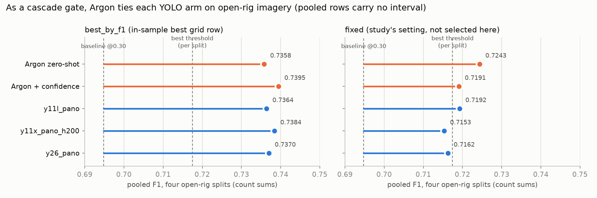
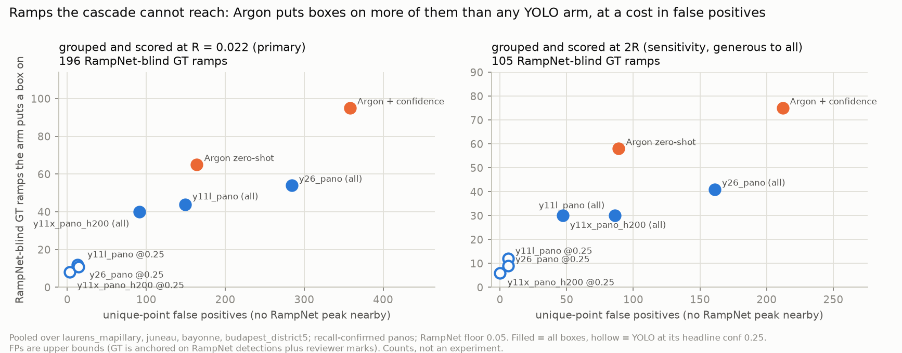

# Gated cascade with Gemini 4 Argon as the second arm (#35)

**Issue:** [#35](https://github.com/ProjectSidewalk/RampNet/issues/35). **Run date:** 2026-11-15
(review fixes the same day, PR #289).
**Script:** `scripts/analysis/cascade_argon_35.py` (tests: `tests/test_cascade_argon_35.py`;
figures: `scripts/analysis/cascade_argon_35_figures.py`).
**Outputs:** `analysis_out/cascade_cost_35/argon/` (37 per-pair files in `cascade_cost_35.py`'s
format, `argon_pairs.json`, `runs.json`); `docs/figures/cascade_argon_35/` (two PNGs).
**Compute:** CPU only, committed inputs only, no model call, no network, no spend. About 2 min for the
pair files and 95 s for `argon_pairs.json` on `jonfhome`; `--check` takes 176 s there. No ledger
row, as for `cascade_cost_35.md`.
**Status:** exploratory. No rule was stated before these numbers were read.

## Why

[`cascade_cost_35.md`](cascade_cost_35.md) never ran the Gemini 4 Argon legs; its `summary.json`
lists them under `gaps`. The question here is whether agreement with Argon tells us more about a
RampNet sub-threshold peak than RampNet's own score does, and whether it tells us more than an
open-weight detector does. It was meant to bear on whether to pay for an "Argon as teacher"
distillation run. It answers the first two questions. It does not answer the teacher question:
see below.

## Result

**As a cascade gate on RampNet's sub-threshold peaks, Argon ties a YOLO pano arm on the
open-imagery splits.** Pooled over the four open-rig splits, all five arms taken one at a time
(two Argon legs, three YOLO arms) are within 0.0037 F1 of each other under `best_by_f1`
(0.7358–0.7395) and within 0.0090 under `fixed` (0.7153–0.7243). Argon zero-shot leads the
`fixed` pool by +0.0051 over the best YOLO arm (`y11l_pano`). Per split, of the sixteen
Argon-minus-best-YOLO intervals one excludes 0, and it favours YOLO.

**This PR does not answer the teacher / label-source question, and the numbers below are why it
is open.** The cascade can only promote RampNet's own peaks, so it never sees an Argon box with no
RampNet peak nearby. Those boxes are counted separately (section "Unique points"). Pooled over the
four open-rig splits there are 196 GT ramps with no RampNet op_cache peak ≥ 0.05 within R
("RampNet-blind"). Argon zero-shot puts a box on 65 of them (confidence leg: 95). The YOLO arms at
their headline conf 0.25 reach 12 / 8 / 11 (`y11l` / `y11x` / `y26`), and with every box down to
their 0.05 floor 44 / 40 / 54. Argon's unique points are not precise: 64 TP / 164 FP (0.28)
for zero-shot, against 47 TP / 284 FP (0.14) for `y26` with all boxes. Both FP counts are upper
bounds. Argon reaches more of the ramps RampNet misses, at a cost in false positives. Whether that
is worth a teacher run needs its own experiment.



*Figure 1. The narrow claim: pooled F1 over the four open-rig splits, every arm on its own.
Dashed lines are the 0.30 baseline and the per-split best single threshold. Pooled rows carry no
interval. Regenerate with `cascade_argon_35_figures.py`.*



*Figure 2. Why the teacher question is open: for each arm's unique points (no RampNet peak
nearby), false positives against how many RampNet-blind GT ramps the arm puts a box on. Left at
R, right at 2R (sensitivity). Filled = all boxes; hollow = YOLO at conf 0.25.*

Argon's agreement does carry information beyond RampNet's score on two splits: on
`laurens_mapillary` and `bayonne` both Argon legs read VIABLE with every resample of the
selection-aware bootstrap viable, and on `laurens_mapillary` the cascade beats the best single
threshold by +0.069 [+0.034, +0.110] (zero-shot) and +0.080 [+0.044, +0.120] (confidence leg).
The YOLO arms do the same thing there.

## Method

`cascade_cost_35.run_pair`, unchanged, with the study's arguments: T_hi 0.30, T_lo ∈ {0.05 … 0.25},
r_gate ∈ {R/2, R, 2R}, 20 evenly spaced null shifts (all 123 on richmond), 2,000 resamples, seed 0.
Same GT, same op_cache floor peaks, same scorer (`score_pano`, radius R = 0.022, wrapped).

- **`gemini-4-argon`** (standing zero-shot leg) emits no score: 15 settings, c_min = 0 only.
- **`gemini-4-argon-confidence-on`** (the #276 leg) has scores: 60 settings, c_min ∈ {0, q25, q50, q75}.
- **Open-weight arms:** `y11l_pano`, `y11x_pano_h200`, `y26_pano`. Their committed files in
  `analysis_out/cascade_cost_35/` are read as they are. The study had not run them on `juneau`,
  `bayonne` or `laurens_gsv`; those nine pairs are run here.

Three reads of each pair, all the study's: `best_viable`, `best_by_f1` (both chosen **in sample**)
and `fixed` (T_lo 0.05, r_gate R/2, c_min = the arm's median score or all boxes; chosen on
richmond × the Vistas arm, so selected on none of these splits or arms).

**Selection.** Each `best_by_f1` row is the best of 15 settings for the zero-shot leg and of 60 for
a scored arm. "Best YOLO arm" is then a **second in-sample max, over the three YOLO arms, per split
and per pool**: up to 3 × 60 = 180 candidate rows against Argon zero-shot's 15 and the confidence
leg's 60. The paired "vs best YOLO" intervals are conditional on both choices. Each YOLO arm is
therefore also reported on its own in every F1 table below.

**Intervals** are `cascade_cost_35.bootstrap_delta` (pano resample, paired, setting held fixed).
The study points it at a cascade row and the 0.30 baseline. Here the same function is also pointed
at the best single threshold, the threshold at matched recall, and the best YOLO arm's row.

**Pools** are count sums (TP, FP, recall TP, recall GT added across splits), one arm on every split:
`open_276` = `laurens_mapillary` + `bayonne` (`prompt_276_heldout.OPEN_POOL`), `open_rig` = those
plus `juneau` and `budapest_district5`. The cascade study has no pool and no pooled bootstrap, so
the pooled rows carry no interval.

**Unique points** (added after review): an arm's boxes with no RampNet op_cache peak ≥ 0.05 within
the group radius, scored alone by `score_pano` at the score radius, on the recall-confirmed panos
only (a pano whose missed-ramp scan was not attested has no GT for a ramp RampNet never fired on).
**RampNet-blind GT** = GT ramps on those panos with no such peak within the group radius;
**reached** = the arm has any box within the score radius of one (not a 1:1 match). YOLO is read at
its headline conf 0.25 and with all boxes (published down to 0.05); both Argon legs with all boxes.
Three configurations: **R** (group and score at R, primary), **2R** (group and score at 2R) and
**R-group / 2R-score** (the reviewer's read, which holds the box set fixed and loosens only the
match). 2R is generous to every arm, so both 2R reads are sensitivity, never a replacement.

## Open-rig splits (F1)

Baseline is RampNet's op_cache peaks at ≥ 0.30. "Best thr" is the best single threshold on a
0.05–0.95 sweep. All four splits are Mapillary or Panoramax imagery. The best YOLO arm per row is
in **bold**.

**`best_by_f1` (in-sample best grid row)**

| split | n GT | baseline @0.30 | best thr (t) | y11l_pano | y11x_pano_h200 | y26_pano | Argon zero-shot | Argon + confidence |
|---|---:|---:|---:|---:|---:|---:|---:|---:|
| laurens_mapillary | 249 | 0.6600 | 0.7082 (0.16) | 0.7868 | 0.7803 | **0.8018** | 0.7775 | 0.7877 |
| juneau | 297 | 0.8294 | 0.8303 (0.26) | 0.8342 | 0.8348 | **0.8354** | 0.8449 | 0.8401 |
| bayonne | 301 | 0.6000 | 0.6467 (0.19) | 0.6543 | **0.6774** | 0.6502 | 0.6533 | 0.6643 |
| budapest_district5 | 300 | 0.6736 | 0.6839 (0.37) | **0.6814** | 0.6735 | 0.6701 | 0.6779 | 0.6767 |
| **pool open_276** | 550 | 0.6265 | 0.6739 (per split) | 0.7149 | **0.7231** | 0.7204 | 0.7090 | 0.7201 |
| **pool open_rig** | 1147 | 0.6948 | 0.7175 (per split) | 0.7364 | **0.7384** | 0.7370 | 0.7358 | 0.7395 |

**`fixed` (not selected on these data)**

| split | baseline @0.30 | best thr (t) | y11l_pano | y11x_pano_h200 | y26_pano | Argon zero-shot | Argon + confidence |
|---|---:|---:|---:|---:|---:|---:|---:|
| laurens_mapillary | 0.6600 | 0.7082 (0.16) | 0.7552 | 0.7286 | **0.7564** | 0.7423 | 0.7133 |
| juneau | 0.8294 | 0.8303 (0.26) | 0.8231 | **0.8270** | 0.8267 | 0.8404 | 0.8399 |
| bayonne | 0.6000 | 0.6467 (0.19) | 0.6389 | **0.6426** | 0.6288 | 0.6492 | 0.6452 |
| budapest_district5 | 0.6736 | 0.6839 (0.37) | **0.6678** | 0.6667 | 0.6622 | 0.6678 | 0.6735 |
| **pool open_276** | 0.6265 | 0.6739 (per split) | **0.6910** | 0.6808 | 0.6861 | 0.6904 | 0.6752 |
| **pool open_rig** | 0.6948 | 0.7175 (per split) | **0.7192** | 0.7153 | 0.7162 | 0.7243 | 0.7191 |

Reading the two tables:

- **`laurens_mapillary`, `best_by_f1`:** "the best YOLO arm is ahead of both Argon legs" rests on
  `y26_pano` alone. Argon + confidence (0.7877) is ahead of `y11l` (0.7868) and `y11x` (0.7803);
  zero-shot (0.7775) trails `y11x` by 0.0028.
- **Where Argon is ahead of the best YOLO arm:** under `best_by_f1`, on `juneau` only (both legs,
  by +0.005 to +0.010). Under `fixed`, on `juneau` and `bayonne` (both legs) and on
  `budapest_district5` (confidence leg, +0.0057; zero-shot ties `y11l` at 0.6678). Every one of
  these per-split intervals includes 0 (next section).
- **The pools:** `open_rig` as in the Result. `open_276` is wider: `best_by_f1` 0.7090–0.7231
  (zero-shot trails `y11x` by 0.0141), `fixed` 0.6752–0.6910 (the confidence leg trails `y11l` by
  0.0158).

`best_viable` equals `best_by_f1` on these four splits for both Argon legs. Verdicts under the
study's rule: both Argon legs VIABLE on all four. YOLO: all three VIABLE on `laurens_mapillary` and
`bayonne`; on `budapest_district5` only `y11l_pano`; on `juneau` only `y26_pano`. One calibration
flag: the confidence leg's wrong-pano copies read VIABLE 1 time in 20 on `laurens_mapillary`.

Attributable ΔR of the best viable row (after the wrong-pano null), Argon zero-shot / confidence /
best YOLO: `laurens_mapillary` +0.134 / +0.150 / +0.182; `bayonne` +0.088 / +0.103 / +0.121;
`juneau` +0.035 / +0.036 / +0.028; `budapest_district5` +0.028 / +0.029 / +0.023.

## Paired intervals (ΔF1, Argon cascade minus the comparator, 95%)

The "vs best YOLO arm" column is conditional on the per-split choice of arm (Method, Selection).

| split | leg | read | vs best threshold | vs threshold at matched recall | vs best YOLO arm |
|---|---|---|---|---|---|
| laurens_mapillary | zero-shot | best_by_f1 | +0.069 [+0.034, +0.110] | +0.088 [+0.052, +0.130] | −0.024 [−0.050, +0.000] (y26) |
| laurens_mapillary | zero-shot | fixed | +0.034 [−0.003, +0.076] | +0.034 [−0.003, +0.076] | −0.014 [−0.047, +0.018] (y26) |
| laurens_mapillary | confidence | best_by_f1 | +0.080 [+0.044, +0.120] | +0.112 [+0.076, +0.154] | −0.014 [−0.040, +0.012] (y26) |
| laurens_mapillary | confidence | fixed | +0.005 [−0.028, +0.042] | +0.005 [−0.028, +0.042] | **−0.043 [−0.069, −0.017]** (y26) |
| juneau | zero-shot | best_by_f1 | +0.015 [−0.001, +0.030] | +0.022 [+0.002, +0.042] | +0.010 [−0.007, +0.027] (y26) |
| juneau | zero-shot | fixed | +0.010 [−0.007, +0.026] | +0.017 [−0.003, +0.038] | +0.014 [−0.000, +0.028] (y11x) |
| juneau | confidence | best_by_f1 | +0.010 [−0.007, +0.026] | +0.017 [−0.005, +0.038] | +0.005 [−0.013, +0.023] (y26) |
| juneau | confidence | fixed | +0.010 [−0.006, +0.025] | +0.017 [−0.004, +0.039] | +0.013 [−0.002, +0.028] (y11x) |
| bayonne | zero-shot | best_by_f1 | +0.007 [−0.024, +0.039] | same threshold | −0.024 [−0.057, +0.010] (y11x) |
| bayonne | zero-shot | fixed | +0.002 [−0.027, +0.034] | same threshold | +0.007 [−0.022, +0.038] (y11x) |
| bayonne | confidence | best_by_f1 | +0.018 [−0.004, +0.042] | same threshold | −0.013 [−0.040, +0.014] (y11x) |
| bayonne | confidence | fixed | −0.002 [−0.032, +0.033] | same threshold | +0.003 [−0.025, +0.033] (y11x) |
| budapest_district5 | zero-shot | best_by_f1 | −0.006 [−0.031, +0.021] | +0.041 [+0.022, +0.060] | −0.004 [−0.021, +0.014] (y11l) |
| budapest_district5 | zero-shot | fixed | −0.016 [−0.035, +0.005] | +0.025 [+0.008, +0.043] | +0.000 [−0.012, +0.011] (y11l) |
| budapest_district5 | confidence | best_by_f1 | −0.007 [−0.034, +0.018] | +0.046 [+0.028, +0.063] | −0.005 [−0.023, +0.014] (y11l) |
| budapest_district5 | confidence | fixed | −0.010 [−0.031, +0.010] | +0.031 [+0.013, +0.049] | +0.006 [−0.008, +0.019] (y11l) |

Of the sixteen Argon-minus-YOLO intervals, one excludes 0, and it favours YOLO; a second ends at
exactly 0.000 on the same side. Against the best single threshold, an interval above 0 occurs on
**two of the 14 splits**: on `laurens_mapillary` (both legs, in-sample rows, above) and on
`sao_paulo` (zero-shot `best_by_f1`, +0.011 [+0.002, +0.021]). On `budapest_district5` neither
Argon leg beats the best threshold. All 14 splits are in `argon_pairs.json` and `--tables`; on the
ten non-open-rig splits every Argon-minus-YOLO interval includes 0 except `laurens_gsv` zero-shot
`fixed`, −0.032 [−0.060, −0.003].

## Argon-only points

An Argon box with no RampNet floor peak within R, at the op_cache's 0.05 floor and at the labeler's
0.10 storage floor, both legs. Scored alone by `score_pano` on the recall-confirmed panos.
"New" = matched ramps the 0.30 baseline does not already match.

| split | leg | floor | boxes | TP / FP / ignored | precision | new TP |
|---|---|---:|---:|---|---:|---:|
| laurens_mapillary | zero-shot | 0.05 | 36 | 17 / 18 / 1 | 0.486 | 17 |
| laurens_mapillary | zero-shot | 0.10 | 46 | 27 / 18 / 1 | 0.600 | 27 |
| laurens_mapillary | confidence | 0.05 | 70 | 22 / 45 / 3 | 0.328 | 22 |
| laurens_mapillary | confidence | 0.10 | 82 | 34 / 45 / 3 | 0.430 | 34 |
| juneau | zero-shot | 0.05 | 31 | 6 / 23 / 2 | 0.207 | 6 |
| juneau | zero-shot | 0.10 | 37 | 8 / 27 / 2 | 0.229 | 8 |
| juneau | confidence | 0.05 | 91 | 11 / 75 / 5 | 0.128 | 10 |
| juneau | confidence | 0.10 | 109 | 17 / 87 / 5 | 0.163 | 16 |
| bayonne | zero-shot | 0.05 | 85 | 28 / 55 / 2 | 0.337 | 28 |
| bayonne | zero-shot | 0.10 | 99 | 33 / 63 / 3 | 0.344 | 33 |
| bayonne | confidence | 0.05 | 164 | 33 / 123 / 8 | 0.212 | 33 |
| bayonne | confidence | 0.10 | 192 | 42 / 141 / 9 | 0.230 | 42 |
| budapest_district5 | zero-shot | 0.05 | 84 | 13 / 68 / 3 | 0.160 | 13 |
| budapest_district5 | zero-shot | 0.10 | 85 | 13 / 69 / 3 | 0.159 | 13 |
| budapest_district5 | confidence | 0.05 | 143 | 25 / 115 / 3 | 0.179 | 24 |
| budapest_district5 | confidence | 0.10 | 152 | 27 / 120 / 5 | 0.184 | 26 |

At R, **mostly false positives against the ground truth on three of the four splits**, and about
even on `laurens_mapillary`. Almost every TP is a ramp the 0.30 baseline misses, but not all: on
`juneau` and `budapest_district5` the confidence leg has one TP per row that the baseline already
matches (a ramp with a baseline peak just over R from the box). On the ten other splits the
precision of Argon-only points is 0.00–0.25 at the 0.05 floor, both legs.

**2R sensitivity (floor 0.05).** Argon's box centres are looser than YOLO's, so R penalises them
more (PR #289 review, finding 2). Precision of the zero-shot leg's Argon-only points:

| read | laurens_mapillary | juneau | bayonne | budapest_district5 |
|---|---:|---:|---:|---:|
| R (primary) | 0.486 (17 / 18) | 0.207 (6 / 23) | 0.337 (28 / 55) | 0.160 (13 / 68) |
| 2R, regrouped and rescored | 0.667 (14 / 7) | 0.308 (4 / 9) | 0.420 (21 / 29) | 0.200 (11 / 44) |
| R-group / 2R-score (reviewer's) | 0.743 (26 / 9) | 0.600 (18 / 12) | 0.556 (45 / 36) | 0.350 (28 / 52) |

The verdict depends on which 2R read is taken. Regrouped at 2R, Argon-only points are still mostly
false positives on three of four splits. Holding the box set fixed and loosening only the match,
that falls to one of four (`budapest_district5`). The confidence leg follows the same pattern
(`unique_points` in the JSON). The second read reproduces the review's 0.74 / 0.56 / 0.60 / 0.35.

## Unique points: Argon against the YOLO arms (review finding 1)

The same grouping run on every arm. Cell = unique-point TP / FP (precision), then RampNet-blind GT
reached. Floor 0.05, recall-confirmed panos.

**R (primary)**

| split | blind GT | Argon zero-shot | Argon + confidence | y11l @0.25 | y11x @0.25 | y26 @0.25 | y11l (all) | y11x (all) | y26 (all) |
|---|---:|---|---|---|---|---|---|---|---|
| laurens_mapillary | 36 | 17 / 18 (0.49), 14 | 22 / 45 (0.33), 21 | 9 / 4 (0.69), 10 | 6 / 1 (0.86), 6 | 7 / 4 (0.64), 8 | 16 / 27 (0.37), 16 | 15 / 8 (0.65), 16 | 19 / 54 (0.26), 21 |
| juneau | 26 | 6 / 23 (0.21), 6 | 11 / 75 (0.13), 10 | 0 / 0 (–), 0 | 0 / 0 (–), 0 | 0 / 1 (0.00), 0 | 1 / 19 (0.05), 1 | 0 / 10 (0.00), 0 | 1 / 19 (0.05), 2 |
| bayonne | 76 | 28 / 55 (0.34), 32 | 33 / 123 (0.21), 39 | 0 / 4 (0.00), 1 | 0 / 1 (0.00), 1 | 0 / 3 (0.00), 1 | 11 / 33 (0.25), 12 | 10 / 19 (0.34), 14 | 14 / 75 (0.16), 16 |
| budapest_district5 | 58 | 13 / 68 (0.16), 13 | 25 / 115 (0.18), 25 | 1 / 5 (0.17), 1 | 0 / 1 (0.00), 1 | 1 / 6 (0.14), 2 | 13 / 70 (0.16), 15 | 9 / 54 (0.14), 10 | 13 / 136 (0.09), 15 |
| **pool open_rig** | 196 | 64 / 164 (0.28), 65 | 91 / 358 (0.20), 95 | 10 / 13 (0.43), 12 | 6 / 3 (0.67), 8 | 8 / 14 (0.36), 11 | 41 / 149 (0.22), 44 | 34 / 91 (0.27), 40 | 47 / 284 (0.14), 54 |

**2R, regrouped and rescored (sensitivity)**

| split | blind GT | Argon zero-shot | Argon + confidence | y11l @0.25 | y11x @0.25 | y26 @0.25 | y11l (all) | y11x (all) | y26 (all) |
|---|---:|---|---|---|---|---|---|---|---|
| laurens_mapillary | 23 | 14 / 7 (0.67), 13 | 18 / 27 (0.40), 18 | 9 / 2 (0.82), 9 | 4 / 0 (1.00), 3 | 6 / 1 (0.86), 5 | 13 / 19 (0.41), 11 | 11 / 6 (0.65), 12 | 19 / 41 (0.32), 17 |
| juneau | 12 | 4 / 9 (0.31), 6 | 8 / 44 (0.15), 9 | 0 / 0 (–), 0 | 0 / 0 (–), 0 | 0 / 1 (0.00), 1 | 1 / 12 (0.08), 2 | 0 / 4 (0.00), 1 | 1 / 13 (0.07), 2 |
| bayonne | 45 | 21 / 29 (0.42), 24 | 25 / 78 (0.24), 30 | 1 / 2 (0.33), 1 | 1 / 0 (1.00), 1 | 1 / 1 (0.50), 1 | 8 / 17 (0.32), 8 | 8 / 10 (0.44), 10 | 12 / 36 (0.25), 12 |
| budapest_district5 | 25 | 11 / 44 (0.20), 15 | 17 / 63 (0.21), 18 | 2 / 2 (0.50), 2 | 0 / 0 (–), 2 | 0 / 3 (0.00), 2 | 9 / 38 (0.19), 9 | 7 / 27 (0.21), 7 | 9 / 71 (0.11), 10 |
| **pool open_rig** | 105 | 50 / 89 (0.36), 58 | 68 / 212 (0.24), 75 | 12 / 6 (0.67), 12 | 5 / 0 (1.00), 6 | 7 / 6 (0.54), 9 | 31 / 86 (0.26), 30 | 26 / 47 (0.36), 30 | 41 / 161 (0.20), 41 |

The R-group / 2R-score table and the `open_276` pool are in `--tables`.

What this shows, and what it does not:

- **At YOLO's operating point there are almost no YOLO-only points** outside `laurens_mapillary`:
  0–1 TP per arm on `juneau`, `bayonne` and `budapest_district5`. The arms are trained on
  RampNet's dataset, so they fire where RampNet fires. Their few unique points are the most precise
  in the table (0.36–0.67 pooled), on 9–23 scored boxes per arm.
- **With every YOLO box down to 0.05**, YOLO-only points are about as imprecise as Argon's
  (pooled 0.14–0.27 against 0.28 for zero-shot), and they reach 40–54 blind GT ramps against
  Argon's 65 / 95. On `laurens_mapillary` alone, all-boxes YOLO reaches as many as Argon zero-shot
  or more (16 / 16 / 21 against 14). The gap is on `bayonne`, `juneau` and `budapest_district5`.
- **At 2R the ordering holds**: blind GT reached 58 / 75 for Argon against 30 / 30 / 41 for
  all-boxes YOLO and 6–12 at conf 0.25.
- None of this is a teacher experiment. It counts boxes against GT that is anchored on RampNet
  (Caveats). It shows that Argon's detections are less redundant with RampNet's than the YOLO arms'
  are, which is the precondition for a teacher run, not evidence that one would help.

## Scoreboard threshold (review finding 6)

`laurens_mapillary` reads F1 0.543 on the scoreboard and 0.660 as this study's baseline. The
difference is the threshold only. The scoreboard's RampNet `operating_point` is **0.55**; the
first version of this PR named 0.5519, which gives the same F1 on this split but is not the
scoreboard's setting (the bundle's record floor here is 0.5553). The script recomputes the op_cache peaks at the
scoreboard's operating point, read from `analysis_out/scoreboard.json`:

| split | op_cache at 0.55: F1 (TP / FP / FN) | scoreboard: F1 (TP / FP / FN) |
|---|---|---|
| laurens_mapillary | 0.5434 (97 / 11 / 152) | 0.5434 (97 / 11 / 152) |
| juneau | 0.8032 (204 / 7 / 93) | 0.8032 (204 / 7 / 93) |
| budapest_district5 | 0.6442 (153 / 22 / 147) | 0.6442 (153 / 22 / 147) |
| bayonne | 0.5182 (114 / 25 / 187) | 0.5172 (113 / 23 / 188) |

Identical on three of the four open-rig splits. On `bayonne` the pre-seam-fix op_cache is not the
scoreboard's RampNet (`OP_CACHE_NOTE`), as in the study.

## Caveats

- **Argon-only and YOLO-only FPs are upper bounds.** GT on every split but `manual_gold` is
  RampNet's reviewed detections plus the reviewer's missed marks. A real ramp that neither RampNet
  nor the reviewer marked scores as an FP. On `manual_gold` (independent labels) Argon-only
  precision is 0.14.
- **The cascade cannot use an Argon-only point at all.** It only promotes RampNet's own peaks, so
  the cascade numbers say nothing about what Argon's extra boxes would add as training labels.
  The unique-point tables are the only evidence here on that, and they are counts, not an
  experiment.
- **`best_by_f1` and `best_viable` are in-sample**, the scored arms pick from four times as many
  settings as the zero-shot leg, and "best YOLO arm" is a further max over three arms (180
  candidates). Each arm is also shown on its own.
- **The pooled rows have no interval**, and the per-split intervals are conditional on the setting.
- **The 2R reads are generous to every arm.** They show how much of Argon's FP count is
  localisation; they are not a better radius.
- **"Reached" is any box within the radius**, not a 1:1 match, so one box can reach two nearby
  blind ramps.
- **20 null shifts** on every split but richmond, as in the study; **pre-seam-fix op_caches**, as in
  the study (`cascade_cost_35.md`, Caveats).
- **One Argon run per leg.** #276 Step 7 measured run-to-run variation for the prompt arms; nothing
  here measures it for the cascade.
- **Not run:** the two `definition-*` Argon legs, the Gemini 3.8 Flash legs, the `y11x_tiles` legs
  and the Vistas arm on the splits the study skipped. `summary.json` still lists every pair in this
  note under `gaps`, because it reads only the files directly under `analysis_out/cascade_cost_35/`.
  It was left unchanged on purpose: adding these files there would change `summary.json`, the 141-pair
  counts quoted in `cascade_cost_35.md`, and the tests that pin them.

## Where each number lives

All keys are in `analysis_out/cascade_cost_35/argon/argon_pairs.json` unless stated.

| number | key |
|---|---|
| per-split baseline, best threshold | `splits[].baseline`, `.threshold_only_best` |
| each arm's three reads, verdict | `splits[].arms.<leg>.{best_viable,best_by_f1,fixed,verdict}` |
| per-split best YOLO arm (the in-sample max) | `splits[].best_open_weight.<read>` |
| paired intervals | `splits[].paired.<leg>.<read>.minus_*` |
| pooled F1, every arm on its own | `pools.{open_276,open_rig}.arms.<leg>.{best_by_f1,fixed}` |
| pooled best YOLO arm | `pools.<pool>.best_open_weight_<read>` |
| Argon-only table (both legs, both floors) | `splits[].argon_only.<leg>[]` (`none` = no floor peak; `tp_new` = new TP) |
| unique points, blind GT, reached (per split) | `splits[].unique_points.{R,2R,R_group_2R_score}` (`n_blind_gt`, `arms.<leg>.{all,conf_ge_0.25}`) |
| unique points, pooled | `pools_unique_points.<pool>.<config>` |
| scoreboard reconciliation | `splits[].scoreboard_reconciliation` (scoreboard values read from `analysis_out/scoreboard.json`) |
| selection disclosure | `selection_note`, `unique_points_note` |
| full grid, null, calibration per pair | `analysis_out/cascade_cost_35/argon/<split>__<leg>.json`, and `analysis_out/cascade_cost_35/<split>__<yolo leg>.json` for the pairs the study ran |
| figures | `docs/figures/cascade_argon_35/{pooled_f1,blind_gt}.png`, from `pools` and `pools_unique_points.open_rig` |

## Reproduction

```bash
# from a clean clone, CPU only; every input is committed
python scripts/analysis/cascade_argon_35.py            # runs missing pairs, writes argon_pairs.json (~4 min)
python scripts/analysis/cascade_argon_35.py --tables   # every split, all reads, unique points, scoreboard check
python scripts/analysis/cascade_argon_35.py --check    # regenerate all 37 pair files + argon_pairs.json, byte-compare (~3 min)
python scripts/analysis/cascade_argon_35_figures.py    # the two figures, from argon_pairs.json alone (needs matplotlib)
pytest -q tests/test_cascade_argon_35.py
```

`--check` covers every number in this note, the unique-point and scoreboard tables included. The
figures are not byte-compared (PNG output varies with the matplotlib build); every plotted value is
in the tables above.
