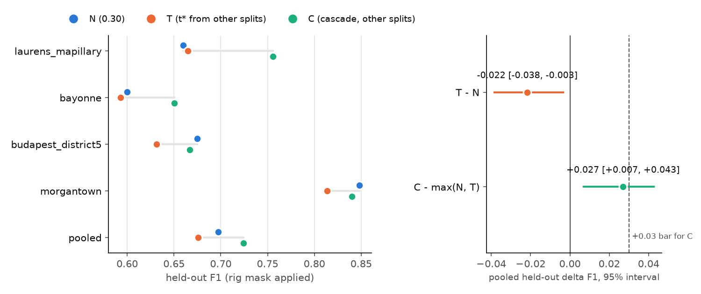

# Open-weight cascade confirmation, Stage 0: a CPU screen (#35, option B1)

**Issue:** [#35](https://github.com/ProjectSidewalk/RampNet/issues/35). **Run date:** 2026-11-15.
**Plan:** `open-weight-cascade-confirm-2026-11-15.md` (Claude Fable 5.2), with its review
(Claude Opus 5.5) and "Changes after review". This note covers **Stage 0 only**.
**Script:** `scripts/analysis/cascade_confirm_35.py` (tests: `tests/test_cascade_confirm_35.py`;
figure: `scripts/analysis/cascade_confirm_35_figures.py`).
**Output:** `analysis_out/cascade_confirm_35/stage0.json` (plus `inputs.json`, the input hashes).
**Compute:** CPU only, committed inputs only, about 3 s. No model call, no network, no spend.
**Base:** branch `cascade-argon-b0` at `b3868c8e` ([RampNet#289](https://github.com/ProjectSidewalk/RampNet/pull/289)).

## Result: N. Both T and C are dropped, and the work stops here.

| rule | what it tests | reading | verdict |
|---|---|---|---|
| 1, drop T | rig key test fails, or pooled held-out T − N has a 95% lower bound ≤ 0 | rig key test does not pass; T − N = **−0.022 [−0.038, −0.003]** | **drop T** (on both counts) |
| 2, drop C | pooled held-out C − max(N, T) < +0.03, or its lower bound ≤ 0, or C wins fewer than 2 of 4 splits | **+0.027 [+0.007, +0.043]**, wins 2 of 4 | **drop C** (below +0.03) |
| 3, flag "one instance" | leaving out one Laurens sequence takes the gain below +0.02, or 5 panos carry over half the net promoted ramps | worst leave-one-out +0.079; top 5 panos carry 0.41 | not flagged |
| 4, outcome | both dropped means N | | **N** |

C is close. It clears zero, its interval excludes zero, and it wins on two splits, but the pooled
gain is +0.027 against a +0.03 bar. The whole gain comes from `laurens_mapillary` (+0.091) and
`bayonne` (+0.051); C loses a little on `budapest_district5` and `morgantown` (−0.008 each, the same
values the review's crude run found). T loses outright: one threshold for GoPro Max picked on three
splits hurts the fourth on three of the four folds.

This is a screen on splits the earlier cascade study already inspected. It can end the work; it
confirms nothing. The plan says what follows from N: B1 closes at no cost, and Stage 1 (Lyon) and
Stage 2 (Kaysville) are not run.



*Figure 1. Left: held-out F1 of N, T and C, leave-one-split-out, rig mask applied. Right: the
two pooled quantities the rules read, with their selection-aware 95% intervals; the dashed line is
Rule 2's +0.03 bar. Regenerate with `cascade_confirm_35_figures.py`.*

## Step 1: reproduce

Both commands report 0 differences on this branch:

- `python scripts/analysis/cascade_cost_35.py --check`: 142 pair files, `0 differ`, exit 0.
- `python scripts/analysis/cascade_argon_35.py --check`: all Argon pair files and
  `argon_pairs.json`, exit 0.

## Step 2: the grid

Arms `y11l_pano`, `y11x_pano_h200`, `y26_pano`. T_lo ∈ {0.10, 0.15, 0.20, 0.25}. r_gate ∈ {R/2, R,
2R} with R = 0.022. c_min, an absolute box score, ∈ {0.05, 0.15, 0.25, 0.40}. That is 144
candidates. T_hi is 0.30. `t*` is searched over 0.10 to 0.55 in steps of 0.01.

The C rule is `cascade_cost_35`'s, unchanged: keep RampNet peaks at 0.30 or above, and add peaks in
[T_lo, 0.30) that lie within r_gate (wrapped, pano space) of an arm box scoring c_min or more. The
scorer is the benchmark's (`score_pano`, radius 0.022). Before any policy is built, the labeler's
49° nadir rig mask drops every RampNet peak with normalized y above 0.5 + 49/180 = 0.7722.

**In-sample context (not a gate).** Each split on its own panos, rig mask applied:

| split | N (0.30) | best single threshold (t) | best C (arm, T_lo / r_gate / c_min) |
|---|---:|---:|---:|
| laurens_mapillary | 0.6600 | 0.7417 (0.13) | 0.7689 (y26, 0.10 / 0.022 / 0.05) |
| bayonne | 0.6000 | 0.6467 (0.19) | 0.6703 (y11x, 0.10 / 0.022 / 0.05) |
| budapest_district5 | 0.6748 | 0.6839 (0.37) | 0.6825 (y11l, 0.10 / 0.044 / 0.15) |
| morgantown | 0.8481 | 0.8549 (0.32) | 0.8577 (y11x, 0.10 / 0.022 / 0.15) |

The best single thresholds are 0.13, 0.19, 0.37 and 0.32 on one camera model, the disagreement the
plan expected to sink T.

## Step 3: leave-one-split-out

For each held-out split, `t*` and one of the 144 candidates are chosen on the other three splits by
summed-count F1, then N, T and C are scored on the held-out split. The four held-out results are
summed into one pooled F1 per policy. The interval is 2,000 pano resamples (seed 0), stratified by
split, with **both choices repeated inside every resample**.

| held out | t* | C candidate (arm, T_lo / r_gate / c_min) | N | T | C | T − N | C − max(N, T) [95%] | same t* / candidate / arm in resamples |
|---|---:|---|---:|---:|---:|---:|---|---|
| laurens_mapillary | 0.29 | y11x 0.10 / 0.022 / 0.05 | 0.6600 | 0.6650 | 0.7558 | +0.0050 | +0.0908 [+0.035, +0.133] | 0.27 / 0.48 / 0.58 |
| bayonne | 0.31 | y11l 0.10 / 0.011 / 0.05 | 0.6000 | 0.5927 | 0.6506 | −0.0073 | +0.0506 [+0.005, +0.078] | 0.34 / 0.41 / 0.88 |
| budapest_district5 | 0.19 | y11x 0.10 / 0.022 / 0.05 | 0.6748 | 0.6316 | 0.6667 | −0.0432 | −0.0082 [−0.025, +0.009] | 0.57 / 0.47 / 0.53 |
| morgantown | 0.20 | y11x 0.10 / 0.022 / 0.05 | 0.8481 | 0.8134 | 0.8403 | −0.0347 | −0.0078 [−0.023, +0.012] | 0.62 / 0.57 / 0.58 |
| **pooled** | | | **0.6974** | **0.6756** | **0.7243** | **−0.0217** | **+0.0270 [+0.007, +0.043]** | |

Pooled counts (TP / FP / FN of 1,117 recall GT): N 689 / 170 / 428, T 702 / 259 / 415, C
762 / 225 / 355. Pooled T − N is −0.0217 [−0.0384, −0.0035], and C − N is +0.0270 [+0.0071,
+0.0428]. Because pooled T is below N, C − max(N, T) equals C − N at the point estimate.

The selections are unstable. The same `t*` comes back in 27–62% of resamples, the same candidate in
41–57%, and the same arm in 53–88%. Every fold's chosen candidate has T_lo 0.10 and c_min 0.05 (all
boxes); they differ in the arm and the gate radius.

## Step 4: rig key test (no ground truth)

Per contributor (Mapillary `creator.username`, Panoramax `geovisio:producer`), the share of RampNet
peaks at 0.30 or above that the nadir mask removes:

| split | contributor | panos | masked / peaks ≥ 0.30 | share | exploratory: masked / peaks ≥ 0.10 |
|---|---|---:|---:|---:|---:|
| laurens_mapillary | GIS_ISG | 94 | 0 / 153 | 0.0000 | 33 / 263 (0.125) |
| morgantown | jdgat | 125 | 2 / 254 | 0.0079 | 9 / 369 (0.024) |
| budapest_district5 | grozsa11 | 107 | 1 / 256 | 0.0039 | 4 / 409 (0.010) |
| budapest_district5 | vst | 17 | 0 / 35 | 0.0000 | 4 / 57 (0.070) |
| budapest_district5 | kami911 (LG R105) | 1 | 0 / 0 | – | 0 / 1 |
| bayonne | sig_bayonne | 123 | 0 / 210 | 0.0000 | 0 / 393 (0.000) |
| bayonne | Arretche | 2 | 0 / 2 | 0.0000 | 0 / 2 |

**The test does not pass.** By contributor, the plan's wording, no cut separates Laurens (0.0000)
from budapest's `vst` (0.0000): it fails whatever ecartip shows. By split, Laurens (0.0000) sits
below budapest (0.0034) and morgantown (0.0079), so a cut exists among the non-Lyon splits. But the
test also needs ecartip on Laurens's side, and Lyon is withheld from Stage 0 (Amendment 1), so it
cannot pass here either. The mask removes 0 to 2 peaks at 0.30 or above per split, so at the plan's
threshold it carries almost no signal, and on Laurens it points the opposite way from the plan's
premise. Below 0.30 the picture differs: at the labeler's 0.10 storage floor Laurens has the
largest share (0.125, against at most 0.070). That column was read after the data and is used by no
rule. Rule 1 drops T on its interval alone in any case.

## Step 5: concentration on `laurens_mapillary`

With the Laurens fold's settings (`t*` 0.29; C = y11x, 0.10 / 0.022 / 0.05, both chosen on the
other three splits, so leaving out a Laurens sequence cannot change them):

- Gain, C − max(N, T): **+0.0908** (C − N: +0.0958).
- Net promoted ramps (promoted TP minus promoted FP, C against N): **29**, over 22 panos with a
  positive net and 2 with a negative one.
- The five largest panos carry 12 of the 29, **0.41**: under the 0.5 bar.
- Leaving out each of the 18 sequences in turn, the gain stays between **+0.079** (without
  `z0rwf2KqY6IS5XELmdtpyV`, 13 panos, net 8) and +0.101: never near +0.02.

So the Laurens gain is not one instance within Laurens. Laurens is still one contributor and one
rig, which this step cannot test (review finding 8).

## Amendments

The common rules for this run say: take the most literal reading where the plan proves ambiguous,
record it here, and give both readings where they disagree.

1. **Lyon is withheld, so the ecartip half of step 4 is unevaluated.** The plan's step 4 includes
   Lyon contributors, ecartip above all. The instruction for this run forbids reading Lyon or
   Kaysville at Stage 0, since they are the Stage 1 and Stage 2 confirmation sets. That instruction
   wins. Readings: by contributor the test fails without ecartip (tie at 0.0000 with `vst`); by
   split it is undecided without ecartip and so cannot pass. Rule 1 drops T in both, and also on the
   T − N interval alone, so the outcome does not depend on this.
2. **The rig mask is applied to N and T as well as C.** The plan states the mask in the grid step.
   The labeler applies it to everything it submits, so a comparison with an unmasked N would be
   unfair to N. It changes the numbers mainly on Laurens: the mask removes 33 peaks between 0.10
   and 0.30 there (8 on budapest, 9 on morgantown, 0 on bayonne), which lifts Laurens's in-sample
   best threshold from 0.708 (0.16, unmasked, `cascade_argon_35.md`) to 0.742 (0.13). In-sample
   best C stays at 0.769, the review's number. Pooled N moves from 0.6963 to 0.6974: the three
   masked peaks at 0.30 or above (one on budapest, two on morgantown) were all FPs.
3. **"Pooled" and "max(N, T)".** Pooled means the four held-out results summed as counts (TP, FP,
   recall TP, recall GT), then F1, as `cascade_argon_35` pools. The pooled comparison uses
   max(pooled N, pooled T); the "splits won" count uses each split's own max(N, T). The alternative
   reading that compares C with N alone, since T is dropped, gives the same verdict: +0.0270
   [+0.0071, +0.0428], 2 wins, below +0.03.
4. **Bootstrap unit.** Panos, stratified by split, 2,000 resamples, seed 0, both selections
   repeated per resample. The account-level bootstrap in the plan belongs to Stage 1.
5. **Ties.** `t*` ties go to the lowest threshold (`cascade_cost_35`'s convention), candidate ties
   to the first in grid order (arm, T_lo, r_gate, c_min).
6. **Laurens gain** in Rule 3 is held-out C − max(N, T) on Laurens with that fold's settings; C − N
   is also given. The full gain is +0.091, so "below +0.02" is a real test, not one met before any
   sequence is left out.
7. **Contributors** are Mapillary `creator.username` and Panoramax `geovisio:producer`.
   `kami911` (budapest, one LG R105 pano) has no peak at 0.30 or above, so it has no share and
   enters neither side.

## Caveats

- The four splits are the ones the cascade study inspected. Stage 0 is a screen, not a
  confirmation.
- The op_caches predate the seam fix `f4c71c8` (`cascade_cost_35.md`, Caveats), as in the study.
- GT is RampNet's reviewed detections plus reviewer-added misses, so an unmarked real ramp scores
  as an FP for every policy.
- One checkpoint per arm, no seeds.
- The plan's +0.03 bar is Jon's to revisit (plan section 7, decision 1). At +0.02 C would survive
  Rule 2 here (lower bound +0.007, 2 wins). That is a statement about the bar, not a re-tuned gate.

## Where each number lives

All keys are in `analysis_out/cascade_confirm_35/stage0.json`.

| number | key |
|---|---|
| rule verdicts | `rules.{1_drop_T,2_drop_C,2_alt_C_vs_N,3_one_instance,4_outcome}` |
| held-out N / T / C per split, chosen settings, per-split intervals, selection stability | `folds[]` |
| pooled N / T / C and the three pooled deltas with intervals | `pooled` |
| in-sample context table | `in_sample.<split>` |
| rig key shares (per contributor, per split), both readings | `rig_key.{contributors,splits,readings}` |
| peaks the mask removes at ≥ 0.10 | `rig_mask.peaks_removed_ge_0.10` |
| concentration: gain, net promoted, top 5, per-sequence leave-one-out | `concentration` |
| grid, bootstrap settings, pano counts, missing-pano lists (all empty) | `grid`, `bootstrap`, `panos`, `panos_missing_*` |
| input sha256 | `analysis_out/cascade_confirm_35/inputs.json` |
| figure | `docs/figures/cascade_confirm_35/heldout.png`, from `folds` and `pooled` |

## Replication

```bash
# CPU only; every input is committed. Lyon and Kaysville are never read.
python scripts/analysis/cascade_cost_35.py --check       # step 1 (~13 min)
python scripts/analysis/cascade_argon_35.py --check      # step 1 (~3 min)
python scripts/analysis/cascade_confirm_35.py            # writes stage0.json + inputs.json (~3 s)
python scripts/analysis/cascade_confirm_35.py --check    # regenerate stage0.json, byte-compare
python scripts/analysis/cascade_confirm_35_figures.py    # the figure, from stage0.json (needs matplotlib)
python scripts/check_all.py --only cascade_confirm_35
pytest -q tests/test_cascade_confirm_35.py
```

Inputs (sha256 in `inputs.json`): for each of the four splits, `benchmark/<split>/records.jsonl`,
`benchmark/<split>/verdicts.json`, `analysis_out/op_cache/<split>.json`, and
`benchmark/model_detections/{y11l_pano,y11x_pano_h200,y26_pano}__<split>.json`. `--check` does not
compare the hashes, because a checkout with `core.autocrlf=true` rewrites `records.jsonl` line
endings without changing any number. The figure is not byte-compared; every plotted value is in the
tables above.

*Run by Claude Opus 5.5 (`claude-opus-5-5`) under the plan's Stage 0 approval.*
