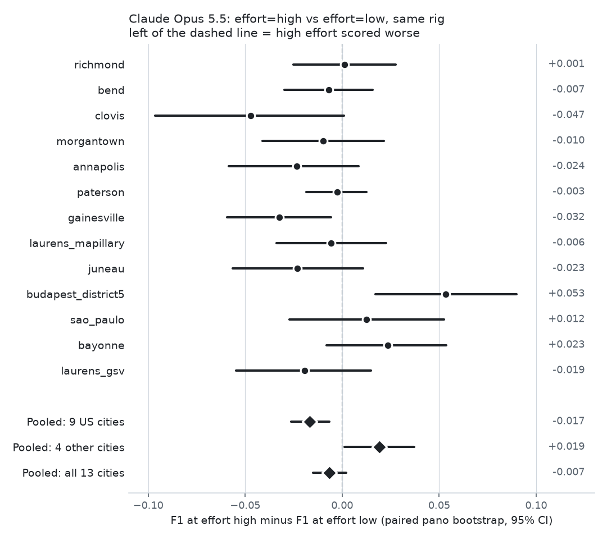

# Claude Opus 5.5 at effort=high: no gain on the US cities (2026-11-17)

**Status: final.** Opus 5.5 was re-run at `--claude-effort high` on all 13 city splits, with the
effort=low leg's rig ([`claude_newest_ids.md`](claude_newest_ids.md))
changed in two settings only: effort, and `--claude-max-tokens 20000` to leave room for thinking.
It is paired here against that low leg, pano by pano.

## Result

- **High effort is worse on the nine pooled US cities**: macro F1 0.712 -> 0.695 (**-0.017**),
  micro -0.017 [-0.026, -0.007] (paired, stratified pano bootstrap). It is lower on 8 of the 9,
  and the only split whose own interval excludes zero is gainesville (-0.032). clovis loses the
  most (-0.047), almost all of it precision (0.563 -> 0.472).
- **On the four other city splits it is slightly better**: macro 0.604 -> 0.622, micro
  +0.019 [+0.001, +0.037], carried by budapest_district5 (+0.053 [+0.017, +0.090], the one
  split where high is clearly ahead). That grouping was made before the run (`rampnet.eval.POOLED_SPLITS`
  versus the rest), but four splits is few and the interval nearly touches zero, so read it as a
  lead to follow, not a finding.
- **Across all 13 cities it is a wash**: micro -0.007 [-0.015, +0.002].
- **Mechanism: effort moves the operating point.** High emits more boxes on every split
  (clovis 1.96 -> 2.41 per pano, annapolis 2.62 -> 2.93). On most splits recall rises and
  precision falls; budapest_district5 is the exception that gains on both, and juneau loses on
  both.
  This is the same shape #122 measured on annapolis for Opus 5 and Sonnet 5 at effort high
  ([`claude_legs_122.md`](claude_legs_122.md); the `claude-opus-5-effort-high` roster note:
  "effort moves the operating point, it does not raise the ceiling"). This run replicates it on
  the newer model across 13 splits.
- **It does not change Claude's standing against RampNet.** RampNet is still ahead on 10 of the
  13 cities, and the two splits where Claude beats RampNet at low effort stay that way at high
  (laurens_mapillary, RampNet minus high -0.130; bayonne -0.125).
- **High effort is cheap on this model**: about 150 thinking tokens per call against about 20 at
  low, so $0.075-0.084 per pano against $0.067-0.068, about 18% more. The 13 city splits cost
  $122.18 at list price (this leg's ledger rows); the day's other rows are $11.87 for a
  150-pano `manual_gold` slice (below) and $4.49 for an effort=max calibration.

## Per split

r = 0.022, RampNet at the deployed 0.55. "High - low" and "RampNet - high" are paired pano
bootstrap differences in F1 with 95% intervals.

| Split | Low P / R / **F1** | High P / R / **F1** | High - low [95% CI] | Boxes/pano low -> high | RampNet - high [95% CI] |
|---|---|---|---|---|---|
| richmond | 0.658 / 0.839 / **0.738** | 0.654 / 0.848 / **0.739** | +0.001 [-0.025, +0.028] | 3.58 -> 3.60 | +0.116 [+0.070, +0.165] |
| bend | 0.701 / 0.740 / **0.720** | 0.671 / 0.761 / **0.713** | -0.007 [-0.030, +0.016] | 3.32 -> 3.59 | +0.136 [+0.088, +0.185] |
| clovis | 0.563 / 0.667 / **0.610** | 0.472 / 0.697 / **0.563** | -0.047 [-0.096, +0.001] | 1.96 -> 2.41 | +0.238 [+0.176, +0.301] |
| morgantown | 0.759 / 0.813 / **0.785** | 0.741 / 0.813 / **0.775** | -0.010 [-0.041, +0.021] | 2.40 -> 2.47 | +0.060 [+0.021, +0.102] |
| annapolis | 0.694 / 0.748 / **0.720** | 0.639 / 0.765 / **0.697** | -0.024 [-0.059, +0.009] | 2.62 -> 2.93 | +0.143 [+0.091, +0.194] |
| paterson | 0.826 / 0.673 / **0.742** | 0.802 / 0.686 / **0.739** | -0.003 [-0.018, +0.013] | 2.64 -> 2.80 | +0.066 [+0.038, +0.095] |
| gainesville | 0.622 / 0.761 / **0.684** | 0.572 / 0.757 / **0.652** | -0.032 [-0.059, -0.006] | 2.78 -> 2.97 | +0.151 [+0.100, +0.204] |
| laurens_mapillary | 0.706 / 0.655 / **0.679** | 0.672 / 0.675 / **0.673** | -0.006 [-0.034, +0.023] | 2.52 -> 2.75 | -0.130 [-0.212, -0.044] |
| juneau | 0.733 / 0.721 / **0.727** | 0.700 / 0.707 / **0.704** | -0.023 [-0.057, +0.011] | 2.43 -> 2.52 | +0.100 [+0.057, +0.143] |
| budapest_district5 | 0.517 / 0.400 / **0.451** | 0.549 / 0.467 / **0.505** | +0.053 [+0.017, +0.090] | 1.92 -> 2.14 | +0.140 [+0.054, +0.225] |
| sao_paulo | 0.663 / 0.630 / **0.646** | 0.658 / 0.658 / **0.658** | +0.012 [-0.027, +0.052] | 2.26 -> 2.49 | +0.118 [+0.060, +0.173] |
| bayonne | 0.620 / 0.618 / **0.619** | 0.613 / 0.674 / **0.642** | +0.023 [-0.008, +0.054] | 2.49 -> 2.78 | -0.125 [-0.189, -0.063] |
| laurens_gsv | 0.727 / 0.677 / **0.701** | 0.687 / 0.677 / **0.682** | -0.019 [-0.055, +0.015] | 2.42 -> 2.57 | -0.023 [-0.085, +0.044] |

**`manual_gold` is not in this comparison.** Its first 150 panos also ran at effort high
(`compare.py --limit 150`, $11.87, ledger row 2026-11-17T23:47:28Z), but a partial split cannot be
published (`benchmark/model_detections/` holds only complete splits, and `tests/test_export_model_cache.py`
enforces it), so the slice stays in the producing machine's `.model_cache` and no number from it is
quoted. Completing the remaining 850 panos would cost about $67 at list price.

## Pooled

| Pool | Panos | Low P / R / **F1** (micro) | High P / R / **F1** (micro) | High - low, micro [95% CI] | Macro F1 low -> high |
|---|---:|---|---|---|---|
| 9 US cities | 1078 | 0.697 / 0.736 / **0.716** | 0.658 / 0.746 / **0.700** | -0.017 [-0.026, -0.007] | 0.712 -> 0.695 (-0.017) |
| 4 other cities | 461 | 0.629 / 0.574 / **0.600** | 0.625 / 0.614 / **0.619** | +0.019 [+0.001, +0.037] | 0.604 -> 0.622 (+0.018) |
| all 13 cities | 1539 | 0.679 / 0.688 / **0.684** | 0.649 / 0.707 / **0.677** | -0.007 [-0.015, +0.002] | 0.679 -> 0.672 (-0.006) |

The macro column is the scoreboard's headline aggregation (the mean of per-split F1s; the low
leg's 0.712 is its published pooled number). The interval is on the micro (count-pooled) F1, with
each split's panos resampled within that split.

## Cost and thinking

List price from `analysis_out/usage_log.jsonl` (`est_cost_usd`), not reconciled against the
Console. Thinking is per API call; each pano is six calls (six perspective views).

| Split | Low $/pano | High $/pano | Low thinking/call | High thinking/call |
|---|---:|---:|---:|---:|
| richmond | 0.0674 | 0.0805 | 14 | 158 |
| bend | 0.0684 | 0.0795 | 22 | 153 |
| clovis | 0.0670 | 0.0796 | 23 | 156 |
| morgantown | 0.0670 | 0.0777 | 18 | 139 |
| annapolis | 0.0676 | 0.0807 | 20 | 162 |
| paterson | 0.0668 | 0.0748 | 9 | 118 |
| gainesville | 0.0675 | 0.0788 | 18 | 152 |
| laurens_mapillary | 0.0684 | 0.0814 | 29 | 169 |
| juneau | 0.0672 | 0.0792 | 18 | 149 |
| budapest_district5 | 0.0667 | 0.0770 | 26 | 142 |
| sao_paulo | 0.0668 | 0.0803 | 18 | 158 |
| bayonne | 0.0683 | 0.0839 | 33 | 184 |
| laurens_gsv | 0.0678 | 0.0793 | 25 | 155 |

**Effort=max is not runnable with the current detector.** A 5-pano richmond calibration at
effort max (also `--claude-max-tokens 20000`) cost $4.49, took 437 s per pano, and 3 of the 5
panos hit `max_tokens` before answering (recorded as failures, not cached, per
`ClaudeDetector._check_stop_reason`). Raising the cap is blocked client-side: the SDK refuses a
non-streaming call whose `max_tokens` implies more than ten minutes (32000 was refused before any
request was sent), so effort max needs streaming support in `ClaudeDetector` first. Its F1 on the
two panos that finished is not reported; two panos are not a measurement.

**Calls.** Every high-effort call ended in `tool_use` except one on morgantown, which ended in
`end_turn` (an answer without the tool call, scored as no boxes for that view). No refusals.

## How it ran

- Paid from the `claude20` Console org's Oct 19 grant ($170.94 left that morning, expiring
  2026-11-18 00:00 UTC) on 2026-11-17, 22:08-23:47 UTC, nine streams in parallel. Every ledger row
  carries `api_account: claude20`.
- `scripts/model_comparison/run_claude_legs_by_account.ps1 -Account claude20 -Model claude-opus-5-5
  -Effort high -MaxTokens 20000 -PerPano 0.0855 -Cap 200 -Splits <split>`, one invocation per
  stream (the `-Effort` / `-MaxTokens` parameters are new in this change).
- 21 s per pano per stream in practice, against 24.7 s in the 5-pano calibration.

## Replication

From a clean clone, no API key, no `.model_cache`, CPU only:

    python scripts/analysis/claude_effort_high.py --check     # re-derives results.json
    python scripts/analysis/claude_effort_high.py --markdown  # every table above
    python scripts/analysis/claude_effort_high.py --figures   # the forest plot

Re-exporting and verifying the published detections needs the producing run's `.model_cache`:

    python scripts/analysis/export_model_cache.py --models claude:claude-opus-5-5 \
        --claude-effort high --claude-serving-path anthropic --claude-max-tokens 20000 \
        --splits annapolis,bend,budapest_district5,clovis,gainesville,laurens_gsv,laurens_mapillary,morgantown,paterson,richmond,sao_paulo,bayonne,juneau
    python scripts/analysis/export_model_cache.py --verify --models claude:claude-opus-5-5 \
        --claude-effort high --claude-serving-path anthropic --claude-max-tokens 20000 --splits <the 13 above>

Re-running the paid legs costs about $0.08 per pano at list price; `laurens_gsv`,
`laurens_mapillary`, `bayonne` and `juneau` also need panoramas that are not on Hugging Face yet
([`replication.md`](replication.md)).

## Where each number lives

| Number | Source |
|---|---|
| Every P / R / F1, interval, boxes/pano, pooled and macro figure | `analysis_out/claude_effort_high/results.json`, written by `scripts/analysis/claude_effort_high.py --write` |
| High-effort detections | `benchmark/model_detections/claude-opus-5-5-effort-high-anthropic-maxtokens-20000__<split>.json` (roster: study leg `claude_effort_high`) |
| Low-effort detections | `benchmark/model_detections/claude-opus-5-5-effort-low-anthropic__<split>.json` |
| $/pano, thinking/call, $122.18 | the leg's rows in `analysis_out/usage_log.jsonl` (signature `effort: high`, `max_tokens: 20000`) |
| Effort=max calibration ($4.49, 437 s/pano, 3 truncations) | its `usage_log.jsonl` row (signature `effort: max`), 2026-11-17T22:47:50Z |
| `manual_gold` slice ($11.87) | its `usage_log.jsonl` row, 2026-11-17T23:47:28Z |
| Low leg's scoreboard cells | `analysis_out/scoreboard.json`, asserted equal by the script |

## Limits

- Single runs, no seed variance, at effort high only (medium and xhigh not run).
- The four non-US splits were not chosen for this test; their pooled gain rests mostly on one
  split (budapest_district5).
- No `manual_gold` comparison (see above).
