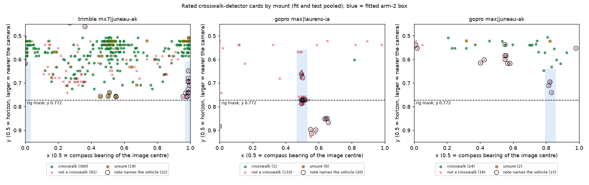

# Crosswalk detector follow-ups (#285): car-top rule, missed-crosswalk check, OSM placer checks

Three pieces of work that follow `crosswalk_s5` (see
[`stage1_crosswalk_sdot_274.md`](stage1_crosswalk_sdot_274.md)). `crosswalk_s4` (seed 1, threshold 0.23)
is the detector of record throughout. Plan approved by Jon on 2026-11-10 after an adversarial review.

| Part | Question | Status |
|---|---|---|
| B | Does a rule on image position remove capture-vehicle false alarms without losing crosswalks? | done, below (exploratory) |
| C | What share of visible marked crosswalks does s4 miss in Juneau and Laurens? | rated 2026-11-11; results below |
| A | Can OSM marked crossings plus the Vistas snap label many cities (#285)? | city count and two placer checks done; Sacramento pilot placed and rated: 97 of 100 placements correct, passes the 91 bar; full-city fetch and the A4 pre-registration are next |

## B. A position rule for capture-vehicle false alarms (exploratory, 2026-11-10)

**Short answer.** No single height cut-off works. The labeler's existing 49° rig mask is safe to switch on
for crosswalks and removes the Laurens car tops that s4 still makes. A small region behind the Trimble
vehicle removes a few more in Juneau. Together they remove 12 of s4's 72 rated false alarms on the
evaluation draws and none of its 359 confirmed crosswalks. Most remaining false alarms are not on the
vehicle at all.

**This is exploratory.** The card positions were known before the rules were written, and one fitting
choice was changed after a first run (below). Any region must be confirmed on a fresh draw before it
ships.

### Data

- **Fit:** the two mining pages, whose cards already became training negatives:
  `hardneg/s4_inputs/stepA/ratings_jon_2026-11-09_carTop.csv` (Laurens, 124 cards) and
  `hardneg/s5_inputs/ratings_jon_2026-11-09_juneauMine.csv` (Juneau, 278 cards after merging duplicates).
- **Test:** s4's rated cards on the evaluation draws, `hardneg/confirm_s3/<draw>/s4/ratings.csv`
  (Seattle, Juneau, Laurens Mapillary, Laurens GSV) and `hardneg/s5_inputs/juneau_eval/s4/ratings.csv`:
  440 detections, of which 359 crosswalk, 72 not a crosswalk and 9 unsure.
- **Human crosswalk labels** (clicks, 119 in all), to see what a rule would hide: the live PS labels
  in Laurens (16) and Juneau (5), Jon's 89 confirmed Richmond positives, and 9 Bayonne labels.
- **Mount** = camera model × city, from the labeler's records (`camera_lookup.csv`, 320 of 424 panos; the
  rest are GSV panos, which have no camera field, and 57 Richmond label panos outside the labeler's run).
- Intervals resample Mapillary sequences, so one vehicle's panos stay together.

No "car top" class is used for scoring. Jon's notes name the vehicle on only some cards (13 of the 124
Laurens mining cards), so each arm is scored by the false alarms it removes against the crosswalks it
removes. The cards whose note does name the vehicle are reported beside that.

### Where the vehicle false alarms are



*Rated cards on the three Mapillary mounts, fit and test pooled. Circles mark notes that name the
capture vehicle. The dashed line is the labeler's rig mask; blue is the fitted box.*

- **Trimble MX7, Juneau:** behind the vehicle, at the image seam (x 0.95–1.00 and 0.00), y 0.62–0.76.
  On the Juneau confirmation draw, 6 of s4's 7 vehicle-noted false alarms are on Trimble panos. The older
  statement that Trimble panos have none held for s1 and s3 only.
- **GoPro Max, Laurens:** the mining cards (from s1) sit in a narrow column at x 0.47–0.53, y 0.56–0.79.
  s4 was trained on those as negatives, and its 7 remaining car tops are elsewhere: x 0.55–0.66 and 0.00,
  y 0.85–0.90, below the rig mask line.
- **GoPro Max, Juneau:** scattered over x 0.40–0.83 at y 0.54–0.74, across four sequences, in the same
  band as that mount's real crosswalks. There is no region to cut.

### Arms and results on the test cards

| Arm | False alarms removed (of 72) | Crosswalks removed (of 359) | Vehicle-noted removed (of 19) | Human labels hidden (of 119) |
|---|---|---|---|---|
| 0. Existing rig mask, y > 0.772 | 7 [0.02, 0.22] | 0 (upper bound 0.8%) | 7 | 0 |
| 1. Single cut-off, y ≥ 0.70 | 16 [0.12, 0.34] | 7 [0.003, 0.04] | 14 | 2 |
| 1. Single cut-off, y ≥ 0.60 | 47 [0.50, 0.78] | 85 [0.19, 0.30] | 17 | not computed |
| 2. One box per mount, fitted on the mining pages | 5 [0.01, 0.14] | 0 | 5 | 0 |
| 0 + 2 | 12 [0.07, 0.29] | 0 | 12 | 0 |

Brackets are 95% intervals on the share, by sequence bootstrap. The full sweep is in `arms.csv`.

- **Arm 0** removes exactly the 7 Laurens GoPro car tops and nothing else. It costs no crosswalk on any
  mount and hides no human label.
- **Arm 1** fails as expected. A crosswalk 3–40 m from a 2.5 m camera sits at y 0.52–0.72, the same band
  as the vehicle. At y ≥ 0.70 it already removes 7 real crosswalks (6 in Seattle) for 16 false alarms.
- **Arm 2** fitted three boxes: Trimble at the seam (x within 0.03 of 0, y ≥ 0.61), Laurens GoPro
  (x 0.47–0.53, y ≥ 0.56) and Juneau GoPro (x 0.80–0.86, y ≥ 0.64). On the fit cards they remove 122 of
  182 false alarms and 0 of 206 crosswalks. On the test cards only the Trimble box does anything: 5 of
  the 43 Trimble false alarms (5 of the 8 vehicle-noted ones), 0 of 111 Trimble crosswalks (upper bound
  2.7%). The Laurens box removes 0 of 9, because s4 no longer fires there. The Juneau GoPro box removes
  0 of 6.

### Reading

1. **Switch the existing rig mask on for crosswalks.** It is the one rule here that is not fitted to
   these cards, and `DetectorSpec.mask_rig` in the labeler already supports it per label type. The
   crosswalk scoring in this repo has never applied it.
2. **The Trimble seam region is worth a confirmation, not adoption.** It rests on 5 test cards from a
   handful of sequences.
3. **Per-mount boxes do not generalise.** The Laurens box was fitted on s1's false alarms and is empty
   for s4; the Juneau GoPro mount has no region. A box per mount would also never cover an unseen vehicle.
4. **Position cannot fix most of what is left.** 19 of s4's 81 non-crosswalk test cards are on the
   vehicle. The rest are brick sidewalks, turn-lane markings, curb ramps and similar, spread over the image.
   If vehicle false alarms still matter after the rig mask, the next thing to try is a mask learned per
   sequence from pixels that never change, which needs no ratings and would cover a new vehicle.

### Fitting choice changed after a first run

Arm 2's first criterion compared a box's false alarms with its share of the whole lower image and found
no Trimble box. The criterion now compares within the same y band (does the box hold more than twice
the false alarms its x width alone would give it, by at least 3 cards, with no fit crosswalk inside),
which is what "the vehicle is fixed in x" predicts. Both runs used the same data; this is one more
reason the result is exploratory.

### Where each number lives

All paths are under `analysis_out/crosswalk_followups_285/cartop/`.

| Number | File |
|---|---|
| Arm table (every arm, split and mount; intervals; upper bounds) | `arms.csv` |
| Human labels hidden per arm and mount | `labels_hidden.csv` |
| Fitted boxes, card counts per mount, the vehicle-noted test cards | `summary.json` |
| Every card with its mount, sequence, verdict and note | `cards.csv` |
| Camera and sequence per pano | `camera_lookup.csv` |

### Replication

```bash
# camera lookup (needs the labeler's run records; the committed camera_lookup.csv makes this optional)
python scripts/analysis/stage1_crosswalk_sdot_274/cartop_mask.py lookup --records \
    <sal-juneau>/runs/juneau/results.jsonl <labeler>/runs/juneau_expansion/results.jsonl \
    <labeler>/runs/laurens/results.raw.jsonl <labeler>/runs/laurens_gsv/results.jsonl \
    <labeler>/runs/richmond/results.jsonl <labeler>/runs/bayonne/results.jsonl \
    <crosswalk274-confirm>/{juneau,laurens_mly,laurens_gsv}_draw_records.jsonl \
    <crosswalk274-confirm>/ps_label_panos_records.jsonl
# arms, intervals and tables (CPU, seconds; seed 285, 2,000 bootstrap draws)
python scripts/analysis/stage1_crosswalk_sdot_274/cartop_mask.py score
python scripts/analysis/stage1_crosswalk_sdot_274/cartop_mask.py figures
```

## C. Missed-crosswalk check, Juneau and Laurens (page built 2026-11-10, rated 2026-11-11)

**Question, per view.** Of the marked crosswalks a person can see in a pano within 25 m, what share does
s4 at 0.23 detect? This is not per-crosswalk recall across views, and it does not cover mid-block
crossings or parking lots.

**Sample, fixed before any page was built** (`recall_check.py draw`, seed 285):

| | Laurens (Mapillary) | Juneau main area (Mapillary) |
|---|---|---|
| Intersections in the OSM road graph (3 or more segments, nodes within 20 m merged) | 101 | 152 |
| With a usable pano within 15 m | 95 | 134 |
| No pano within 15 m | 6 | 17 |
| Every pano within 15 m is in an earlier draw | 0 | 1 |
| Drawn | **95** (all) | **80** (all 11 GoPro Max, 69 of the Trimble MX7) |
| Drawn pano is not the nearest one (the nearest was in an earlier draw) | 12 | 12 |
| Sequences | 18 | 28 |

- Intersections come from the labeler's cached street query, never from OSM crossing tags.
- Excluded by draw membership, not by whether a model fired: the confirmation draws
  (`confirm_s3/cities_draw.txt`), the Laurens and Juneau mining draws, the Juneau s5 evaluation draw, and
  the 13 panos that carry live PS Crosswalk labels.
- 59 of the 80 Juneau panos are within 30 m of an s5 mining pano. That does not matter for s4, which
  never trained on Juneau. They are flagged, and any s5 number is read on the other 21 only.
- Pixels: fetched from Mapillary through the labeler (`export_benchmark.py --out`), 175 of 175 verified.

**Page.** `recall_check.py page` builds a bundle with every detection stripped and runs `gt_gallery.py`
over it, then swaps the gallery's curb-ramp wording for crosswalk wording and replaces its instructions.
The reviewer clicks the centre of each marked crosswalk (brick and paver count) or confirms none. The
page is local HTML outside the repo: `D:/Git/sal-scratch-keep/recall285/page/index.html`. Checked so
far: 175 entries, none with a detection crop, and the page's JavaScript parses. It has not been opened
in a browser by the author.

**Scoring, fixed before rating** (`recall_check.py score`): one-to-one matching of marks to detections
at or above 0.23, radius 0.05 (0.03 and 0.08 as sensitivity); primary population is marks at
y ≥ 0.532 (25 m from a 2.5 m camera); marks beyond it and unsure marks are reported separately; recall
per city and per camera with a pano bootstrap. s4's predictions on the 175 panos are already in
`analysis_out/crosswalk_followups_285/recall/preds/crosswalk_s4/` (local RTX 3070, checkpoint sha256
`ebad379b5f7c…`). No pass bar: this is a measurement.

### Results (Jon rated all 175 panos, 2026-11-10 to 11-11)

Jon marked 162 crosswalks on 55 panos (11 of them unsure) and confirmed none on 119 panos. One further
pano carries only an unsure mark. Of the 151 sure marks, 121 are within 25 m and 30 are beyond it.

| Group | Panos with a sure mark within 25 m | Marks within 25 m | s4 finds (radius 0.05) | Recall | 95% interval (pano bootstrap) | Radius 0.03 | Radius 0.08 |
|---|---|---|---|---|---|---|---|
| Juneau, all | 48 | 110 | 63 | **0.57** | 0.47 to 0.67 | 0.51 | 0.63 |
| Juneau, Trimble MX7 | 44 | 104 | 59 | 0.57 | 0.46 to 0.67 | 0.51 | 0.63 |
| Juneau, GoPro Max | 4 | 6 | 4 | 0.67 | 0.25 to 1.00 | 0.50 | 0.67 |
| Juneau, within 30 m of an s5 mining pano | 36 | 89 | 46 | 0.52 | not computed | | |
| Juneau, not within 30 m | 12 | 21 | 17 | 0.81 | 0.60 to 0.96 | 0.76 | 0.86 |
| Laurens (all GoPro Max) | 3 | 11 | 1 | **0.09** | 0.00 to 0.25 | 0.00 | 0.09 |

- **Beyond 25 m (Juneau only):** s4 finds 11 of 30.
- **Unsure marks:** 4 of the 11 have an s4 detection within 0.05.
- **Laurens has few crosswalks at intersections:** 92 of 95 intersection panos show none, and the 11
  marks sit on 3 panos, so its recall is a count (1 of 11), not a rate to compare. It agrees with the
  earlier 3 of 16 on the PS-label panos.
- **Juneau recall is lowest for the nearest crosswalks.** By mark height, at radius 0.05:

| Mark height (y) | Roughly | Marks | Found at 0.03 | Found at 0.05 | Found at 0.08 |
|---|---|---|---|---|---|
| 0.532 to 0.58 | 10 to 25 m | 36 | 25 | 26 | 27 |
| 0.58 to 0.63 | 6 to 10 m | 45 | 25 | 27 | 28 |
| 0.63 and above | nearer than 6 m | 29 | 6 | 10 | 14 |

  The near band moves most with the radius (6, 10, 14), so part of its gap is a large crosswalk whose
  detection peak is far from the clicked centre, and part is real misses. The two were not separated.
- **Detections on the panos Jon confirmed empty** (a by-product, not the page's purpose): Laurens 25
  detections on 18 of 92 panos; Juneau 4 on 4 of 27. Every one is a false alarm by construction.
- The split by distance to an s5 mining pano is descriptive for s4 (it never trained on Juneau); the
  mining panos were drawn downtown, where crosswalks are denser.
- s5 was not scored on these panos.

Ratings: `analysis_out/crosswalk_followups_285/recall/ratings/recall285_verdicts_jon_2026-11-11.json`.
Scores: `analysis_out/crosswalk_followups_285/recall/score/crosswalk_s4/{marks.csv,recall.json}`. The
height-band table and the empty-pano counts were computed from `marks.csv`, the ratings and the s4
predictions with ad hoc code; they are not yet a `recall_check.py` command.

### Region matching (exploratory, added 2026-11-11 after the radius results were seen)

Jon's observations after rating: about a fifth of the crosswalks reach the pano seam, perhaps 10 to 15%
are partly hidden by the capture vehicle (mostly the nearest ones), and a long thin crosswalk is hard to
reduce to one click. The marks agree on the seam (22 of the 110 Juneau marks are within 0.10 of it) and
s4 does not miss those more often (14 of 22 found against 49 of 88 elsewhere). Occlusion was not tagged
on the page, so it cannot be measured.

The one-click problem can be tested without new rating. `recall_region.py` gives each mark a *region*:
the Vistas crosswalk component nearest the click (within 0.05, the placer's own snap rule), after a
15 px closing that joins zebra stripes, in a 90 degree view centred on the click. A mark is found if a
detection is on the region or within 0.022 of it; a mark with no region keeps the 0.05 radius rule.
Matching stays one-to-one.

| Juneau marks within 25 m | Marks | Radius 0.05 | Region rule | Recall, region rule (95% interval) |
|---|---|---|---|---|
| All | 110 | 63 | 66 | 0.60 (0.49 to 0.71) |
| 10 to 25 m | 36 | 26 | 26 | 0.72 |
| 6 to 10 m | 45 | 27 | 27 | 0.60 |
| Nearer than 6 m | 29 | 10 | 13 | 0.45 |
| Segmenter sees a region at the click | 89 | 56 | 59 | 0.66 |
| Segmenter sees no region | 21 | 7 | 7 (radius rule) | 0.33 |

- **The click is a small part of the gap.** Region matching adds 5 marks and drops 2 that only the
  radius found; counting a mark found under either rule gives 68 of 110 (0.62). The misses are mostly
  real.
- **It matters only for the nearest crosswalks** (10 to 13 of 29); the two farther bands do not change.
  The regions are wide (median 0.14 of the pano width, 69% wider than 0.10), so the unchanged far bands
  are not for lack of room.
- **s4 misses what the segmenter misses.** Where the segmenter sees no crosswalk at Jon's click, s4
  finds 7 of 21; where it does, 59 of 89. In Laurens the segmenter sees a region at 2 of the 11 marks,
  and s4 finds 1 of 11. s4's positives were placed by this segmenter, so this is consistent with the
  detector inheriting its label source's blind spots. It is an association on 110 marks, not a test.
- Limits: the region is confined to a 90 degree view, so a crosswalk wider than that, or one split by
  the seam or the vehicle, is still several regions; the closing size and the 0.022 tolerance were
  chosen once and not tuned.

```bash
python scripts/analysis/stage1_crosswalk_sdot_274/recall_region.py pairs --verdicts <ratings>.json \
    --preds analysis_out/crosswalk_followups_285/recall/preds/crosswalk_s4/{laurens-ia,juneau-ak}.jsonl \
    --cities laurens-ia juneau-ak --native "laurens-ia=<keep>/recall285/laurens-ia_native" \
    "juneau-ak=<keep>/recall285/juneau-ak_native" --label crosswalk_s4 --threshold 0.23   # RTX 3070, 2 min
python scripts/analysis/stage1_crosswalk_sdot_274/recall_region.py score --label crosswalk_s4
```

Numbers: `analysis_out/crosswalk_followups_285/recall/score/crosswalk_s4/{region_pairs.csv,
region_marks.csv,region_recall.json}`. The seam counts and the either-rule count are ad hoc reads of
`marks.csv` and `region_marks.csv`.

**Earlier, smaller reading (already in the s4 results):** on the 13 panos with live PS labels, s4 finds
3 of 16 in Laurens and 5 of 5 in Juneau.

```bash
python scripts/analysis/stage1_crosswalk_sdot_274/recall_check.py draw --city laurens-ia \
    --streets <labeler>/runs/laurens/osm_streets.json --records <labeler>/runs/laurens/results.raw.jsonl \
    --exclude <hardneg>/confirm_s3/cities_draw.txt <hardneg>/s4_inputs/stepA/laurens_mine_draw.txt \
              <hardneg>/confirm_s3/ps_labels/panos.txt --take all
python scripts/analysis/stage1_crosswalk_sdot_274/recall_check.py draw --city juneau-ak \
    --streets <sal-juneau>/runs/juneau/osm_streets.json --records <sal-juneau>/runs/juneau/results.jsonl \
    --exclude <hardneg>/confirm_s3/cities_draw.txt <hardneg>/s5_inputs/juneau_mine_draw.txt \
              <hardneg>/s5_inputs/juneau_eval_draw.txt <hardneg>/confirm_s3/ps_labels/panos.txt \
    --flag <hardneg>/s5_inputs/juneau_near_mine_30m.csv --take 80 --all-of "GoPro Max"
python scripts/analysis/stage1_crosswalk_sdot_274/recall_check.py page --draw \
    "laurens-ia=<keep>/recall285/laurens-ia_draw_records.jsonl::<keep>/recall285/laurens-ia_native" \
    "juneau-ak=<keep>/recall285/juneau-ak_draw_records.jsonl::<keep>/recall285/juneau-ak_native" \
    --bundle <keep>/recall285/recall285 --out <keep>/recall285/page
python scripts/analysis/stage1_crosswalk_sdot_274/recall_check.py score --verdicts <export>.json \
    --preds analysis_out/crosswalk_followups_285/recall/preds/crosswalk_s4/{laurens-ia,juneau-ak}.jsonl \
    --cities laurens-ia juneau-ak --label crosswalk_s4 --threshold 0.23
```

Numbers: `analysis_out/crosswalk_followups_285/recall/<city>/{intersections.csv,draw.txt,draw_meta.json}`.

## A. OSM marked crossings as a label source (#285): first local checks (2026-11-10)

The #285 placer is B2 from the Seattle pilot: project an OSM crossing into a pano (B1), then snap it to
the nearest Vistas crosswalk component within 0.05 of the pano width. No component means an ignore
region. Three things were checked locally before any city is fetched.

### A0. Which cities have both fresh open imagery and tagged crossings

Street-walk coverage is from the streetscape tracker (`streetwalks.json.gz`, generated 2026-11-10; 360°
coverage by street length and median age of covered streets). OSM counts are one Overpass `out count`
query per city by boundary name on 2026-11-10; the tag columns overlap.

| City | Mapillary 360 | GSV | Crossing nodes | `crossing=marked/zebra` | `crossing:markings` set, not `no` | `crossing=unmarked` |
|---|---|---|---|---|---|---|
| Sacramento CA | 87.2%, 1.0 y (3,872 km) | 96.1%, 1.6 y | 11,013 | 1,111 | 3,195 | 1,948 |
| Coral Gables FL | 97.0%, 11.7 y | 98.4%, 2.2 y | 3,227 | 18 | 2,050 | 296 |
| Kaysville UT | 85.0%, 1.1 y (Panoramax 57.7%) | 93.1%, 3.9 y | 1,346 | 62 | 97 | 1,089 |
| Los Altos CA | 86.7%, 1.4 y | 95.1%, 3.5 y | 960 | 34 | 216 | 440 |
| Miami Gardens FL | 91.8%, 11.6 y | 95.3%, 1.0 y | 935 | 14 | 451 | 87 |
| Juneau AK (held out) | 84.2%, 2.4 y | none | 562 | 99 | 254 | 163 |
| Hamtramck MI | 99.5%, 4.6 y | none | 117 | 18 | 10 | 26 |
| Westport WA | 96.1%, 6.1 y | 91.3%, 2.4 y | 44 | 0 | 33 | 5 |
| Laurens IA (held out) | 91.6%, 1.0 y | none | 12 | 0 | 1 | 3 |
| Seattle WA (reference) | 35.0%, 3.5 y | 98.5%, 1.1 y | 46,328 | 3,630 | 8,563 | 26,443 |

- The marking information is in `crossing:markings` more than in `crossing=marked`, so the positive
  set has to read both (as `pilot.osm_marked_nodes` does).
- **Sacramento is the one fresh Mapillary city with thousands of tagged crossings.** The Florida cities'
  Mapillary imagery is 11 years old. Hamtramck, Westport and Laurens are too small to matter.
- Not counted yet: Foothill Farms and Orangevale (census-designated places that did not resolve by
  name), and the other large fresh Mapillary cities the tracker lists (Fresno 77.9%, 1.5 y; Honolulu
  69.7%, 1.0 y; Bogotá 64.6%, 0.8 y; Brussels 85.2%, 2.9 y). Lyon and Bayonne matched two boundaries
  each and overcount, so they are left out of the table. The next count runs on run or tracker polygons.
- A count ranks cities; it does not qualify one. Phase 0 found that 36% of crowd labels that sit on an
  OSM node sit on an untagged or unmarked one.

### A2 check 2. Does Vistas see brick and faded crosswalks? Mostly yes

`osm_arm.py style-check` runs the same snap at human-confirmed crosswalk clicks, where the answer should
be "paint here". A style Vistas cannot see can never become an OSM + Vistas positive.

| Label set | Imagery | Style (PS tags) | Labels | Click exactly on a component | Component within 0.05 (B2 would place) |
|---|---|---|---|---|---|
| Columbia SC, Jon-confirmed | GSV | brick or paver | 210 | 0.56 | **0.81** [0.76, 0.86] |
| Richmond, Jon-confirmed | Mapillary | untagged or other | 49 | 0.94 | 1.00 [0.93, 1.00] |
| Richmond, Jon-confirmed | Mapillary | paint fading | 31 | 0.87 | 0.97 [0.84, 0.99] |
| Richmond, Jon-confirmed | Mapillary | brick or paver | 9 | 0.67 | 0.78 [0.45, 0.94] |
| Bayonne, live PS labels | Panoramax | tags not pulled | 9 | 1.00 | 1.00 [0.70, 1.00] |
| Juneau, live PS labels | Mapillary | tags not pulled | 5 | 1.00 | 1.00 [0.57, 1.00] |
| Laurens, live PS labels | Mapillary | tags not pulled | 16 | 0.31 | **0.44** [0.23, 0.67] |

Brackets are Wilson 95% intervals. For reference, crowd clicks in Seattle were on a component in about
0.73 of cases.

- Brick is not a blind spot: Vistas gives a component at about four in five brick crossings. Faded
  paint is fine in Richmond.
- Laurens is the exception (7 of 16): brick pavers and two faded lines on concrete, seen from a GoPro
  roof mount. That is the same city where the detector's recall is lowest, so OSM + Vistas would not
  have supplied those positives either. Small-town, low-contrast crossings stay a gap for this route.

### A2 check 1. Projection and snap on Mapillary and Panoramax panos

**Short answer:** the bearing is loose, the snap is needed, and this check cannot say whether the snap
picks the right crosswalk.

`osm_arm.py geometry-check` projects every OSM crossing node within 25 m of a labelled pano (camera
height 2.6 m, the stored position and compass heading), snaps it, and compares with the human clicks.
Only panos with a labeler record could be used (Richmond 17 of 49 label panos). The rows below are nodes
whose projected point is within 0.10 of a click, taken to be that click's crossing.

| City | Imagery | Clicks | Clicks with an OSM node projected within 0.10 | Nodes on a clicked crossing | B1 within 0.022 of the click | Component found | B2 within 0.022 / 0.05 of the click | Median B1 → click | Median B2 → click |
|---|---|---|---|---|---|---|---|---|---|
| Richmond | Mapillary | 32 | 29 (0.91) | 52 | 4 (0.08) | 48 (0.92) | 16 / 24 of 48 | 0.062 | 0.050 |
| Bayonne | Panoramax | 8 | 7 | 7 | 2 | 7 | 5 / 5 of 7 | 0.034 | 0.013 |
| Laurens | Mapillary | 16 | 10 | 12 | 4 | 6 | 3 / 4 of 6 | 0.043 | 0.042 |

(Juneau's 5 labels have no cached OSM pull and were not scored.)

- **B1 alone is worse than on Seattle GSV.** In Richmond the projected point is within the matcher
  radius of the click for 8% of nodes, and the median miss is 0.062 of the pano width (about 22° of
  bearing). Stored Mapillary positions and headings are looser than GSV's.
- **A component is nearly always there in Richmond and Bayonne** (92% and 7 of 7), as in Seattle (0.83).
- **Whether B2 lands on the right crosswalk is not settled by this check.** Only half of Richmond's snaps
  end within 0.05 of a click. Clicks are not exhaustive, so some of those snaps are on a real crosswalk
  nobody clicked, and some are on the neighbouring crosswalk because B1 started 20° off. Telling these
  apart needs eyes: that is the per-city precision page (step A3 of the plan), and this result is the
  reason it cannot be skipped for open imagery.
- Samples are small (17, 5 and 10 panos). Richmond's other 32 label panos need a metadata fetch first.

### What this means for the #285 plan

1. The route is viable for style coverage: Vistas sees brick and faded crosswalks in most places.
2. On open imagery the projection is loose enough that the snap may pick a neighbour. Before any
   training, each city needs the rated precision sample; a tighter snap radius or a heading correction
   per sequence are the things to try if a city fails it.
3. Auto-labelled panos train only inside discs around their positives, so this route adds crosswalk
   styles and cities (recall). It cannot reduce look-alikes by itself.
4. Sacramento is the natural first open-imagery pilot.

### Where each number lives, and replication

| Number | File (under `analysis_out/crosswalk_followups_285/osm_arm/`) |
|---|---|
| Style check, per label | `style_check_labels.csv` |
| Style check, per set and style | `style_check_summary.csv` |
| Geometry check, per projected node and per click | `geometry_nodes.csv`, `geometry_clicks.csv` |
| Geometry check, per city | `geometry_summary.json` |

```bash
# GPU (RTX 3070, Vistas fp16): about 2.5 minutes and 1 minute
python scripts/analysis/stage1_crosswalk_sdot_274/osm_arm.py style-check --keep <keep>
python scripts/analysis/stage1_crosswalk_sdot_274/osm_arm.py geometry-check --keep <keep> \
    --census <phase0 census>/out --records <labeler>/runs/richmond/results.jsonl \
    <labeler>/runs/bayonne/results.jsonl <keep>/crosswalk274-confirm/ps_label_panos_records.jsonl
```

`<keep>` is the local scratch root with the 4096-px pano dirs (`s4-stepA/prep_4096`,
`crosswalk274-confirm/ps_label_4096`, `s4-bayonne/prep_4096`), which are archived on the lab share with
the #274 study. The tracker table was read from the public `streetwalks.json.gz`; the OSM counts are
not yet scripted in the repo.

## A, continued. Sacramento pilot (started 2026-11-11)

Jon chose Sacramento as the first pilot city on 2026-11-11, with no auto-negatives: the pilot's panos train
as `sparse`, positives only.

### Precision gate, written before any placement was looked at

- **Sample:** 100 placements drawn with seed 285 from the pilot's positives (a marked, at-grade OSM crossing
  within 20 m of the pano whose projected point snaps to a segmenter component, first claim on that paint).
  A simple random draw over positives, so it is weighted as training would be.
- **Page:** `score_274.py cards --blind --definition paint_brick`. Captions carry no OSM tag, range or
  camera, and the order is shuffled.
- **Question:** is the outlined cross on a marked crosswalk? A snap onto a neighbouring real crosswalk
  counts as correct, because the training label is the paint, not the OSM node. Unsure counts as not correct.
- **Bar:** the city enters training if at least 91 of 100 are correct (Wilson lower bound 0.838). This is the
  proposed bar; Jon has not confirmed it.
- **Notes to record on a wrong card:** stop line, paint removed, mark off the paint, other.

### What was run (2026-11-11)

| Step | Result |
|---|---|
| OSM crossing nodes inside the city boundary (Wikidata Q18013; OSM data of 2026-11-11) | 11,017 |
| Marked (a `crossing:markings` value other than `no`: 3,203; `crossing=marked` and the like: 351; signals only: 611) | 4,165 |
| Marked and at grade (no way through the node has a tunnel, a bridge or a non-zero layer) | 4,151 |
| Sampled crossings (seed 285) | 300 |
| Sampled crossings with a Mapillary 360 pano within 20 m, after 5 m thinning | 279 |
| Panos fetched (up to 3 per crossing, seeded); none skipped or failed | 830 |
| Panos with a marked crossing within 20 m of their stored position | 797 |
| Placements (every marked at-grade crossing within 20 m of a pano, sampled or not) | 1,820 |
| Positive: snapped to a segmenter component, first claim on that paint | 1,458 (0.80) |
| Ignore: snapped onto paint another crossing on the pano already labels | 92 |
| Ignore: no component within 0.05 | 270 |
| Panos with at least one positive / distinct crossings with one | 744 / 711 |

- **The snap finds a component less often for near crossings:** 397 of 592 under 10 m against 1,061 of 1,228
  at 10 to 20 m. This is the range where s4's Juneau recall is lowest.
- **The tag basis barely matters for the snap:** 0.80 for `crossing:markings`, 0.83 for `crossing=marked`,
  0.80 for signals-only nodes. Whether signals-only nodes are really painted is for the rated page.
- **The projected point is rarely on the paint:** 29% of positives have the projected point on a segmenter
  crosswalk pixel, and the median snap moves it 0.032 of the pano width. The snap is doing most of the placing,
  as in Richmond.
- **Sacramento's Mapillary coverage is close to one vehicle.** 819 of the 830 panos are from one contributor
  (a survey company, Labpano Pilot One camera, 330 sequences, captured 2024 and 2025). The city adds crosswalk
  styles and one new rig, not a mix of rigs. The vehicle's roof and a logo disc fill the bottom of every pano.
- Not done in the pilot: the position check on sequences, and dropping panos that are themselves on a bridge.

### Rated result (Jon, 2026-11-11): 97 of 100, the gate passes

Jon rated all 100 cards: 97 crosswalk, 1 not a crosswalk, 2 unsure. With unsure counted as not correct, as
the gate says, 97 of 100 are correct (interval 0.915 to 0.990), above the bar of 91. The bar itself is still
the proposed one.

| Split | Correct |
|---|---|
| `crossing:markings` | 65 of 67 |
| `crossing=marked` and the like | 11 of 12 |
| Signals only | 21 of 21 |
| Crossing under 10 m from the pano | 29 of 30 |
| Crossing 10 to 20 m from the pano | 68 of 70 |
| Projected point on paint / off paint | 28 of 29 / 69 of 71 |

- **Signals-only nodes were painted in every rated case** (21 of 21), so the sample gives no reason to
  exclude them.
- **All three misses are near misses on a real crosswalk, in Jon's notes:** one on the corner and sidewalk
  beside the crosswalk (the segmenter component there is 16 pixels), one on the median between two
  crosswalks, one on the curb ramp next to the crosswalk (a 0.089 pano-width snap). None is a stop line or
  removed paint.
- **Small components, exploratory:** 5 of the 6 rated placements on a component under 100 pixels are
  correct, and 91 of the pilot's 1,458 positives sit on one. Too few to set a minimum area.
- Jon noted the capture vehicle covering or touching the cross on two cards rated crosswalk.

The 100-card page and the 60-placement gallery are local (they embed imagery):
`<keep>/osm285/sacramento-ca/page/rate_a3_sacramento.html` and `<keep>/osm285/sacramento-ca/gallery.html`.

| Number | File (under `analysis_out/crosswalk_followups_285/osm_arm/cities/sacramento-ca/`) |
|---|---|
| Crossing counts by class | `crossings.csv`, `crossings_summary.json` (raw pull: `osm_crossings.json`) |
| Sample, tiles, candidate panos | `candidates.csv`, `candidates_summary.json` |
| Placements and kinds, and every split above | `placements_kinds.csv`, `placements_summary.json` |
| The 100 rated placements | `a3_candidates.csv` |
| Jon's verdicts, and the score with every split | `ratings/ratings_a3_sacramento_jon_2026-11-11.csv`, `a3_score.json` |

```bash
L=<sidewalk-auto-labeler checkout>; PYL=<its environment's python>; S=scripts/analysis/stage1_crosswalk_sdot_274
$PYL $S/osm_city.py crossings --city sacramento-ca --wikidata Q18013
$PYL $S/osm_city.py panos --city sacramento-ca --labeler $L --take 300      # Mapillary coverage changes over time
$PYL $S/osm_city.py meta --city sacramento-ca --labeler $L --keep <keep>    # positions and headings, no images
$PYL $S/osm_city.py store --city sacramento-ca --labeler $L --keep <keep> \n    --pano-tools <sidewalk-panorama-tools checkout> --python <its python>   # 830 panos, 2.5 GB
python $S/osm_arm.py city-place --city sacramento-ca --keep <keep>          # GPU (RTX 3070); resumable
python $S/osm_arm.py city-report --city sacramento-ca --keep <keep>
python $S/score_274.py cards --candidates <the a3_candidates.csv above> --label a3_sacramento --blind \
    --definition paint_brick --pano-dir <keep>/pano_store/sacramento-ca --out <keep>/osm285/sacramento-ca/page
python $S/osm_arm.py city-score --city sacramento-ca --ratings <the ratings CSV above>   # bar defaults to 91
```

**Images now go through sidewalk-panorama-tools (changed 2026-11-11, after the rating).** `osm_city.py store`
hands the pano list to pano-tools' `DownloadRunner.py -c`, which writes `<keep>/pano_store/<city>/<id[:2]>/<id>.jpg`
with its ledgers. That is the Project Sidewalk pano store layout, so a later deployment of the city can reuse the
files. The pilot's 830 images were downloaded earlier by a direct six-thread fetch in this script (since removed),
then moved into the store, where pano-tools (commit 3acb2e41) ledgered all 830 as already present. Three of them
fetched again through pano-tools were byte-identical to the pilot's copies. The run's counts are in
`store_summary.json`, and the list pano-tools read is `pano_list.csv`.

The contributor and sequence counts and the on-paint share were read ad hoc from `records.jsonl` and
`placements_kinds.csv`.

## A, continued. Kaysville and Brussels pano lists (2026-11-11; no images, nothing placed or rated yet)

Two more pilot cities, chosen to differ from Sacramento: Kaysville, Utah (a small US suburb) and the
Brussels-Capital Region (European crossings, many contributors). Only the steps that need no image were run:
`crossings`, `panos` and `meta`. Placement, the 100-card page and the rating follow once the images are fetched.

| | Sacramento | Kaysville (`kaysville-ut`, Q482516) | Brussels region (`brussels-be`, Q240) |
|---|---|---|---|
| OSM crossing nodes | | 1,346 | 22,767 |
| Marked, at grade | 4,151 | 107 | 18,445 (72 more are grade separated) |
| Crossings sampled / with a pano within 20 m | 300 / 279 | 107 / 107 | 300 / 295 |
| Panos in range / after 5 m thinning | | 4,346 / 1,643 | 12,885 / 5,494 |
| Panos on the list | 830 | 300 | 882 |
| Contributors | 1 has 819 | 1 has 299 | 13; the top three have 377, 362 and 111 |
| Main camera | Labpano Pilot One | GoPro Max (5376×2688) | GoPro Max (877 of 882; 830 are 5760×2880) |
| Capture years | 2024–2025 | almost all 2025 | 2016–2026, mostly 2022–2026 |

- **The pano list now comes from the streetscape tracker's Mapillary census** (`panos --tracker-census`), its
  per-city run CSV of every 360° image in the city's tiles. No tile request is made. Sacramento's list was built
  from Mapillary tiles directly, before this option existed.
- **Brussels uses the region boundary (Q240),** which matches the tracker's `brussels--belgium`. The City of
  Brussels alone (Q239) has 5,152 crossing nodes, 4,039 of them with `crossing:markings`.
- **Fresno, California was counted as an alternative** and not taken further: 5,886 crossing nodes, 2,069 with
  `crossing:markings`, 442 `crossing=marked` or `zebra`, 819 signals.
- **Not checked:** whether the Brussels panos come from cars, bikes or people on foot. The placer assumes a 2.6 m
  camera, so a lower camera shifts where each crossing is projected.
- **Images are fetched by sidewalk-panorama-tools from each `pano_list.csv` into the lab pano store,** then copied
  to `<keep>/pano_store/<city>/` for placement. `osm_city.py store` is the local equivalent.

Every number above is in `crossings_summary.json` and `candidates_summary.json` under
`analysis_out/crosswalk_followups_285/osm_arm/cities/<city>/`, except the contributor, camera and capture-year
counts, which were read ad hoc from `<keep>/osm285/<city>/records.jsonl`, and the Q239 and Fresno counts, which
were one-off Overpass counts. The census files are public, under
`https://makeabilitylab.cs.washington.edu/public/streetscape-tracker/data/`.

```bash
T=<keep>/osm285/kaysville-ut/tracker/kaysville--utah--united-states_width_8018_height_7277_step_20_mapillary_2026-10-03.csv.gz
$PYL $S/osm_city.py crossings --city kaysville-ut --wikidata Q482516
$PYL $S/osm_city.py panos --city kaysville-ut --labeler $L --take 300 --tracker-census $T
$PYL $S/osm_city.py meta --city kaysville-ut --labeler $L --keep <keep>       # writes pano_list.csv
T=<keep>/osm285/brussels-be/tracker/brussels--belgium_width_16800_height_16711_step_20_mapillary_2026-10-06.csv.gz
$PYL $S/osm_city.py crossings --city brussels-be --wikidata Q240
$PYL $S/osm_city.py panos --city brussels-be --labeler $L --take 300 --tracker-census $T
$PYL $S/osm_city.py meta --city brussels-be --labeler $L --keep <keep>
```

**Sacramento's images are archived in the lab pano store (2026-11-11):** all 830 were fetched again there by
sidewalk-panorama-tools from `sacramento-ca/pano_list.csv` (830 downloaded, 0 failed, 0 incomplete JPEGs), at
`/projects/makeabilitylab/sidewalk_panos/Panoramas/sacramento-ca/` on makelab2. 21 sampled files have the same
sha256 as the copies the pilot was placed and rated on. That check was run by the pano-tools session, not here.

### Kaysville placed and rated (Jon, 2026-11-12): 98 of 100, the gate passes

Kaysville's 300 images were fetched into the lab pano store by sidewalk-panorama-tools (300 downloaded, 0 failed;
`/projects/makeabilitylab/sidewalk_panos/Panoramas/kaysville-ut/` on makelab2) and copied to
`<keep>/pano_store/kaysville-ut/`. Placement: 515 placements on 300 panos, 421 positives (82%) on 266 panos, for
100 of the 107 crossings; 84 placements found no crosswalk region and 10 collided. The same gate as Sacramento
(100 placements, seed 285, blind page, bar 91):

| | Correct | Of |
|---|---|---|
| All | 98 | 100 (Wilson 0.930 to 0.994) |
| `crossing:markings` | 87 | 89 |
| `crossing=marked` | 11 | 11 |
| Under 10 m | 28 | 30 |
| 10 to 20 m | 70 | 70 |
| Projected point on paint | 21 | 22 |
| Projected point off paint | 77 | 78 |

- **Both cards not rated crosswalk are on the capture vehicle** (Jon's notes; both rated unsure). Both crossings
  are under 10 m away, and both labels sit 44.5° below the horizon, just above the labeler's 49° rig mask.
- **Few positives sit that low:** 8 of Kaysville's 421 positives are 44° or more below the horizon (2 beyond 49°),
  and 4 of Sacramento's 1,458 (1 beyond 49°). Counted ad hoc from `b2_y` in each `placements_kinds.csv`. No cut
  is applied yet.

Files, under `analysis_out/crosswalk_followups_285/osm_arm/cities/kaysville-ut/`: `placements_kinds.csv`,
`placements_summary.json`, `a3_candidates.csv`, `ratings/ratings_a3_kaysville_jon_2026-11-12.csv`, `a3_score.json`.
The page is local: `<keep>/osm285/kaysville-ut/page/rate_a3_kaysville.html`.

```bash
rsync -rt makelab2:/projects/makeabilitylab/sidewalk_panos/Panoramas/kaysville-ut/ <keep>/pano_store/kaysville-ut/
python $S/osm_arm.py city-place --city kaysville-ut --keep <keep>
python $S/osm_arm.py city-report --city kaysville-ut --keep <keep>
python $S/score_274.py cards --candidates <kaysville a3_candidates.csv> --label a3_kaysville --blind \
    --definition paint_brick --pano-dir <keep>/pano_store/kaysville-ut --out <keep>/osm285/kaysville-ut/page
python $S/osm_arm.py city-score --city kaysville-ut --ratings <the ratings CSV above>
```

### Where the pilot files that are not in the repo are archived (2026-11-12)

| What | Where on makelab2 |
|---|---|
| Images, Sacramento (830), Kaysville (300) and Brussels (882), with sidewalk-panorama-tools' ledgers | `/projects/makeabilitylab/sidewalk_panos/Panoramas/<city>/` |
| Per-pano Mapillary positions and headings as used by the placer (`records.jsonl`), the three rating pages, galleries, card views, and the tracker census files the Kaysville and Brussels lists were read from | `/projects/makeabilitylab/RampNet/archives/crosswalk_followups_285/osm285/<city>/` (4,520 files, 446 MB, copied 2026-11-12 from `<keep>/osm285/`, Brussels included) |

To rerun placement from the archive, copy a city's image folder to `<keep>/pano_store/<city>/` and its
`osm285/<city>/` folder to `<keep>/osm285/<city>/`, then run `city-place` as above. `records.jsonl` is archived
because Mapillary can revise a pano's computed position and heading, which would move the placements.

### Brussels placed and rated (Jon, 2026-11-12): 95 of 100, the gate passes

Brussels' 882 images were fetched into the lab pano store by sidewalk-panorama-tools (882 downloaded, 0 failed;
`/projects/makeabilitylab/sidewalk_panos/Panoramas/brussels-be/`) and copied to `<keep>/pano_store/brussels-be/`.
Placement: 2,171 placements on 882 panos, 1,617 positives (74%) on 778 panos, for 849 crossings; 403 placements
found no crosswalk region and 151 collided. The placer uses every tagged crossing within 20 m of a listed pano,
not only the 300 sampled ones, which is why more crossings than that have a positive. Same gate (100 placements,
seed 285, blind page, bar 91):

| | Correct | Of |
|---|---|---|
| All | 95 | 100 (Wilson 0.888 to 0.978); 2 not a crosswalk, 3 unsure |
| `crossing:markings` | 94 | 99 |
| Signals only | 1 | 1 |
| Under 10 m | 38 | 38 |
| 10 to 20 m | 57 | 62 |
| Projected point on paint | 18 | 18 |
| Projected point off paint | 77 | 82 |

- **All five misses are distant and tiny:** 12 to 19 m away, on a snapped region of 16 to 80 pixels. Jon's notes:
  beside the crosswalk on a median or sidewalk (2), seen through a fence, too far to tell, and possibly a light
  rail median crossing.

### Across the three cities: small snapped regions carry most of the misses (post hoc)

Splitting the 300 rated placements by the size of the Vistas region the label snapped to (`comp_area_px`, in
pixels of the 4096-wide pano the placer works on):

| Snapped region | Brussels | Kaysville | Sacramento | Pooled |
|---|---|---|---|---|
| 100 px or less | 4 of 9 | 4 of 5 | 5 of 6 | 13 of 20 |
| More than 100 px | 91 of 91 | 94 of 95 | 92 of 94 | 277 of 280 |

- **Regions of 100 px or less hold 7 of the 10 misses** and 228 of the 3,496 positives (113 Brussels, 24
  Kaysville, 91 Sacramento), 6.5%.
- **This cut was chosen after seeing the ratings,** on 20 rated cards, so it is a proposal for the training
  pre-registration, not a tested rule. The Sacramento section above judged its own six cards too few to set a
  minimum; the Brussels cards are what changed that.
- **The other three misses:** two on the capture vehicle (Kaysville, see above) and one Sacramento near miss.

Counted ad hoc by matching each rated card to its row in `placements_kinds.csv` (pano id and position).

Files, under `analysis_out/crosswalk_followups_285/osm_arm/cities/brussels-be/`: `placements_kinds.csv`,
`placements_summary.json`, `a3_candidates.csv`, `ratings/ratings_a3_brussels_jon_2026-11-12.csv`, `a3_score.json`.
The page is local: `<keep>/osm285/brussels-be/page/rate_a3_brussels.html`. Commands are Kaysville's with
`brussels-be` and `a3_brussels`.
