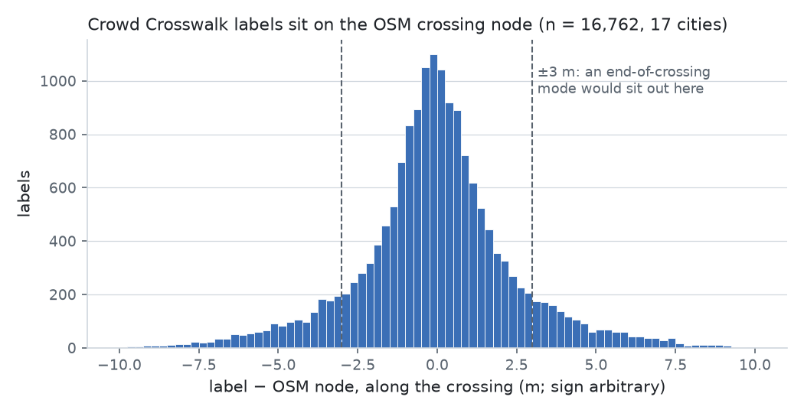
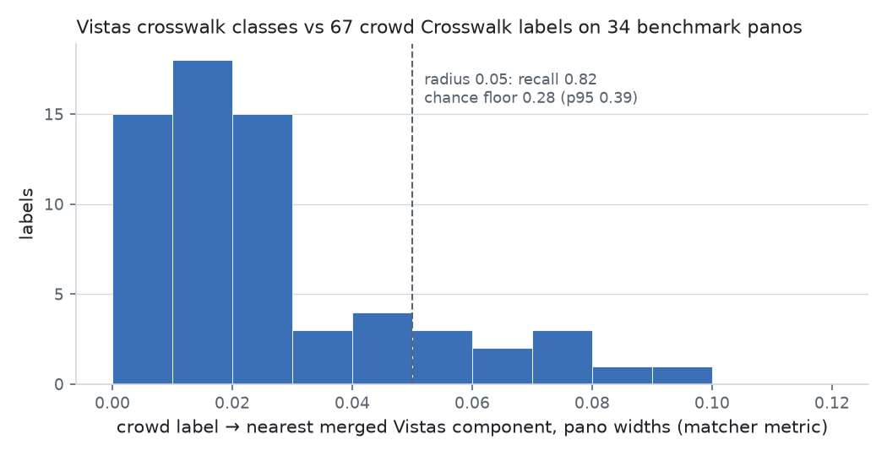

# Crosswalk Phase 0 (#274): census, offset read, Vistas probe

The three Phase 0 items of [#274](https://github.com/ProjectSidewalk/RampNet/issues/274) (umbrella:
ProjectSidewalk/Planning#36), run 2026-10-28, with the aerial-imagery lookup the umbrella's Phase 0 asks
for. Items 1 and 2 were posted on the issue as they finished and are reproduced here verbatim; item 3 is
new in this doc. Scripts: [`scripts/analysis/crosswalk_phase0_274/`](../scripts/analysis/crosswalk_phase0_274/README.md);
tables: [`analysis_out/crosswalk_phase0_274/`](../analysis_out/crosswalk_phase0_274/).

**What Phase 0 settles.**

1. OSM crossing coverage across the 46 public PS cities is bimodal; in the 17 dense cities the crowd's
   Crosswalk label sits a median 1.2 m along / 1.0 m across the crossing from the OSM node, symmetric about
   zero, so **the crowd labels the centre and the OSM crossing node is that centre** (the umbrella's
   target convention stands). Three Latin American cities tag the junction node instead and give bearing only.
2. On 2023 Seattle orthoimagery (AI first pass, 120 labels, to be spot-checked) a node OSM tags marked is
   painted 39 of 40 times and an untagged node with a confirmed crowd label 37 of 40, but a node tagged
   `unmarked` is painted 20 of 40: **marked ∪ untagged is a usable positive set; `unmarked` is not a
   negative set.** 85% of labels sit within 5 m of the node on the crossing; the end cases are 7%.
3. The Vistas crosswalk classes find a merged component within 0.05 of the pano width for 0.82 of crowd
   Crosswalk labels on labeled benchmark panos (chance 0.28), clearing the pinned 0.8 bar by one label:
   **a usable Stage 1 extent filter, not a source and not a placer** (0.58 at the ramp radius).

## Replication

| what | command | needs |
|---|---|---|
| item 1 tables | `python scripts/analysis/crosswalk_phase0_274/crossing_census.py --out OUT` then `make_table.py OUT` | PS API + Overpass (cached under OUT) |
| item 2 tables | `python scripts/analysis/crosswalk_phase0_274/offset_read.py --out OUT` then `offset_table.py OUT` | Overpass (cached) |
| aerial sheet | `python scripts/analysis/crosswalk_phase0_274/aerial_sample.py --out OUT --city seattle-wa` | item 2 outputs |
| aerial crops | `python scripts/analysis/crosswalk_phase0_274/aerial_crops.py --sheet OUT/aerial_sample_seattle-wa.csv --out CROPS` | King County 2023 ortho map service (view only) |
| item 3 | `python scripts/analysis/crosswalk_phase0_274/vistas_crosswalk_probe.py --rampnet . --rawlabels OUT/rawlabels --split paterson=paterson-nj --split gainesville=gainesville-fl --out P` then `score_extra.py` | benchmark `panos/` for both splits, the Vistas checkpoint, a GPU |
| figures | `python scripts/analysis/crosswalk_phase0_274/figures.py` | the committed tables only |

Where each number lives: the per-city census table and readings 1–4 come from `census.json` (+ `per_label/`,
not committed); the offset tables and pooled cuts from `offsets/<city>.csv` and `offset_read.json`; the probe
table from `vistas_probe/summary.json` (pinned cuts), `summary_extra.json` (chance floor, sensitivity,
server-flag cuts) and `labels_scored.csv` (one row per label); the aerial table from
`aerial_sample_seattle-wa.rated_ai.csv`; the components-per-pano line from
`vistas_probe/panos.csv`. Label ids are per city (`label_uid` = `<city>:<label_id>`).

## Item 1: census of crowd Crosswalk / Signal labels vs OSM crossing and signal nodes (all 46 public cities)

**Method.** For every public city on `/v3/api/cities`: all crowd `Crosswalk` and `Signal` labels from `rawLabels` (every user, the server's stored lat/lng, no re-raycast); OSM `highway=crossing` nodes (Signal: `highway=traffic_signals` or `crossing=traffic_signals`) pulled from Overpass over the 0.1° tiles that hold ≥ 1 label; haversine distance from each label to the nearest node. `marked` = `crossing:markings` ≠ `no`, or `crossing` ∈ {marked, zebra, lines, ladder, dashes, dots, surface}; `unmarked` = `crossing:markings=no` or `crossing` ∈ {unmarked, no, informal}. "human ok/wrong" is a simplified margin rule on human votes only (net ≥ 2 Agree / net ≥ 2 Disagree); the AI validator's votes are ignored. Stdlib script, every pull cached; it goes in with the Phase 0 PR. Pulled 2026-10-28.

#### Per-city table

Sorted by label count. "marked" and "tagged either way" are shares of the OSM nodes in the tiles (which cover more than the city). Distances are label → nearest node.

| city | Crosswalk labels | human ok/wrong | OSM crossing nodes | marked | tagged either way | median m to any node | <=10 m any | <=10 m marked | Signal labels | median m to signal node | <=10 m |
|---|---|---|---|---|---|---|---|---|---|---|---|
| chicago-il | 28091 | 3907/163 | 247831 | 25% | 44% | 1.5 | 93% | 37% | 5826 | 8.9 | 64% |
| seattle-wa | 6283 | 1820/232 | 53353 | 21% | 77% | 2.2 | 96% | 86% | 1671 | 9.5 | 55% |
| paterson-nj | 5300 | 41/0 | 3695 | 52% | 60% | 239.1 | 18% | 15% | 159 | 19.7 | 13% |
| cdmx | 3931 | 114/29 | 5726 | 29% | 35% | 185.0 | 19% | 18% | 112 | 20.7 | 21% |
| teaneck-nj | 3363 | 1595/112 | 12890 | 66% | 72% | 183.5 | 30% | 28% | 227 | 29.6 | 30% |
| amsterdam | 2976 | 890/112 | 8769 | 83% | 92% | 2.1 | 86% | 86% | 1034 | 8.6 | 54% |
| st-louis-mo | 2890 | 292/7 | 18946 | 31% | 75% | 3.6 | 70% | 64% | 1359 | 11.2 | 41% |
| gainesville-fl | 2420 | 15/0 | 6448 | 40% | 74% | 1.8 | 92% | 70% | 719 | 12.4 | 27% |
| cuenca | 1768 | 257/15 | 1439 | 54% | 58% | 75.4 | 36% | 25% | 801 | 11.0 | 43% |
| burnaby | 1728 | 289/5 | 23016 | 28% | 89% | 2.3 | 98% | 82% | 891 | 9.4 | 58% |
| pittsburgh-pa | 1018 | 214/33 | 16703 | 23% | 40% | 2.3 | 80% | 42% | 218 | 8.9 | 60% |
| mendota-il | 983 | 457/246 | 33 | 73% | 91% | 178.9 | 16% | 14% | 31 | 18.5 | 8% |
| columbus-oh | 889 | 177/7 | 12925 | 24% | 68% | 2.4 | 83% | 30% | 725 | 12.9 | 30% |
| walla-walla-wa | 878 | 234/19 | 505 | 38% | 53% | 42.3 | 42% | 31% | 284 | 16.6 | 7% |
| tucson-az | 691 | 195/8 | 10492 | 26% | 63% | 2.9 | 74% | 71% | 138 | 14.6 | 20% |
| oradell-nj | 675 | 483/33 | 973 | 49% | 61% | 430.4 | 5% | 6% | 21 | 14.8 | 0% |
| maywood-nj | 505 | 127/2 | 3260 | 65% | 74% | 586.7 | 1% | 0% | 31 | 22.5 | 6% |
| danville-il | 488 | 15/2 | 2613 | 6% | 52% | 2.9 | 86% | 29% | 100 | 11.2 | 28% |
| knox-oh | 355 | 76/10 | 295 | 37% | 61% | 254.5 | 11% | 8% | 19 | 593.5 | 0% |
| west-chester-pa | 331 | 47/0 | 448 | 34% | 43% | 136.8 | 28% | 12% | 44 | 7.7 | 64% |
| detroit-mi | 283 | 42/7 | 5740 | 5% | 19% | 1.7 | 75% | 13% | 17 | 13.4 | 18% |
| waltham-ma | 281 | 62/2 | 5737 | 40% | 64% | 1.8 | 89% | 55% | 47 | 8.6 | 66% |
| auckland | 273 | 153/8 | 8260 | 27% | 75% | 2.6 | 93% | 69% | 271 | 6.8 | 84% |
| cliffside-park-nj | 201 | 64/2 | 9050 | 67% | 71% | 239.4 | 18% | 18% | 9 | 137.8 | 0% |
| rancagua-chile | 148 | 7/1 | 2237 | 17% | 17% | 4.4 | 76% | 15% | 143 | 7.8 | 67% |
| madison-wi | 137 | 45/2 | 1842 | 51% | 71% | 2.7 | 78% | 71% | 12 | 19.1 | 0% |
| spgg | 130 | 29/45 | 1431 | 22% | 26% | 176.2 | 10% | 2% | 14 | 32.0 | 0% |
| santiago-chile | 128 | 3/0 | 9864 | 77% | 82% | 4.5 | 85% | 71% | 116 | 6.8 | 80% |
| niagara-falls-ny | 115 | 12/1 | 1855 | 44% | 63% | 24.5 | 41% | 28% | 70 | 12.1 | 34% |
| sao-paulo-brazil | 105 | 0/0 | 15105 | 60% | 66% | 4.0 | 76% | 61% | 20 | 87.0 | 15% |
| hackensack-nj | 98 | 35/1 | 2318 | 72% | 80% | 102.4 | 16% | 12% | 16 | 18.3 | 6% |
| chandigarh-india | 94 | 6/2 | 106 | 62% | 63% | 446.7 | 2% | 0% | 6 |  |  |
| fort-wayne-in | 75 | 3/0 | 4208 | 24% | 60% | 71.3 | 33% | 21% | 17 | 386.0 | 0% |
| houston-tx | 71 | 1/0 | 14587 | 45% | 77% | 2.8 | 84% | 54% | 17 | 528.1 | 41% |
| richmond-va | 69 | 0/0 | 10713 | 23% | 77% | 5.0 | 100% | 19% | 53 | 5.9 | 87% |
| la-ca | 47 | 28/0 | 15215 | 25% | 53% | 2.4 | 100% | 47% | 57 | 11.9 | 33% |
| newberg-or | 47 | 1/5 | 1463 | 26% | 95% | 97.9 | 34% | 23% | 0 |  |  |
| blackhawk-hills-il | 38 | 18/1 | 78 | 4% | 91% | 557.6 | 0% |  | 0 |  |  |
| la-piedad | 29 | 0/0 | 2 | 50% | 50% |  |  |  | 0 |  |  |
| laurens-ia | 20 | 0/0 | 11 | 9% | 36% | 6.0 | 75% | 10% | 0 |  |  |
| clifton-nj | 18 | 7/0 | 1795 | 50% | 58% | 6.4 | 61% | 39% | 3 | 17.1 | 0% |
| virden-il | 17 | 7/2 | 18 | 22% | 94% | 135.5 | 0% | 0% | 5 |  |  |
| vancouver-wa | 12 | 0/0 | 9734 | 33% | 52% | 3.1 | 92% | 50% | 6 | 10.9 | 50% |
| bayonne-fr | 9 | 0/0 | 1785 | 72% | 73% | 3.4 | 100% | 100% | 0 |  |  |
| washington-dc | 4 | 0/0 | 8342 | 58% | 79% | 0.7 | 100% | 100% | 0 |  |  |
| newport-ky | 2 | 0/0 | 1550 | 47% | 71% | 7.2 | 100% | 100% | 0 |  |  |

Total Crosswalk labels: 68014; Signal: 15309

#### Reading 1: OSM crossing coverage across our cities is bimodal, and that, not placement, drives the distances

The median label-to-node distance is either 2–5 m or 100–500 m, with almost nothing between. Counting OSM crossing nodes inside each city's own label footprint (1 km cells that hold ≥ 1 label) separates the two groups almost perfectly: above ~40 nodes per cell the crowd's labels sit on OSM nodes; below ~30 they do not, because there are no nodes to sit on. The far group is not crowd error: Teaneck (1,595 human-confirmed labels, 24 nodes/cell), Paterson, CDMX, Mendota, Oradell and Maywood are all heavily validated. Two cities have nodes but not where the crowd labels are, which is worth a look on an aerial basemap before trusting either side: Cuenca (86 nodes/cell, median 75 m) and Newberg (58/cell, 98 m; Bend-like, few painted crossings).

| city | labels | 1 km cells with labels | OSM crossing nodes in those cells | nodes per cell | median m | <=25 m |
|---|---|---|---|---|---|---|
| richmond-va | 69 | 4 | 1239 | 309.8 | 5.0 | 1.0 |
| la-ca | 47 | 3 | 856 | 285.3 | 2.4 | 1.0 |
| seattle-wa | 6283 | 211 | 42640 | 202.1 | 2.2 | 0.986 |
| newport-ky | 2 | 1 | 164 | 164.0 | 7.2 | 1.0 |
| chicago-il | 28091 | 1081 | 163507 | 151.3 | 1.5 | 0.944 |
| washington-dc | 4 | 1 | 151 | 151.0 | 0.7 | 1.0 |
| sao-paulo-brazil | 105 | 8 | 1200 | 150.0 | 4.0 | 0.867 |
| santiago-chile | 128 | 5 | 697 | 139.4 | 4.5 | 0.93 |
| pittsburgh-pa | 1018 | 70 | 9474 | 135.3 | 2.3 | 0.83 |
| rancagua-chile | 148 | 6 | 787 | 131.2 | 4.4 | 0.777 |
| burnaby | 1728 | 47 | 5350 | 113.8 | 2.3 | 0.997 |
| columbus-oh | 889 | 34 | 3863 | 113.6 | 2.4 | 0.863 |
| danville-il | 488 | 18 | 1875 | 104.2 | 2.9 | 0.949 |
| detroit-mi | 283 | 6 | 615 | 102.5 | 1.7 | 0.845 |
| tucson-az | 691 | 10 | 889 | 88.9 | 2.9 | 0.826 |
| cuenca | 1768 | 11 | 948 | 86.2 | 75.4 | 0.428 |
| st-louis-mo | 2890 | 160 | 13289 | 83.1 | 3.6 | 0.753 |
| gainesville-fl | 2420 | 54 | 4478 | 82.9 | 1.8 | 0.954 |
| bayonne-fr | 9 | 3 | 245 | 81.7 | 3.4 | 1.0 |
| houston-tx | 71 | 6 | 478 | 79.7 | 2.8 | 0.944 |
| waltham-ma | 281 | 17 | 1266 | 74.5 | 1.8 | 0.9 |
| newberg-or | 47 | 8 | 460 | 57.5 | 97.9 | 0.362 |
| auckland | 273 | 13 | 710 | 54.6 | 2.6 | 0.96 |
| madison-wi | 137 | 6 | 298 | 49.7 | 2.7 | 0.898 |
| amsterdam | 2976 | 67 | 3274 | 48.9 | 2.1 | 0.887 |
| vancouver-wa | 12 | 4 | 165 | 41.2 | 3.1 | 0.917 |
| fort-wayne-in | 75 | 8 | 302 | 37.8 | 71.3 | 0.387 |
| west-chester-pa | 331 | 7 | 222 | 31.7 | 136.8 | 0.305 |
| niagara-falls-ny | 115 | 19 | 556 | 29.3 | 24.5 | 0.505 |
| cliffside-park-nj | 201 | 8 | 226 | 28.2 | 239.4 | 0.189 |
| teaneck-nj | 3363 | 25 | 605 | 24.2 | 183.5 | 0.312 |
| hackensack-nj | 98 | 2 | 40 | 20.0 | 102.4 | 0.327 |
| clifton-nj | 18 | 2 | 38 | 19.0 | 6.4 | 0.611 |
| cdmx | 3931 | 50 | 927 | 18.5 | 185.0 | 0.222 |
| paterson-nj | 5300 | 35 | 618 | 17.7 | 239.1 | 0.218 |
| spgg | 130 | 22 | 374 | 17.0 | 176.2 | 0.178 |
| walla-walla-wa | 878 | 32 | 462 | 14.4 | 42.3 | 0.484 |
| knox-oh | 355 | 36 | 256 | 7.1 | 254.5 | 0.126 |
| oradell-nj | 675 | 14 | 81 | 5.8 | 430.4 | 0.062 |
| maywood-nj | 505 | 8 | 45 | 5.6 | 586.7 | 0.021 |
| laurens-ia | 20 | 2 | 10 | 5.0 | 6.0 | 0.8 |
| mendota-il | 983 | 11 | 33 | 3.0 | 178.9 | 0.191 |
| virden-il | 17 | 5 | 11 | 2.2 | 135.5 | 0.0 |
| chandigarh-india | 94 | 23 | 19 | 0.8 | 446.7 | 0.047 |
| blackhawk-hills-il | 38 | 3 | 2 | 0.7 | 557.6 | 0.0 |
| la-piedad | 29 | 4 | 0 | 0.0 | None | None |

#### Reading 2: where a node exists, it is where the crowd puts the label, which supports the midpoint convention

In the 17 cities with ≥ 100 labels and a median ≤ 5 m, the median is 1.5–4.5 m, which is inside the server's own placement error for a label raycast from a pano. Restricted to **human-confirmed** labels in those cities (8,086 labels, Chicago 3,907 of them):

| city | confirmed labels | ≤ 10 m any node | ≤ 10 m marked node |
|---|---|---|---|
| chicago-il | 3907 | 93% | 34% |
| seattle-wa | 1820 | 98% | 93% |
| amsterdam | 890 | 98% | 97% |
| st-louis-mo | 292 | 44% | 34% |
| burnaby | 289 | 98% | 84% |
| pittsburgh-pa | 214 | 92% | 53% |
| tucson-az | 195 | 78% | 75% |
| columbus-oh | 177 | 79% | 41% |
| auckland | 153 | 97% | 76% |
| waltham-ma | 62 | 90% | 42% |
| madison-wi | 45 | 84% | 80% |
| detroit-mi | 42 | 67% | 14% |
| **pooled** | **8086** | **92%** | **59%** |

So the OSM crossing node is a usable Stage 1 bearing source (the ±18° tolerance is far wider than 2–5 m at any range we use) in the dense group, and the along/across decomposition of item 2 can be read from these same joins. St. Louis is the outlier to check (confirmed labels agree with nodes less often than unconfirmed ones).

#### Reading 3: the `crossing:markings` tag disagrees with the crowd often enough that it cannot be the positive set on its own

Pooled over confirmed labels with a node within 10 m, 36% sit on a node OSM tags unmarked or leaves untagged. Chicago drives that (56% of its 248k crossing nodes carry no markings tag at all; only 37% of its labels are within 10 m of a marked node); without Chicago it is 1 in 9, but in Columbus, Pittsburgh, Waltham and Detroit it is 1 in 2 or worse, and Richmond's 69 labels are all within 10 m of a node but only 19% within 10 m of a *marked* one. Either the tags are stale (a crossing painted since the node was tagged) or the crowd labels unmarked crossings as `Crosswalk`. That is exactly what the one-city aerial reference in item 2 has to settle before any OSM-marked node is used as a training positive; until then, positives come from crowd-confirmed labels, and OSM nodes supply bearing and candidate crossings only.

#### Reading 4: Signal labels sit ~9–12 m from OSM signal nodes

Across the cities with ≥ 100 Signal labels the median is 7–15 m and only 27–64% are within 10 m, against 2–4 m for crossings. An OSM signal node is tagged on the intersection node (or the stop line), while the PS label is on the pole at the corner, so a signal bearing rule needs a corner offset rather than the node itself. Parked until crosswalks are done; recorded here so the number is not re-derived.

#### What this settles for Phase 0

- **Item 2 (offset read)** runs on the 17 dense-group cities; the aerial reference city should be one with many confirmed labels, dense OSM nodes and a marking inventory to compare against. Seattle fits all three; Burnaby and Amsterdam are the non-US checks.
- **Item 3 (Vistas probe)** stays on `richmond` and the `laurens` splits as pinned, with the caveat that both are small (69 and 20 crowd labels).
- The far group (Paterson, Teaneck, CDMX, Mendota, …) is where the crowd labels are the *only* supervision; they are also where a crosswalk detector adds the most, since no open data covers them.

## Item 2: crowd-vs-OSM offset read, 17 dense cities

**Method.** In each of the 17 cities from the census with ≥ 100 Crosswalk labels and a median ≤ 5 m to the nearest OSM crossing node: every crowd label (server lat/lng, no re-raycast) is joined to its nearest `highway=crossing` node within 10 m; a seeded sample of up to 1,500 matched labels per city (all of them in Seattle); the ways through the sampled nodes are pulled from Overpass with geometry. The crossing axis is the `footway=crossing` (or cycleway/path `=crossing`) way through the node when one exists, else the normal to the road way at the node. The offset vector label − node is projected on that axis (**along** the crossing, i.e. toward one kerb or the other) and on the road axis (**across**, i.e. up or down the street). Under a centre convention the along-crossing offset is small and symmetric about zero; under an end convention it has a mode near half the carriageway width (3–6 m) with either sign. Same script family as item 1; cached pulls; CSV per city with `label_uid`, node id, axis source, both components, the node's marking tag and the human verdict.

#### Per-city table

| city | labels | matched <=10 m | sampled | axis from footway | median |along| m | p90 |along| | median |across| m | p90 |across| | |along| > 3 m | |across| > 3 m |
|---|---|---|---|---|---|---|---|---|---|---|
| chicago-il | 28091 | 25938 | 1500 | 98% | 0.87 | 3.07 | 0.69 | 2.19 | 10% | 6% |
| seattle-wa | 6283 | 6034 | 6034 | 99% | 1.3 | 4.3 | 1.04 | 3.3 | 21% | 12% |
| amsterdam | 2976 | 2571 | 1126 | 17% | 0.94 | 3.39 | 1.12 | 3.05 | 13% | 10% |
| st-louis-mo | 2890 | 2018 | 1500 | 98% | 1.47 | 4.75 | 1.28 | 4.06 | 23% | 17% |
| gainesville-fl | 2420 | 2227 | 1497 | 92% | 0.95 | 4.14 | 0.83 | 2.21 | 18% | 4% |
| burnaby | 1728 | 1693 | 1496 | 100% | 1.34 | 4.92 | 0.96 | 3.12 | 27% | 11% |
| pittsburgh-pa | 1018 | 819 | 819 | 97% | 1.08 | 3.99 | 0.9 | 3.11 | 17% | 10% |
| columbus-oh | 889 | 739 | 739 | 71% | 1.05 | 3.56 | 1.27 | 3.41 | 12% | 14% |
| tucson-az | 691 | 510 | 510 | 99% | 1.18 | 4.23 | 1.21 | 3.88 | 17% | 16% |
| danville-il | 488 | 419 | 419 | 99% | 1.45 | 5.34 | 1.41 | 3.24 | 26% | 13% |
| detroit-mi | 283 | 212 | 212 | 33% | 0.9 | 2.84 | 0.71 | 2.24 | 8% | 7% |
| waltham-ma | 281 | 251 | 251 | 96% | 0.99 | 3.61 | 0.76 | 2.19 | 15% | 5% |
| auckland | 273 | 254 | 252 | 97% | 1.61 | 4.61 | 1.11 | 3.71 | 24% | 13% |
| rancagua-chile | 148 | 112 | 111 | 12% | 1.37 | 5.3 | 2.58 | 5.69 | 22% | 42% |
| madison-wi | 137 | 107 | 107 | 99% | 1.6 | 5.06 | 0.89 | 2.95 | 25% | 8% |
| santiago-chile | 128 | 109 | 109 | 18% | 1.53 | 5.38 | 2.49 | 5.84 | 32% | 40% |
| sao-paulo-brazil | 105 | 80 | 80 | 56% | 0.94 | 3.3 | 2.5 | 6.72 | 15% | 41% |

#### Pooled cuts

| subset | n | median \|along\| | p90 | median \|across\| | p90 | \|along\| > 3 m | signed along median |
|---|---|---|---|---|---|---|---|
| all sampled | 16762 | 1.17 | 4.26 | 1.00 | 3.22 | 19% | -0.06 |
| human-confirmed | 3512 | 1.18 | 4.11 | 1.03 | 3.15 | 19% | -0.04 |
| human-rejected | 183 | 1.21 | 5.51 | 1.09 | 4.52 | 26% | -0.31 |
| axis = footway way | 14961 | 1.20 | 4.30 | 0.99 | 3.15 | 20% | -0.06 |
| axis = road normal | 1801 | 1.00 | 3.77 | 1.14 | 3.64 | 15% | -0.08 |
| node tagged marked | 12604 | 1.22 | 4.29 | 1.02 | 3.18 | 20% | -0.07 |
| node tagged unmarked | 1182 | 1.12 | 4.48 | 1.21 | 4.12 | 19% | -0.04 |
| node untagged | 2976 | 1.03 | 3.98 | 0.90 | 3.06 | 17% | -0.05 |
| on a oneway road | 5076 | 1.25 | 4.63 | 1.05 | 3.47 | 23% | -0.05 |

#### Reading 1: the crowd labels the centre, and the OSM node is that centre

Pooled over 16,762 sampled labels the median offset is 1.17 m along the crossing and 1.00 m across it; the signed along-crossing median is -0.06 m, so the labels scatter symmetrically about the node rather than piling up at a kerb, and only 19% are more than 3 m from it along the crossing. There is no half-carriageway mode anywhere in the 17 cities (per-city medians 0.87–1.61 m along). Human-confirmed labels (3,512) read the same (1.18 m along, 1.03 m across), so this is not an artefact of unvalidated labels. These numbers are at or under the server's own placement error for a label raycast from a pano, which means the OSM node is, to the precision we can measure here, the midpoint the labeling convention asks for (the umbrella's Decision on the target convention stands: **centre of the marked extent**).

#### Reading 2: the caveats from the review are small or confined

- **Dual carriageways.** Labels whose node sits on a `oneway=yes` road (5,076) read 1.25 m along / 1.05 m across, against 1.17 / 1.00 overall: no separate mode. Each carriageway of a dual road tends to carry its own crossing node, and the crowd labels each half.
- **Junction-node tagging.** The exception is the three Latin American cities, Santiago, Rancagua and São Paulo: only 12–56% of their nodes have a footway crossing way, and the **across**-road component jumps to a 2.5 m median with ~40% beyond 3 m, while the along-crossing component stays at ~1–1.5 m. That is a node tagged on or near the junction node (or a crossing drawn as one node for several marked crossings) rather than at the crossing, so in those cities the node gives the bearing but not the midpoint. CDMX, Cuenca and the rest of the sparse group were not in this read at all.
- **Axis source.** Road-normal and footway axes give the same picture (1.00 vs 1.20 m along), so the result does not hinge on the footway ways being drawn.
- **Marking tag.** Labels on nodes tagged `unmarked` (1,182) sit exactly like labels on `marked` nodes (1.12 vs 1.22 m along). The crowd places them the same way; whether those are stale tags or unmarked crossings the crowd calls `Crosswalk` is the question only the aerial sheet answers (below).

#### What this sets for item 3 and for Stage 1

- **Matcher radius for the Vistas probe:** the pooled p90 is 4.3 m along / 3.2 m across the crossing. At the 10–25 m ranges a crossing is seen from in a pano, 4–5 m of ground offset is ~10–25° of bearing, well inside Stage 1's ±18.37° tolerance at the near end and the reason the probe's reading rule uses a radius of 0.05 of the pano width (~18°) rather than the ramp radius.
- **Stage 1 bearing source:** an OSM crossing node is usable as the bearing anchor in the dense group without any midpoint correction; in the junction-tagged cities it needs the footway way or a road-normal offset, which the crop model is there to absorb.
- **Aerial reference (Seattle):** a seeded rating sheet is ready, 120 human-confirmed labels on nodes tagged marked / unmarked / untagged with both positions, the offset and map links, for a person to rate on a basemap: is there a painted crossing at the node, and is the label at its centre. It is the step that decides whether `crossing:markings` can be a positive source at all. It needs a rater and an imagery source, so it is the one item in Phase 0 that waits on a person.

#### Aerial reference, Seattle: an AI first-pass rating of the 120-label sheet

The sheet (`aerial_sample_seattle-wa.csv`: 120 human-confirmed Seattle Crosswalk labels, 40 each on OSM
nodes tagged marked / unmarked / untagged) was rated by Claude (claude-fable-5-1) on 2023 King County
3-inch orthoimagery (36 m crops centred on the node, from the county's public map service; the imagery is
licensed to the county and is not committed), as a first pass for a person to spot-check:
`aerial_sample_seattle-wa.rated_ai.csv`, with a note per row where the call needed one. Two questions per
row: is there a painted crossing at the OSM node (yes / unclear / no), and where is the label relative to
that crossing (≤ 2 m of the node; 2–5 m but on the crossing; at an end, > 5 m but on the crossing; off the
crossing; n/a). The population is nodes that already have a confirmed crowd label within 10 m, so this reads
the tag's precision on crossings the crowd has found, not OSM's recall.

| OSM class | n | painted at node: yes | unclear | no | label ≤ 2 m | 2–5 m on crossing | at an end | off the crossing | n/a |
|---|---|---|---|---|---|---|---|---|---|
| marked | 40 | 39 | 1 | 0 | 22 | 13 | 4 | 0 | 1 |
| unmarked (`crossing=unmarked` + `crossing:markings=no`, all 40) | 40 | 20 | 7 | 13 | 9 | 15 | 1 | 13 | 2 |
| untagged | 40 | 37 | 2 | 1 | 16 | 17 | 3 | 4 | 0 |

Readings: (a) a node OSM tags **marked** is painted in 39 of 40, and an **untagged** node with a confirmed
crowd label is painted in 37 of 40, so on this population both are positives; (b) a node OSM tags
**unmarked** is painted in 20 of 40 and not in 13, so the tag is wrong or stale about half the time and
excluding those nodes would cost recall; `crossing:markings=no` is not a clean negative either. Reading 3 of
item 1 now reads: **marked ∪ untagged-with-crowd-label is a usable positive set in Seattle; `unmarked` is
not a negative set.** (c) Of the 13 unmarked-class nodes with no paint, in 4 the crowd label 5–9 m away sits
on a painted crossing (a green bike crossing or a zebra) that OSM has not tagged as such: the node, not the
crowd, is off. (d) Label placement: 92 of the 117 ratable labels are within 5 m of the node on the crossing,
8 more are on the crossing at an end, and 17 are off the crossing, 13 of them in the unmarked class (the
no-paint cases above) and 3 untagged ones 6–9 m away that look like placement error. The centre convention
holds on the imagery as it did in the offsets, with the end cases at 7% (8 of 117).

## Item 3: Vistas probe, classes 8 + 23 against crowd Crosswalk labels on benchmark panos

**Amendment, stated before the numbers.** The issue pinned the `richmond` and `laurens_mapillary` / `laurens_gsv` splits. Their denominator is empty: no benchmark pano in any of the three carries a crowd Crosswalk label (Richmond has 70 Crosswalk labels city-wide and none on its 124 benchmark panos; the Laurens PS city has none on its 180). The two benchmark splits whose panos do carry crowd Crosswalk labels are **paterson** (16 of 125 panos, 44 labels) and **gainesville** (18 of 125, 23 labels), both GSV, so the probe ran there with the component rule and the reading rule exactly as pinned. The crowd positions are the server's `pano_x / pano_width`, `pano_y / pano_height`; the label's recorded pano size matches the benchmark record's on every row.

**Method.** `facebook/mask2former-swin-large-mapillary-vistas-semantic` (the #126 checkpoint; class 8 = `Crosswalk - Plain`, 23 = `Lane Marking - Crosswalk`, checked against the loaded `id2label`) on the 1024 parity rig (`equirect_tiling.default_views()`: 6 yaws, 90°×90°, pitch −30°, 1024×1024 views, source capped at 4096, processor size forced to 1024×1024), fp16 on an RTX 3070. Per view: union of the two classes, 8-connected components, min area 16 px (the #126 cache floor), each component's centroid mapped to pano-normalized coordinates. Across views: components whose pano centroids are within 0.03 of the pano width (RampNet's matcher metric, x wrapped at the seam and scaled by 1024, y by 512) are merged into one point, area-weighted. A label is matched when a merged component lies within 0.05 of the pano width in that metric. One departure from `VistasDetector._raw_detect`: the class/mask reduction runs at the logits' 256×256 and the argmax map is upsampled, the memory-light order the #126 note recommends; it differs only at boundary pixels.

| cut | labels | panos | recall@0.022 | **recall@0.05** | recall@0.1 |
|---|---|---|---|---|---|
| all | 67 | 34 | 0.58 | **0.82** (55/67; Wilson 95% 0.71–0.89) | 0.97 |
| paterson | 44 | 16 | 0.68 | 0.89 | 1.00 |
| gainesville | 23 | 18 | 0.39 | 0.70 | 0.91 |
| server `correct` = true | 44 | | | 0.82 | |
| server `correct` = false | 9 | | | 0.78 | |
| chance floor (labels scored on another labeled pano's components, 200 derangements) | 67 | 34 | | 0.28 mean, 0.39 p95 | |

The census's human-only margin rule confirms none of the 67 (they carry AI-validator votes only), so the server's `correct` flag is the only validation cut available, and it is AI-validator dominated.

**What the mask produces.** 6.2 merged components per labeled pano (211 on the 34 panos), of which 65 lie within 0.05 of a crowd label; crowd labels are positives only, so that is not a precision. 24 of the 55 matches merged components from two adjacent views, so the merge step is doing real work on crossings that straddle a view seam. Sensitivity (exploratory, never the rule): dropping components with mean class probability < 0.4 gives 0.81 at 5.4 per pano; < 0.5 gives 0.75 at 4.1; dropping components larger than 5% of a view (the road-surface blobs) gives 0.75. The exploratory pass over every pano of the five splits (labeled or not) reports components per pano by source: Paterson 3.8 per pano (median 2; 27 of 109 panos with none), Gainesville 2.3 (median 2; 35 of 107 with none), downtown Richmond (Mapillary) 5.2 (median 4; 16 of 124 with none), and the two Laurens splits 0.3 (GSV) and 0.2 (Mapillary) with 75 of 86 and 85 of 94 panos carrying no component at all. The rate tracks where painted crossings are (a small SC town paints few; the issue already notes Bend paints few), so the union mask is not firing on every road surface; the labeled-pano rate of 6.2 is the dense-intersection end of that range. 554 panos in all, 2 s each on the 3070.

**Reading, under the rule pinned on the issue.** 0.82 ≥ 0.8: the mask is a usable Stage 1 **extent filter**. The bar is cleared by one label in 67 and the interval spans it; Gainesville alone is under it; and at the ramp radius (0.022) recall is 0.58, so the mask locates a crossing to within a few degrees of bearing, not to the label point. That is the role the issue gave it: an extent read on crop-model candidates, not a positive source and not a placer. A confidence or area cut buys fewer components per pano at a recall cost that would fail the rule, so the filter runs on the raw union.

## Aerial imagery per city (umbrella Phase 0 item 3: name the source and GSD before any GT plan)

Web lookup on 2026-10-28 of the newest public orthoimagery found per PS city with Crosswalk labels, for the
Phase 1 GT plan (top-down marking of crossings needs ≤ 10 cm; coarser imagery means per-pano review). These
are catalogue readings, not opened services: a "?" is a lookup that found nothing definite, and every row
should be confirmed against the service before a city is scheduled.

| city | newest public ortho found | GSD | access | ≤ 10 cm? |
|---|---|---|---|---|
| Seattle | King County 2023 (EagleView); Seattle `SP_Aerial_2023`; 2025 also 3 in urban | 3 in (7.6 cm) urban, 9 in rural | ArcGIS map services; licensed to the county, redistribution limits | yes (view/rate only) |
| Madison | Fly Dane 2024 | 3 in countywide | Dane County LIO | yes |
| Tucson | Pictometry 2024 (Pima County composite); PAG 2023 | 3 in / 6 in | Pima County service | yes (service) |
| Pittsburgh | Allegheny 2017 (PASDA); PEMA SW 2022 | 3 in (2017) / 6 in (2022) | PASDA download | 2017 only |
| Chicago | Cook County 2024 (2025 cached basemap exists) | 6 in | ImageServer; bulk download discouraged | no |
| Laurens (SC) | SC statewide 2023 | 6 in | `SC_2023_RGB` tile service | no |
| Waltham | MassGIS 2023 | 15 cm | GeoTIFF tiles | no |
| Detroit | SEMCOG Nearmap 2025/2026 | 6 in free to members; sub-3 in by subscription | SEMCOG | no (free tier) |
| St Louis | MSDIS 2024 county mosaics; 2012 regional | 6 in | MSDIS | no |
| Vancouver (WA) | Clark County 2020/2021 | 6 in | county GIS | no |
| Paterson | NJ statewide 2020 | 1 ft | `maps.nj.gov` service | no |
| Richmond | VBMP 2023 (eastern VA) | 1 ft; some urban areas 6 in / 3 in, Richmond unconfirmed | VDEM service | ? |
| Gainesville | FDOT/FDEP 2017 statewide (only product found) | ? (2011 was 1 ft) | FDEP service | ? (check Alachua County) |
| Columbus | 2025 City of Columbus orthos (cited by the county's contour metadata) | ? | ? | ? |

So the aerial GT route is open today in Seattle, Madison and Tucson (plus 2017 Pittsburgh), and the Seattle
rating sheet from item 2 can be rated on the city's own 2023 service. Chicago, Paterson, Gainesville,
Richmond and Laurens, the cities with benchmark splits or the most labels, are per-pano-review cities
unless a finer product turns up.
