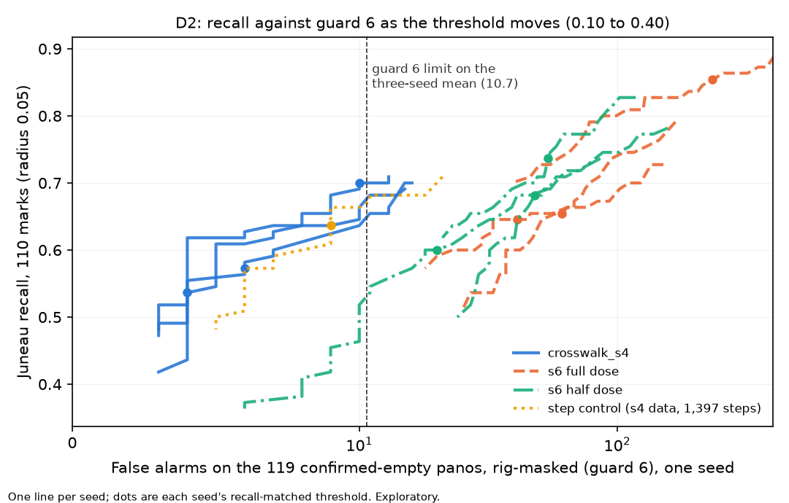

# Crosswalk supervision fix (`crosswalk_s7`): day-1 diagnostics

Plan: `crosswalk-supervision-fix-2026-11-15.md` (v2, Fable 5.2 draft, Opus 5.5 review, revised), approved by Jon
for its $0 stage only. This doc records the day-1 diagnostics of section 2 of that plan: D1 (already read), D2
(exploratory) and **part (a) of D4**, the leak check that is the plan's only stop gate. Nothing was built, trained
or rated. Written by Claude Opus 5.5 (`claude-opus-5-5`).

**D4 part (b) has not been run.** It uses Jon's missed-crosswalk marks (110 Juneau, 11 Laurens) as a hold-out
population, and that use is Jon's decision, not yet made. The code for (b) is written and refuses to run without
`--jon-approved-b`; its marks were not opened for this doc. **The gate's (b) half is pending.**

## Result

| Gate half | n (marks / panos) | Leaked into background | Leak (Wilson 95%) | s4-blind at 0.05 (Wilson 95%) | Verdict |
|---|---|---|---|---|---|
| D4 (a): Jon's `crosswalk` verdicts, 200 Mapillary panos of the confirmation `cities` draw | 106 / 38 | 0 | **0.000 (0.000 to 0.035)** | 0 of 106, 0.000 (0.000 to 0.035) | **holds** (≤ 0.05) |
| D4 (b): Jon's missed-crosswalk marks, 110 Juneau + 11 Laurens | not run | | | | **pending Jon's decision** |

- **(a) holds, but it is a weak test, as the plan said it would be.** Every (a) mark is a card some model fired on, and
  s4 seed 1's own detections are among those cards. An s4 peak's 30 px ignore disc alone covers 104 of the 106 marks,
  and no mark is s4-blind at 0.05 (no seed has a peak within 0.05 of it). With s4's peaks alone and no Vistas or OSM
  term, 2 of 106 would leak; Vistas covers both. So (a) shows the rule does not erase crosswalks s4 already sees. It
  cannot show what happens to the crosswalks s4 misses, which is the recall risk H carries.
- **The gate as a whole is open.** Under the plan, H is built only if the leak is at most 5% in (a) and in (b). (b) is
  the half that measures crosswalks s4 misses (s4 found 63 of the 110 Juneau marks at 0.23). Using those marks this way
  is Jon's call. If he approves, (b) runs with one command (below). If he declines, the plan says the gate is (a)
  alone, and it holds.
- **What happens next, per the plan (section 7):** D4 is the stop rule, so nothing is built until the gate is settled.
  Then days 2 to 3: build `root_v7h`, commit the pre-registration with exact counts, and Jon approves the text before
  any training job. None of that was started here.
- D1 and D2 are exploratory and decide nothing. D2 adds one reading worth Jon's eye: on the 110 marks and the 119
  empty panos, no s6 model reaches s4's false-alarm level at any threshold from 0.10 to 0.40, and at equal false alarms
  s4 finds more marks (section D2).

## Background: fix H and why D4 exists

`crosswalk_s6` added 3,040 auto-placed positives on 1,705 Mapillary panos, all `sparse` (loss only inside a 30 heatmap
px disc around each positive). It found more Juneau crosswalks but its false alarms on confirmed-empty panos rose from
6.7 to 112 (guard 6, docs/crosswalk_followups_285.md, A4). Fix H rewrites those panos as `dense_ignore`: background
everywhere except

- ignore boxes over every Mapillary Vistas crosswalk component of a whole-pano six-view pass (as `neg-check` runs it),
  dilated by 30 px;
- ignore points (30 px discs) at every `crosswalk_s4` peak at or above 0.05, from any of its three seeds;
- ignore points at every projected OSM crossing node, and the existing 803.

A crosswalk that Vistas, OSM and s4 all miss is taught as background. D4 counts how often that happens to crosswalks a
person marked, on panos s4 never trained on. Above 5% in (a) or (b), H is not built.

## D4 (a): the leak check on the confirmation draw's Mapillary panos

**Population.** The 200 Mapillary panos of the confirmation `cities` draw (120 Juneau, 80 Laurens; seed 275,
2026-11-08). None is in any split of `root_v6_full` (checked: 0 of 200 in train, val or test). Jon rated 257 cards
on them across two pages: 144 on the 2026-11-08 confirmation page (s1 and s3 detections) and 113 on the 2026-11-09 s4
Step B page. Merged at 0.01 they are 209 cards: 106 `crosswalk`, 98 `not_crosswalk`, 5 `unsure`, none with
conflicting verdicts. The 106 crosswalks (105 Juneau, 1 Laurens, on 38 panos) are the marks.

**Rule inputs, all on the 4096×2048 panos the training root uses:**

| Source | What was run | Count |
|---|---|---|
| s4 peaks ≥ 0.05 | seed 1: committed A40 predictions; seeds 2 and 3: run here on the RTX 3070 | every stored peak |
| Vistas | whole-pano six-view pass (90° views pitched −30°, as `neg-check`), components of ≥ 16 px | 550 components on 61 of 200 panos |
| OSM | `highway=crossing` nodes from one bounding-box query per city (OSM data of 2026-11-15 20:28 UTC); 248 Juneau and 12 Laurens nodes | 73 node projections within 25 m of a pano |

**Result, per rule reading** (see Amendments for why each exists; the primary gates):

| Reading | Leaked of 106 | Leak (Wilson 95%) |
|---|---|---|
| **Primary:** all OSM nodes within 20 m, boxes dilated 30 heatmap px | **0** | 0.000 (0.000 to 0.035) |
| OSM marked nodes only | 0 | 0.000 (0.000 to 0.035) |
| OSM nodes within 25 m | 0 | 0.000 (0.000 to 0.035) |
| Boxes dilated 30 image px (7.5 heatmap px) | 0 | 0.000 (0.000 to 0.035) |
| Boxes not dilated | 0 | 0.000 (0.000 to 0.035) |

Which source covers each mark (a mark can have several): s4 discs 104, Vistas boxes 96, OSM discs 21. The two marks no
s4 disc covers are both inside a Vistas box (one also under an OSM disc); both have an s4 peak within 0.05, just
outside the 30 px disc. s4-blind at 0.05: 0 of 106 for the three seeds together, 2 of 106 for seed 1 alone.

**What (a) cannot say.** Jon's marks on this draw exist only where a model fired, and s4 is one of those models, so the
population is nearly empty of the crosswalks H could erase. That was known when the plan was revised (section 10,
finding 1), and it is why (b) exists.

## D4 (b): written, not run

`pu_arm.py leak-check --population b --keep <keep> --jon-approved-b` applies the same rule to the sure marks within
25 m of Jon's missed-crosswalk page (the 110 Juneau marks of the A4 primary and the 11 Laurens marks). It reads the
committed `recall285` verdicts, the three s4 seeds' committed predictions on those panos (`crosswalk_s4_klone`,
`_seed2`, `_seed3`), the `recall285` records and 4096 px panos under `<keep>`, runs the Vistas pass on the panos that
carry marks, pulls OSM for each city's draw, and writes `leak_b/` with the same files and summary as (a). Without
`--jon-approved-b` it exits before reading any mark (`tests/test_pu_arm_s7.py` pins that). Nothing under `leak_b/`
exists, and none of those marks was scored against the rule for this doc.

## D1 (exploratory, already read; reproduced)

Detections, true and false together, at or above each model's threshold. No rig mask, no verdicts. `pu_arm.py
diagnose` reproduces every number the plan quotes, from the committed prediction files.

Fresh Juneau draw (120 panos), seeds 1, 2, 3:

| | s4 | Full dose | Half dose | Step control (seed 1) |
|---|---|---|---|---|
| Matched thresholds | 71, 70, 146 | 430, 141, 159 | 187, 110, 182 | 104 |
| Fixed 0.25 | 67, 85, 95 | 268, 159, 154 | 170, 99, 182 | 95 |

Seed 1 only, matched thresholds:

| | s4 (0.23) | Full (0.17) | Half (0.23) | Step control (0.24) |
|---|---|---|---|---|
| Confirmation draw, 200 Mapillary panos | 113 | 621 | 226 | 151 |
| Confirmation draw, 80 GSV panos (Laurens) | 11 | 39 | 30 | 34 |
| Columbia, 127 GSV panos | 902 | 1,053 | 937 | 1,015 |

As the plan says: the GSV rise matches the step control, the open-imagery rise does not. Consistent with the domain
account, not a test of it. Nothing here gates.

## D2 (exploratory): Juneau recall against guard 6 on a threshold grid

For every model, at thresholds 0.10 to 0.40 in steps of 0.01 plus its matched threshold: Juneau recall on the 110 rated
marks (one-to-one, radius 0.05, as the A4 primary) and guard 6's false alarms on the 119 confirmed-empty panos, with
the 49° rig mask and without. At the matched thresholds it reproduces A4 exactly (s4 63, 59, 77 marks with 6, 4, 10
masked false alarms; full 94, 71, 72 with 234, 41, 61; half 75, 66, 81 with 48, 20, 54; step control 70 with 9).



*One line per seed as the threshold moves from 0.10 to 0.40; dots mark each seed's matched threshold. The x axis is
linear to 10, logarithmic beyond.*

| Threshold (all seeds) | s4: marks found / masked false alarms | Half dose | Full dose | Step control |
|---|---|---|---|---|
| 0.13 | 75, 75, 77 / 14, 13, 10 | 83, 78, 89 / 112, 58, 93 | 95, 77, 82 / 320, 123, 116 | 75 / 17 |
| 0.16 | 72, 73, 75 / 11, 10, 9 | 81, 75, 85 / 82, 41, 80 | 95, 76, 79 / 259, 102, 88 | 75 / 13 |
| 0.20 | 64, 69, 70 / 6, 7, 8 | 76, 70, 85 / 55, 29, 66 | 92, 73, 75 / 189, 74, 73 | 73 / 10 |
| 0.25 | 61, 67, 67 / 4, 5, 4 | 71, 65, 81 / 41, 18, 54 | 91, 72, 72 / 128, 46, 58 | 68 / 9 |
| 0.30 | 53, 59, 63 / 4, 4, 4 | 66, 57, 76 / 32, 10, 39 | 88, 71, 66 / 88, 33, 42 | 63 / 7 |

- **No s6 model reaches s4's false-alarm level anywhere on the grid.** At 0.40, the top of the grid, the half and full
  doses' three-seed means are still above guard 6's limit of 10.7 rig-masked false alarms.
- **At equal false alarms, s4 finds more marks.** s4 at a common 0.16 finds 72, 73 and 75 marks (mean recall 0.667)
  with 11, 10 and 9 masked false alarms. That is about the half dose's matched recall (0.673) at a quarter of its
  false alarms (40.7). Half-dose seed 2, the cleanest s6 model, has 10 false alarms at 0.30 and finds 57.
- So on these panos s6 did not move along s4's recall/false-alarm trade-off; it moved off it. That is a sharper
  reading than the plan's W row ("moves along the same trade, not off it"), and it is still one draw of 110 marks
  and 119 empty panos that every arm has been designed around. A common threshold also ignores the per-seed val
  matching the pre-registration uses. It decides nothing.
- The grid starts at 0.10 rather than 0.05 on purpose: at 0.05 it would report which of Jon's marks s4 misses at its
  storage floor, which is a quantity D4 (b) reports and is not approved yet.


## Amendments and readings (the plan was ambiguous here; the most literal reading gates)

Every choice below was fixed in the code before the D4 scoring was run, and none was changed after.

1. **"Dilated by 30 px."** Read as 30 heatmap px, the training-disc radius the plan's diagnosis quotes ("radius =
   ceil(3*sigma) = 30 heatmap px"), which is 120 px at 4096. The other reading, 30 image px at 4096 (7.5 heatmap px),
   is reported as `box_dilate_30_image_px`, and no dilation at all as `no_box_dilation`.
2. **"Every projected OSM crossing node."** Read as every `highway=crossing` node of any class and grade within the
   placer's 20 m (`osm_arm.PLACE_RANGE_M`), projected with the placer's B1 (2.6 m camera, stored position and
   heading). Sensitivities: marked nodes only (`osm_marked_only`, what the s6 placer projected) and every node within
   25 m (`osm_25m`). Nodes come from one Overpass bounding-box query per city (2026-11-15), not a boundary pull.
3. **Hold-out panos have no positives,** so "not within 0.05 of a positive" removes no s4 peak, and every s4 peak at or
   above 0.05 from seeds 1, 2 and 3 is an ignore point. A mark "lands in background" when `train.py`'s own
   `generate_dense_ignore_weight` (lifted from the AST, as `check_root_negatives.py` does) gives weight 1 at the mark's
   heatmap pixel (`int(y × 512)`, `int(x × 1024)`).
4. **"s4-blind at 0.05"** = no s4 peak at or above 0.05, from any of the three seeds, within 0.05 of the mark
   (`recall_check`'s matching radius and distance). Seed 1 alone is reported too.
5. **Population (a)'s marks:** the rated cards on the 200 panos from every rating export that touches them (the
   2026-11-08 confirmation page with s1 and s3 cards, and the 2026-11-09 s4 Step B page; the s5 Step B page has none
   there), merged at 0.01 in that order as `score_274.merge_candidates` does. No merged card had conflicting verdicts.
6. **s4 predictions:** seed 1 is the committed A40 run (`confirm_s3/preds/crosswalk_s4`); seeds 2 and 3 were run for
   this check on the local RTX 3070 with the archived checkpoints (sha256 `48a9928f5bda…`, `6f143e48f2f9…`). The plan
   put s4 inference for the D4 panos on the 3070.
7. The Vistas loader (transformers 5.14.1) reports the Swin backbone's final layernorm as newly initialised and its
   relative-position indices as unexpected. Mask2Former reads the backbone's per-stage outputs through their own
   norms, not that final norm, and the pass behaves as before: its components cover 96 of the 106 (a) marks after
   dilation (81 inside an undilated box), close to the earlier finding that the segmenter sees a region at 89 of 110
   Juneau marks (docs/crosswalk_followups_285.md, region matching). Recorded, not investigated further.

8. **Overpass was down for about 20 minutes** (HTTP 502 on four spaced retries, then on probes every 90 s). The Vistas
   pass had already finished; the check was rerun once the main instance answered again, and it resumed without
   repeating the pass. Two queries in all, no mirror used.

Not done here, by the plan: no training root built, no training, no rating, nothing pushed or posted. One unrelated
test fails on the base commit as well (`tests/test_check_all.py::test_manifest_discovery_covers_the_unowned_manifests`,
a `hardneg/s4_bayonne/*.sha256` manifest not in the `manifests_sha256` pins); it was left alone.

## Where each number lives

All paths under `analysis_out/crosswalk_supervision_s7/`.

| Number | File |
|---|---|
| D1 tables | `diagnose/d1.json` |
| D2 grid, every model and threshold | `diagnose/d2_grid.csv` |
| D2 summaries (matched, fixed 0.25, seed-mean curves) | `diagnose/d2.json` |
| D4 (a): the 200 panos | `leak_a/panos.txt` |
| D4 (a): every rated card after the merge, and the marks | `leak_a/merged_cards.csv`, `leak_a/marks.csv` |
| D4 (a): Vistas components with their pano boxes (undilated) | `leak_a/vistas.jsonl` |
| D4 (a): raw OSM pulls, and every node projected within 25 m | `leak_a/osm_{juneau-ak,laurens-ia}.json`, `leak_a/osm_points.csv` |
| D4 (a): per mark, background under each rule, covering source, s4-blind | `leak_a/marks_scored.csv` |
| D4 (a): leak, Wilson interval, s4-blind share, the half-gate verdict, input hashes | `leak_a/summary.json` |
| s4 seeds 2 and 3 on the 200 panos | `preds/crosswalk_s4_seed{2,3}/cities_mly.jsonl` (+ `meta.json`) |
| D2 figure | `docs/figures/crosswalk_supervision_s7/d2_tradeoff.png` (`pu_arm.py figures`) |

## Replication

Code at the commit that adds this doc, on branch `crosswalk-supervision-s7` (base `crosswalk-followups-285`,
`76ff9783`). `S=scripts/analysis/stage1_crosswalk_sdot_274`, `K=D:/Git/sal-scratch-keep` (the local scratch root;
its `crosswalk274-confirm/` folder is archived on makelab2 with the #274 study).

```bash
# D1 and D2 (CPU, seconds; committed predictions and Jon's committed recall285 verdicts)
python $S/pu_arm.py diagnose
python $S/pu_arm.py figures
# s4 seeds 2 and 3 on the 200 Mapillary panos (RTX 3070, about 4 minutes each)
for s in 2 3; do C=$K/archive-stage1_crosswalk_detector_274/checkpoints/crosswalk_s4_seed$s/final_step_1000.pth
  python $S/score_274.py infer --root $K/crosswalk274-root_v4 --preds analysis_out/crosswalk_supervision_s7/preds \
    --label crosswalk_s4_seed$s --checkpoint $C --sha256 $(cut -d' ' -f1 $C.sha256) \
    --ids-file analysis_out/crosswalk_supervision_s7/leak_a/panos.txt --pano-dir $K/crosswalk274-confirm/prep_4096 \
    --split-name cities_mly; done
# D4 (a): Vistas pass (RTX 3070, fp16, about 20 minutes; resumable), two Overpass queries (cached), scoring
python $S/pu_arm.py leak-check --population a --keep $K
# D4 (b): NOT APPROVED. Runs only after Jon approves using his missed-crosswalk marks:
#   python $S/pu_arm.py leak-check --population b --keep $K --jon-approved-b
# Reproduction from committed files only (CPU; writes nothing)
python $S/pu_arm.py --check
pytest tests/test_pu_arm_s7.py
```

Inputs that are not in the repo, with hashes (first 12 hex of sha256):

| Input | Hash |
|---|---|
| `crosswalk274-confirm/juneau_draw_records.jsonl` (positions, headings) | `6f55e10eeff4` |
| `crosswalk274-confirm/laurens_mly_draw_records.jsonl` | `819e4f4a6d51` |
| The 200 `crosswalk274-confirm/prep_4096` JPEGs (sha256 over id + file sha256, in `panos.txt` order) | `f150b59b7f6c` |
| `crosswalk274-confirm/confirm_4096.tar` (all 280 confirmation panos) | `4a5beaa5471f` |
| s4 seed 2 / seed 3 checkpoints | `48a9928f5bda` / `6f143e48f2f9` |
| Vistas model `facebook/mask2former-swin-large-mapillary-vistas-semantic` | revision `4772b6bf101d` |

The committed inputs' hashes are in `leak_a/summary.json` (`inputs_sha256`, `rating_files`).
