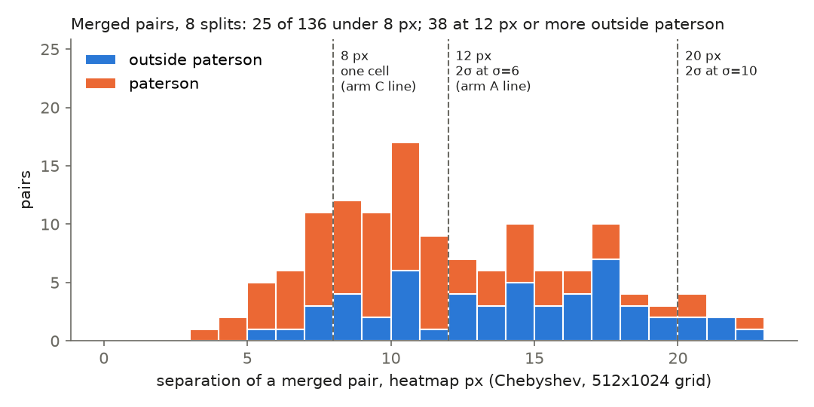
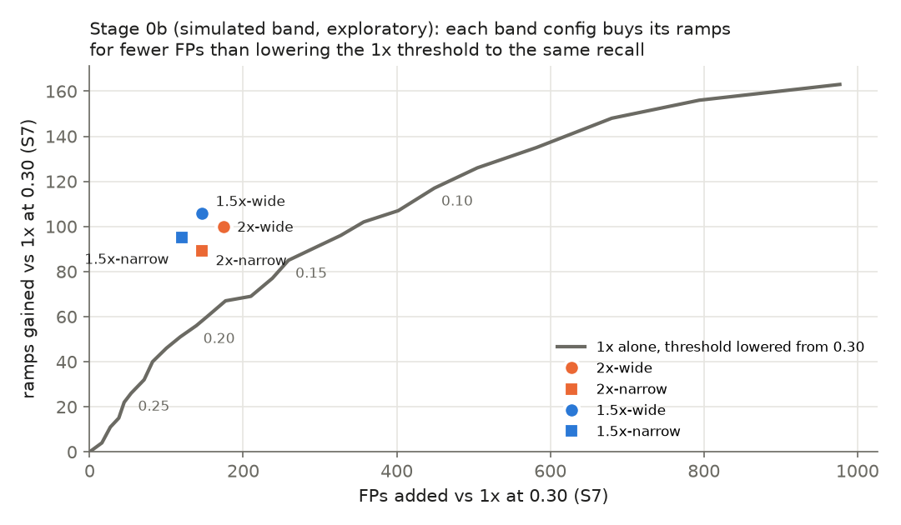

# Detector Phase 1, Stage 0: merged pairs and the horizon band (#263)

Issue [#263](https://github.com/ProjectSidewalk/RampNet/issues/263). This is Stage 0 of the plan
"Detector Phase 1 arms and an upscaled horizon-band pass" (`detector-phase1-horizon-2x-2026-11-15.md`,
section 4, revised after its review). The Phase 1 design is `docs/detector_phase1_263.md` on
`docs/detector-phase1-263` ([PR #270](https://github.com/ProjectSidewalk/RampNet/pull/270)).

**Run date:** 2026-11-15. **Scripts:** `scripts/analysis/merged_separation_263.py` (0a) and
`scripts/analysis/horizon_band_263.py` (0b; 0c written, not run). **Tests:**
`tests/test_merged_separation_263.py`, `tests/test_horizon_band_263.py`. **Outputs:**
`analysis_out/horizon_band_263/{merged_pairs,simulate}.{json,md}` and two figures in
`docs/figures/horizon_band_263/`. **Compute for the results:** CPU only, about 1 minute; committed
caches only, no network, no spend, so no ledger row.

| stage | status | binds? | verdict |
|---|---|---|---|
| 0a merged-pair histogram | run | yes: arm A and arm C triggers | **arm C not triggered** (25 of 136 pairs under 8 px, 18%); **arm A runs** (38 pairs at 12 px or more outside paterson, at least 30 needed) |
| 0b band simulation | run | no (exploratory) | every band config beats the matched-recall threshold; F1 against the 1x pass is not above zero under the standard scorer; leave-one-split-out picks the **narrow** core on 7 of 7 splits at both scales |
| 0c real strips on the A40 | script written, **not run** | yes: the binding gate | — |

## 0a. Merged pairs

A merged miss (`miss_taxonomy.py`, #46) is a missed ramp whose in-radius peak at 0.30 went to a
neighbouring ramp. The plan's rules: more than one third of the pairs under 8 px triggers arm C (the
stride-16 head); arm A (sigma 10 to 6) runs only if at least 30 pairs outside paterson are 12 px or
more apart. Pixels are heatmap px on the 512×1024 grid.

| pool | metric | pairs | under 8 px | share | arm C | at 12 px or more, outside paterson | arm A |
|---|---|---|---|---|---|---|---|
| 8 splits (US_SPLITS minus juneau) | Chebyshev | 136 | 25 | 0.184 | not triggered | 38 | **runs** |
| 8 splits | Euclidean | 136 | 17 | 0.125 | not triggered | 44 | **runs** |
| S7 (context) | Chebyshev | 124 | 24 | 0.194 | — | 31 | — |
| the plan's 9 splits (quoted, not re-read) | Chebyshev | 146 | 25 | 0.171 | not triggered | ≥ 38 | runs |

Both metrics give the same verdicts. Paterson holds 80 of the 136 pairs, and 20 of the 25 under 8 px.
Adding juneau back can only add pairs, so the 8-split arm A count of 38 is a lower bound on the
9-split count. The S7 recount matches the committed `analysis_out/miss_taxonomy.json` (124 pairs, 78
above `min_distance`); the script asserts this.



## 0b. Band simulation (exploratory, binds nothing)

The band is simulated from committed full-pano caches (#196): the in-core peaks of `u4096` (2×,
upsampled) or `r3072` (1.5×, real pixels where the native image has them) are merged into the 1×
`r2048` peaks at 0.30 by #197's seam-wrapped `dedupe`. Splits: S7 (richmond, annapolis, clovis,
morgantown, bend, paterson, gainesville). Intervals: paired pano bootstrap, stratified by split,
2,000 draws, pooled (micro) counts as in the plan's table. The matched-recall baseline is the highest
1× threshold whose recall reaches the band's (#197's definition). These splits chose the band
(review finding 2), so none of this is a test.

**S7 at 0.30, far unmatched detections as FPs (the standard scorer).** 1× alone: P 0.8928, R 0.7961,
F1 0.8417.

| config | F1 | ramps gained | FPs added | ΔR | ΔF1 | matched 1× threshold | its FPs added | band − matched ΔF1 |
|---|---|---|---|---|---|---|---|---|
| 2x-wide (0.45–0.60) | 0.8343 | +100 | +174 | +0.049 [+0.039, +0.059] | −0.007 [−0.015, +0.001] | 0.12 | +357 | +0.035 [+0.025, +0.044] |
| 2x-narrow (0.47–0.56) | 0.8369 | +89 | +146 | +0.043 [+0.034, +0.053] | −0.005 [−0.013, +0.003] | 0.14 | +296 | +0.029 [+0.020, +0.039] |
| 1.5x-wide | 0.8416 | +106 | +146 | +0.051 [+0.042, +0.061] | −0.000 [−0.008, +0.008] | 0.11 | +402 | +0.049 [+0.039, +0.058] |
| 1.5x-narrow | 0.8439 | +95 | +120 | +0.046 [+0.037, +0.056] | +0.002 [−0.005, +0.010] | 0.13 | +327 | +0.040 [+0.031, +0.050] |

**The same, with unmatched detections beyond 25 m ignored (upper bound).** 1× alone: F1 0.8460.

| config | F1 | FPs added | ΔF1 | band − matched ΔF1 |
|---|---|---|---|---|
| 2x-wide | 0.8525 | +105 | +0.006 [−0.001, +0.014] | +0.041 [+0.031, +0.051] |
| 2x-narrow | 0.8553 | +77 | +0.009 [+0.002, +0.017] | +0.037 [+0.027, +0.046] |
| 1.5x-wide | 0.8561 | +96 | +0.010 [+0.003, +0.018] | +0.051 [+0.041, +0.060] |
| 1.5x-narrow | 0.8585 | +70 | +0.013 [+0.006, +0.019] | +0.044 [+0.034, +0.053] |

The ramps gained and FPs added reproduce the plan's scratch table exactly (100/174/357, 89/146/296,
106/146/402, 95/120/327); `tests/test_horizon_band_263.py` pins them. Every config beats the
matched-recall threshold by an interval above zero under both bounds, but against the 1× pass at
0.30 only the ignore bound gives an F1 gain. The two bounds give different readings of F1 against
base. That is the case where the plan schedules a 100-detection far-field audit, but only at 0c and
only if the bounds disagree there.

**Leave-one-split-out choice between the cores.** For each held-out split, the core with the higher
pooled F1 at 0.30 (FP bound) on the other six was chosen; ties would go to wide. **Narrow won on all
seven, at both scales**, by 0.002 to 0.004 F1 each time. The LOSO-assembled result is therefore
identical to the narrow rows above. Stage 0c still tests the wide 1.5× strip first, as the plan
fixes; the narrow strip runs beside it.

**By imagery (context, FP bound).** Mapillary4 (richmond, annapolis, clovis, morgantown) gains 37
ramps for 107 FPs at 2x-wide (ΔF1 −0.022 [−0.033, −0.011]) and 45 for 94 at 1.5x-wide (−0.013
[−0.024, −0.002]). GSV3 (bend, paterson, gainesville) gains 63 for 67 at 2x-wide (+0.009 [−0.003,
+0.021]) and 61 for 52 at 1.5x-wide (+0.014 [+0.002, +0.026]). Without paterson, S7 gains 78 for 136
at 1.5x-wide (ΔF1 −0.007 [−0.017, +0.002]). laurens_mapillary, reported only, gains 5 ramps for 1 FP
in every config (it has 9 of 249 GT ramps beyond 25 m).

**S7 misses at 0.30 by flat-ground range, 1.5× (scorer definition: a GT ramp the 1:1 greedy match
leaves unmatched).**

| range | GT | misses | recovered by the full 1.5× pass | by the wide band | by the narrow band |
|---|---|---|---|---|---|
| 0–8 m | 452 | 46 | 1 | 0 | 0 |
| 8–18 m | 908 | 132 | 30 | 22 | 10 |
| 18–25 m | 395 | 85 | 30 | 25 | 24 |
| ≥ 25 m | 300 | 153 | 69 | 64 | 64 |
| at/above horizon | 5 | 4 | 2 | 2 | 2 |

All 132 misses at 8–18 m have their GT row inside the wide core and 55 inside the narrow one, which
is where the wide core's extra ramps come from. The 2× table, the per-split rows and the plan's
approximate miss counts (43/87/51/112, recovered 1/18/13/59, all reproduced) are in `simulate.md`.



## 0c. Real strips on the A40 (written, not run)

`horizon_band_263.py extract | calibrate | report`, or all three in order with `run0c`. Jon, or a
later session that Jon clears, runs it on makelab2:

```bash
python scripts/analysis/horizon_band_263.py run0c --panos-root /path/to/RampNet
```

`--panos-root` is a RampNet checkout holding `benchmark/<split>/panos/` for S7, sao_paulo,
manual_gold, juneau and bayonne; `extract` checks that every pano is present before it touches the
GPU. Expected cost, from the #196 timings: about 3 to 4 GPU-h. The 1× pass and the full-pano 1.5×
and 2× passes on S7's 859 panos dominate it. `run0c` resumes: a split whose cache exists is skipped.

**What `run0c` does, in order:**

1. `extract --splits selection` (S7 + sao_paulo). For every pano it runs the 1× pass; each strip
   (1.5x-wide, 1.5x-narrow, 2x-wide); and, on S7 only, the full-pano pass at 1.5× and 2× with the
   same input/4 head and scaled `min_distance` (15, 20). It records GPU-side seconds (copy, forward,
   peak extraction) and peak memory per pass, and appends `paid: false` rows to
   `analysis_out/usage_log.jsonl`.
2. `calibrate` freezes the context rule (S7) and the band thresholds (sao_paulo) into
   `analysis_out/horizon_band_263/calibration.json`.
3. If the context rule fails for 1.5x-wide, `run0c` **stops** and the held-out splits stay unread.
4. Otherwise it runs `extract --splits heldout --heldout-read-once`. Each held-out cache records the
   sha256 of the calibration it was read under.
5. `report` writes `gate_0c.json` / `gate_0c.md`.

Then commit the caches, `calibration.json` and the gate files, and confirm with
`calibrate --check` and `report --check`.

**The strip.** The production image is the 2048×4096 pano (`threshold_sweep.PRE`), upsampled
bicubic as #196's u4096 was. From it, `extract` cuts the rows around the core, adds 128 px of
circular wrap each side (192 px at 1.5×), and runs the forward pass with the head's Upsample set to
input/4. Only peaks in the core rows and the unwrapped columns are kept, mapped to pano coordinates
on the full-pass grid, and merged by #197's `dedupe`. The window is aligned to the backbone's
stride-32 grid, so its interior features equal the full pass's and the context check measures
context alone (see amendment 4):

| config | 1× rows (normalized) | strip input | heatmap | `min_distance` | MP |
|---|---|---|---|---|---|
| 1.5x-wide (tested first) | 0.3750–0.6562 | 864×6528 | 216×1632 | 15 | 5.64 |
| 1.5x-narrow | 0.4062–0.6250 | 672×6528 | 168×1632 | 15 | 4.39 |
| 2x-wide | 0.3984–0.6562 | 1056×8704 | 264×2176 | 20 | 9.19 |

**Rules, as the plan states them and as the script reads them:**

- **Context, S7.** The reference is every full-pass peak at 0.30 or more in the core. A peak counts as
  reproduced when a strip core peak lies within the match radius (1:1, seam-wrapped). The rule needs
  ≥ 95% reproduced and |median score shift (strip − full)| < 0.05. A stricter reading also requires
  the strip peak to reach 0.30; it is reported, but it is not the rule.
- **Calibration, sao_paulo.** 1× and strip peaks in the core are paired 1:1, closest first, within
  the radius; a pair counts when either score reaches 0.30. A band threshold is set if |median shift|
  > 0.03, or if strip and 1× in-core precision at 0.30 differ by more than 0.05. When set, it is the
  lowest 0.01-grid threshold at which the strip's in-core precision reaches the 1× in-core precision
  at 0.30. If no grid threshold reaches it, the config cannot be calibrated and its gate is FAIL.
- **Gate, manual_gold (binding for 1.5x-wide).** Three conditions, each on a paired bootstrap
  interval: the recall gain is above zero; band minus matched-recall threshold F1 is above zero (an
  unreachable matched threshold counts as not beaten, as in #197); F1 against the 1× pass is not
  wholly below zero. All three must hold under both bounds: unmatched detections beyond 25 m (or at or
  above the horizon) scored as FPs, and dropped. The same bound applies to every arm being compared.
  Fail: the band is dropped for the shipped weights and kept only as a read for arm B.
- **Open rig, juneau + bayonne pooled.** The recall gain must be at least +0.02 with an interval
  above zero; otherwise the band is not offered for open sources.
- **Cost.** The GPU-side multiple is (1× + strip) / 1×, pooled over every 0c cache. The limit is 1.75×
  (Jon's to change). The 2× strip also needs the limit lifted and must gain at least 1.25 times the
  1.5× strip's ramps on manual_gold.

**Held-out protocol in code.** `simulate` reads no held-out split; no upscaled cache exists for them.
`extract` refuses a held-out split in each of these cases:

- `--heldout-read-once` is missing;
- it is mixed with selection splits;
- `--limit` or `--force` is given;
- `calibration.json` is absent or from a `--smoke` calibrate;
- the context rule failed for 1.5x-wide (`--despite-failed-context` overrides; Jon's call);
- its cache already exists.

`report` refuses a held-out cache whose recorded calibration sha256 differs from the current
`calibration.json`. `tests/test_horizon_band_263.py` covers each refusal. It also runs calibrate and
report end to end on synthetic caches.

**What was verified locally, and what was not.** The extract path ran end to end on one pano each of
richmond and sao_paulo, into a scratch cache root that is not committed. On that one richmond pano,
every full-pass core peak at 0.30 was reproduced by the strip at the same heatmap pixel (median
offset 0 px). That shows the geometry is right; it is not a result. The run used the local RTX 3070,
not the CPU as intended (see Deviations). Not verified: A40 time and memory, and every 0c number.

## Amendments (choices the plan left open, made before any 0c data exists)

1. **0a pool.** The plan names the 9-split pool. juneau is held out until 0c, so it was not read; the
   pool is the other eight. The plan's own 9-split arm C figure (25 of 146) is quoted. Both pools give
   the same verdicts, and arm A's count can only grow with juneau.
2. **0a metric.** "Under 8 px" is Chebyshev in `miss_taxonomy.py`. The plan does not name a metric for
   "12 px or more apart", so both rules were evaluated under both metrics. They agree.
3. **0b misses.** The plan's range and split counts used an approximate test (any 1× peak within the
   radius). The doc's tables use the scorer's 1:1 match. The approximate figures are reproduced
   exactly in `simulate.md`.
4. **Strip size.** The plan's "rows 0.40–0.65 upsampled to 768×6144" is not on the stride-32 grid. A
   window off the grid changes the backbone's sampling phase, which would confound the context rule
   with a shift effect. The script uses the smallest grid-aligned window that keeps at least 0.05 of
   context: 864×6528 (5.64 MP, against the plan's 5.0 MP) for 1.5x-wide. That raises the plan's
   pixel-linear cost estimate from 1.6× to about 1.67×, still under 1.75×; 0c measures the real time.
5. **Context-rule reading.** Reference peaks at 0.30, reproduced at the score floor, |median shift|.
   The stricter reading (strip peak also at 0.30) is reported beside it. If the two readings
   disagree, 0c reports both.
6. **Calibration details.** Symmetric closest-first pairing (pairing on the 1× peaks above 0.30 alone
   would bias the shift downward); precision on in-core peaks of both passes; the threshold rule
   above.
7. **Far bound.** "Beyond 25 m" includes detections at or above the horizon (no ground range). The
   ignore bound drops only unmatched detections, so every TP and the recall are unchanged; the
   matched-recall threshold therefore does not depend on the bound.
8. **Stop before the held-out read.** The plan does not say what happens when the context rule
   fails. `run0c` stops before reading manual_gold, juneau and bayonne, so that their one read is not
   spent on a strip known to be unfaithful.
9. **0b pooling and LOSO criterion.** Micro-pooled counts, as the plan's 0b table; LOSO on pooled F1
   at 0.30 under the standard (FP) scorer, ties to wide.
10. **Seam.** The unwrapped full-pass heatmap can report a blob's tail at column 0 as an extra border
    maximum (`exclude_border=False`); the wrapped strip does not. It touches only peaks within a few
    px of the seam (about 0.2% of peaks, `seam_nms_248.md`), and it shows up, if at all, as a context
    shortfall.

## Deviations

- **The local GPU was used for about 3.5 minutes.** The extract smoke test was meant to run on the
  CPU via `CUDA_VISIBLE_DEVICES=""`. On Windows that empty value did not hide the GPU, so the test ran
  on the shared RTX 3070. Its peak memory (15.7 GiB for the full 2× pass) spilled into shared system
  memory. `nvidia-smi` had not been checked first. The GPU showed 1% use and no other compute process
  afterwards. The run used `--usage-log none`, so it has no ledger row, and nothing from it is
  committed. `extract --device cpu` now exists for smoke tests on a shared machine.

## Where each number lives

| number | file | key |
|---|---|---|
| 0a pairs, under 8 px, at 12 px or more, triggers | `analysis_out/horizon_band_263/merged_pairs.json` | `pool_8.triggers.{chebyshev,euclidean}` |
| 0a S7 context and cross-check | same | `context_S7`, `cross_check` |
| 0a per-pair separations and histogram | same | `pairs`, `pool_8.histogram` |
| 0b S7 and context pools, both bounds | `analysis_out/horizon_band_263/simulate.json` | `pools.<pool>.configs.<cfg>.{fp,ignore}` |
| 0b 1× base | same | `pools.<pool>.base.{fp,ignore}` |
| 0b LOSO choices | same | `loso.<scale>` |
| 0b misses by range | same | `misses_by_range.<scale>` |
| 0b per split, laurens_mapillary | same | `per_split`, `report_only` |
| plan's approximate counts | same | `scratch_reproduction` |
| 0c strip geometry | same | `protocol.strip_geometry_for_0c` |
| figure data (threshold frontier) | same | `threshold_frontier_S7` |

Every table in this doc is pasted from `merged_pairs.md` or `simulate.md`.

## What the plan says happens next

0c runs on makelab2 once Jon approves and starts it (plan section 9: 0c between 11-16 and 11-18, the
gate on 11-19). Its manual_gold gate is the binding read for the band; 0b binds nothing. For the
arms, rung 1 runs F (LR 3e-6, the control) first, then B (zoom), then A, which 0a now permits. C stays
unscheduled because 0a did not trigger it. Nothing past Stage 0 has been run.

## Reproduction

```bash
pip install -e . && pip install -r requirements-dev.txt

# 0a: histogram + triggers from analysis_out/op_cache (~1 s); --check writes nothing
python scripts/analysis/merged_separation_263.py
python scripts/analysis/merged_separation_263.py --check

# 0b: simulation from the committed #196 caches (~60 s, CPU); --check writes nothing
python scripts/analysis/horizon_band_263.py simulate
python scripts/analysis/horizon_band_263.py simulate --check
python scripts/analysis/horizon_band_263.py figures

# tests (~80 s, most of it the two drift guards)
python -m pytest -q tests/test_merged_separation_263.py tests/test_horizon_band_263.py

# both checks through the gate
python scripts/check_all.py --only merged_separation_263 --only horizon_band_263
```

Inputs: `analysis_out/op_cache/{richmond,annapolis,clovis,morgantown,bend,paterson,gainesville,laurens_mapillary}.json`
for 0a, and `analysis_out/input_res_sweep_25/cache/{r2048,r3072,u4096}/<S7 split and laurens_mapillary>.json`
for 0b. Their sha256 values are recorded in each output's `protocol.inputs`, and the #196 caches are
also covered by that directory's `SHA256SUMS` (`python scripts/analysis/input_res_sweep_25.py sums`).
The code is the commit on `analysis/horizon-band-263` that adds this file, on main `8d8d8eef`.
