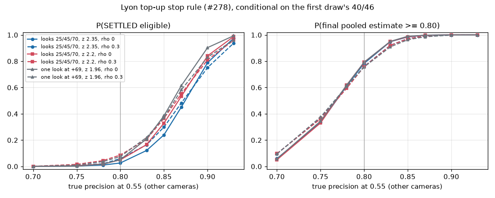

# Lyon label audit (#159, #263): are Lyon's self-labels good enough to train on?

**Status (2026-11-15): other-cameras top-up drawn and pre-registered, not reviewed (#278).** An 80-pano top-up of the other cameras group (`benchmark/lyon_topup278/`) is drawn, and its pooled rule and blind stop rule are committed before any pixel was fetched (section 11). A Lyon label build must now pass the top-up's cumulative never-train lists; the builder refuses otherwise (section 1).

**Status (2026-10-30): reviewed and scored.** Jon judged all 200 panos (export of
2026-10-27T16:34Z, `benchmark/lyon/verdicts.json`). All four groups are **eligible** at 0.55
(precision 0.83-0.95). Grand Lyon Ladybug and other cameras are flagged "not decisive". Recall
is low in every group (0.26), even for nearby ramps. Results are in section 10. The text below that
status, through section 9, is the pre-review plan and is kept as it was posted.

**Status (2026-10-20): ready for review, not reviewed.** The sample is drawn and committed, the
plan and the pass bar are written down (`benchmark/lyon/audit_plan.json`), the never-train lists
are committed, and the known-artifact counts are in. The 200 panos are staged and pinned
(`imagery_manifest.json`, digest `c4ae4b576b27eaba`), the overlays are measured
(`nadir_band.json`), and the gallery is built and checked (section 7). Nobody has judged a
detection. The plan, the pass bar and the group list are a **working draft**; Jon can
amend them until the review opens. They were first posted on #159 on 2026-10-20
([comment](https://github.com/ProjectSidewalk/RampNet/issues/159#issuecomment-6301107391)), and the
bar was simplified the same day after a re-review of PR 264 (section 3; the
[follow-up](https://github.com/ProjectSidewalk/RampNet/issues/159#issuecomment-6301627994) carries the new sha256 of `audit_plan.json`; `records.jsonl` is
unchanged). `bundle_provenance.json` → `posted` pins that version. `score` refuses any other plan or
sample, and refuses when the current code no longer rebuilds the committed plan. Lyon is not approved for training and nothing about it is
frozen.

Issue [#159](https://github.com/ProjectSidewalk/RampNet/issues/159) (decision of
[2026-10-06](https://github.com/ProjectSidewalk/RampNet/issues/159#issuecomment-6020299907)),
campaign [#263](https://github.com/ProjectSidewalk/RampNet/issues/263), track 2. The sampler is
sidewalk-auto-labeler [PR 167](https://github.com/ProjectSidewalk/sidewalk-auto-labeler/pull/167);
the run is sidewalk-auto-labeler [PR 163](https://github.com/ProjectSidewalk/sidewalk-auto-labeler/pull/163)
(`docs/panoramax-lyon.md` section 8 there).

## 1. What Lyon is for (Phase 0)

Lyon exists to answer whether this rig class's self-labels are good enough to train on, per rig
and producer. If Lyon trains, the same bundle later gives the in-city held-out read, **provided the
training-label builder honours the 30 m buffer below**. Without the buffer that read would score
ramps the model trained on.

**These panos never train.** Two committed lists define what is held out:

- `benchmark/lyon/ids.txt`: the 200 audited `panorama_id`s, sorted.
- `benchmark/lyon/exclude_ids.txt`: every run pano within **30 m** of an audited pano (haversine
  on the run's lat/lng; the audited panos included). That is **6,021** of the run's 174,405
  panos. At 5 m thinning, panos a few metres apart show the same ramps, so holding out the 200 ids
  alone would not hold out their ramps. The 30 m radius is the sampler's own spacing.

Nothing in this repo enforces the lists on its own. The builder in #266 is to require
`--benchmark-ids` for any city with a `benchmark/<city>/` directory, and it is to be given
`exclude_ids.txt`.

**Update (2026-11-15, #278).** The top-up (section 11) adds 80 audited panos and their buffer.
A Lyon label build must pass `--benchmark-ids benchmark/lyon_topup278/never_train_ids.txt
--exclude-ids benchmark/lyon_topup278/exclude_ids.txt` (both cumulative: 280 ids and 8,357 buffer
panos). `scripts/build_sparse_labels.py` now refuses a build whose lists miss the ids or the
buffer of any matching bundle that carries an `exclude_ids.txt`, so the first draw's two lists
alone are refused once the top-up directory exists.

- **Not a benchmark split.** Lyon stays training-only under #158's rule that a city trains or
  evaluates, never both. `benchmark/lyon/` is staged the way a split is so that the same tools
  review and score it, but it is not registered (`BENCHMARK_SPLITS`, `US_SPLITS`, `HELD_OUT`),
  enters no pooled number, and is not published to the Hub benchmark.
- **Why per rig and producer.** The 5 m run mixes a professional multi-camera rig (Grand Lyon's
  Point Grey Ladybug, 8192x4096, solid black below y ≈ 0.81) with consumer GoPro Max captures
  from many accounts. One account, ecartip, holds most of the 2026 GoPro Max panos, with a large
  roof rack, detections that sit lower in the frame, and pose reported as exactly 0/0. A pooled
  precision would let the largest producers decide what "GoPro Max" or "Ladybug" means.
- **Imagery tier, if it mattered:** the GoPro Max panos fall in `action-modern` like Bayonne's;
  the Ladybug panos have no tier because nothing on the board uses that rig. No `tier_of()`
  branch is added, because Lyon is not scored as a split.

## 2. The sample

`scripts/export_benchmark.py` with the new stratified mode, on the 5 m run of record
(`results.jsonl`, 174,405 records, sha256 `60e688b2…61ef`). Seed 159, 30 m spacing across all
strata, `top` 5 / `random` 170 / `empty` 25 = **200 panos**, the top of Jon's 150-200. The
`random` and `empty` targets are allocated across four groups in proportion to each group's pool,
with at least **30** `random` and 3 `empty` panos per group. The strata are defined at 0.55, as for
every split: `random` panos have at least one detection at 0.55, `empty` panos none. The records
carry the 0.55 detections only, the same instrument as every split (section 4).

**Why this split of the 200.** The bar is read per group on `random` + `empty`, and `top` is
excluded from it. In the first draw (`top` 10, floor 20), the 10 `top` panos carried 86 of the 330
detections at 0.55, budget that informs no group's bar. Here `top` is the usual 5 (45 detections),
and the larger floor moves panos into the two small groups, which were the hardest to read
(section 3). The exporter refuses a floor that would push the draw past its target
(sidewalk-auto-labeler PR 167), so the 200 is exactly what was asked for.

The four groups are the four strata of Jon's decision. `benchmark/lyon/group_map.json` maps
`camera_model|copyright` to them (first match wins):

- **`grand_lyon_ladybug`**: Grand Lyon 8192x4096, both account spellings (`grand lyon`,
  `grand-lyon`), the Point Grey Ladybug panos and the make-less panos of the same Métropole
  campaign.
- **`ecartip_gopro_max`**: ecartip's GoPro Max panos.
- **`other_gopro_max`**: every other account's GoPro Max panos.
- **`other_cameras`**: everything else (Kandao, Insta360, RICOH, Garmin, GoPro MAX2, the make-less
  10560x5280 bike-route captures, and the few Ladybug panos not from Grand Lyon).

**Group table** (`python scripts/analysis/lyon_review_159.py table`, from `audit_plan.json`):

| group | run panos with a 0.55 detection / without | top | random | empty | detections ≥ 0.55 (random) | stored peaks ≥ 0.30 (random + empty) |
|---|---:|---:|---:|---:|---:|---:|
| grand_lyon_ladybug | 17,089 / 69,151 | 4 | 59 | 12 | 107 | 172 |
| ecartip_gopro_max | 14,576 / 30,829 | 1 | 51 | 5 | 87 | 167 |
| other_gopro_max | 7,710 / 25,654 | 0 | 30 | 5 | 50 | 84 |
| other_cameras | 1,513 / 7,883 | 0 | 30 | 3 | 49 | 80 |
| **all** | 40,888 / 133,517 | **5** | **170** | **25** | **293** | **503** |

With the 5 `top` panos the reviewer judges **338 detections**. The run's stored peaks for these
panos (`analysis_out/lyon_review_159/run_peaks.json`, ≥ 0.10) give the 0.30 read without showing
it (section 4). They are kept outside `benchmark/lyon/`, so the bundle the reviewer opens holds only
what the gallery shows.

**Inside each group** (all strata; `rig_breakdown` in `audit_plan.json`; descriptive, no bar):

- `grand_lyon_ladybug`, 75 panos: 41 tagged Point Grey Ladybug (2020 16, 2021 2, 2022 23), 34
  make-less (2020 18, 2021 7, 2022 3, 2023 6). 65 from `grand lyon`, 10 from `grand-lyon`.
- `ecartip_gopro_max`, 57 panos: 50 from 2026, 7 from 2025.
- `other_gopro_max`, 35 panos from 11 accounts; the largest are `mike en gyroroue` 9,
  `ign_ddc_dtce_np` 6 and `trucbidule` 6.
- `other_cameras`, 34 panos: 12 Kandao QooCam 3, 6 Insta360 X3, 6 make-less 10560x5280 (one
  bike-route account), 5 Garmin VIRB 360, 2 RICOH THETA S, 1 Insta360 X5, 1 GoPro MAX2.

So the long-tail group mixes seven cameras with 1-12 panos each. Its precision speaks for "the
tail as a whole", not for any one camera in it.

**Producer credit.** 167 panos are on `panoramax.ign.fr` (Etalab 2.0) and 33 on
`panoramax.openstreetmap.fr` (CC BY-SA 4.0). Each record carries its producer and licence.
`stage` masks email-shaped tokens in every file it writes (#149); this draw contains none, so the
committed `records.jsonl` is byte-identical to the exporter's.

## 3. The pass bar (draft, posted on #159 before the review)

- **Metric:** precision of the detections at confidence ≥ 0.55, the shipped threshold, the
  detections the reviewer judges.
- **Read on:** each group's unbiased subset (`random` + `empty`; the `top` panos are excluded, as
  for every split). `empty` panos carry no 0.55 detection, so at 0.55 this is the `random` stratum.
- **Eligibility:** a group is eligible for a Lyon training pool when its **point estimate is
  ≥ 0.80**, the #158 build line. Below 0.80 it is not eligible.
- **Two intervals, reported beside it:** the 95% percentile interval of a **pano bootstrap**
  (10,000 resamples of the group's `random` panos with replacement, seed 159; detections on one
  pano are not independent, 107 detections on 59 Ladybug panos) and the 95% **Wilson** interval
  over detections.
- **Decisive or not, as information for Jon.** A reading is decisive when both intervals sit on
  the point estimate's side of 0.80. If either contains 0.80, `score` flags it "not decisive" and
  prints how many more `random` panos a top-up draw would need at the same point estimate. It caps
  that at the group's remaining pool, and gives no number when the estimate is within 0.01 of the
  bar. "Not decisive" is not a third outcome and carries no consequence of its own.
- **Decisive fail:** both upper bounds below 0.80. The group is excluded from any Lyon training
  pool.
- **The `all` row** is reported with no verdict. The floors over-sample the small groups
  (`other_cameras` is 18% of `random` against 3.7% of the run's detection panos), so the pool is
  not a city rate.
- **Reported alongside, with no bar:** recall at 0.55; precision and recall at 0.30 (section 4);
  unsure and duplicate counts; per-rig rows inside each group.
- **Duplicates:** of two detections on one ramp, the lower-confidence one is the `duplicate`
  (records list detections by confidence, so it is the later one). It counts as a false positive,
  the `rampnet.validation` default; `--lenient-duplicates` gives the other reading.

**Why the rule changed after it was first posted.** The first post made a not-decisive reading a
third outcome that kept a group out of the first retrain, with the bootstrap interval as the test.
The re-review of PR 264 measured that at these sizes the percentile bootstrap is the more
**lenient** of the two: on the real per-pano detection counts at p ≈ 0.87, its lower bound sat
0.01-0.03 **above** Wilson's (ecartip 0.798-0.810 against 0.788; `other_cameras` 0.773-0.783
against 0.758). The first version of this section said the opposite. So the bar is now the
point estimate, as the #158 build line is, and both intervals are shown beside it.

**How decisive this can be.** The Wilson interval is decisive only outside these point estimates:
107 detections (`grand_lyon_ladybug`) ≥ 0.879 or ≤ 0.720; 87 (`ecartip_gopro_max`) ≥ 0.885 or
≤ 0.713; 50 (`other_gopro_max`) ≥ 0.920 or ≤ 0.680; 49 (`other_cameras`) ≥ 0.918 or ≤ 0.673. The
bootstrap is usually a little less strict. Bayonne read 0.785 and laurens_mapillary 0.863, so a
"not decisive" flag is likely on some groups.

`python scripts/analysis/lyon_review_159.py score` computes all of this from `verdicts.json`. It
refuses to run before that file exists. It also refuses when `audit_plan.json` or `records.jsonl`
differs from the posted sha256, when the current code no longer rebuilds the committed plan byte
for byte, and when a non-top pano is missing, misaligned or partly judged. `--partial` and
`--allow-unposted-plan` override these, and `score.json` records that they were used.

## 4. What the reviewer sees

The standard ground-truth gallery (`scripts/gt_gallery.py`, `benchmark/RUBRICS.md` §1), the same
instrument as every split, with one difference: **the producer is hidden.** The gallery is built
with `--hide-credit`, which drops the producer credit and the link to the pano's Panoramax page
(which names it). The stratum name is never shown. The rig is still visible in the pixels (the
Ladybug's black nadir, ecartip's roof rack), so this blinds the reviewer to the account, not to
the camera.

- **Only the 0.55 detections are shown**, as in every split. Judge each one, then mark every ramp
  with no detection as missed. The 0.30 tier is read the standard way: `score` matches the run's
  stored peaks ≥ 0.30 (`analysis_out/lyon_review_159/run_peaks.json`) to the ground truth
  built from the verdicts
  (`rampnet.detection_eval`, as `attach-gt` does for an op_cache). A sub-threshold peak on a ramp
  the reviewer marked as missed counts as a true positive at 0.30. Showing the 0.30 crops instead
  is an option Jon can switch on: re-export with `--record-confidence 0.30` (same seed, same 200
  panos; the draw does not depend on the record tier), about 1.6x the detections to judge.
- **Nadir overlays are named.** `nadir_band.json` carries each pano's measured edge and a label;
  the gallery hatches the region, labels it, and asks before a missed-ramp mark lands inside it.
  86 of the 200 panos carry one:
  - **black nadir (no camera)**, 76: all 75 Grand Lyon panos (top edge y 0.818-0.820; the rig has
    no downward camera) and one IGN GoPro Max pano with a thin black strip at y 0.967;
  - **nadir logo band**, 10: the "La Voie Bleue" bike-route logo on the 6 make-less 10560x5280
    panos (y 0.873) and a navy "la ville a velo" logo on 4 GoPro Max panos from two accounts
    (y 0.840-0.842).

  The black nadirs are found by the rule in `band`. The two logos were found by eye on a contact
  sheet of the bottom 31% of all 200 panos (claude-opus-5-5, 2026-10-20), and their edges are
  measured by `logo_band_top`. An overlay of the measured lines on sample panos sat on each edge.
  ecartip's roof rack and the car bodies on other rigs are real imagery, not overlays: they are
  not hatched, and ramps hidden by them cannot be marked.
- **Resolution.** #263 asks for the gallery "at native resolution". The protocol renders every
  pano and crop at the **model's input resolution** (4096x2048, crops 512x512 cut from it), never
  at native (5376 to 11904 wide here), so the reviewer sees what the model saw
  (`docs/adding_a_benchmark_city.md`, "Never review at native resolution"). The check before the
  review is that nothing is downsampled further than that.

**Rubric.** `benchmark/RUBRICS.md` as for every split, including the 2026-10-04 ruling that a
bike-lane cut is not a curb ramp, and the duplicate rule in section 3. From the Bayonne review:
French lowered kerbs at crossings are often a plain lowering with a white-painted kerb face and no
flare, sometimes with tactile paving, and they count; driveway and garage lowerings do not.

**Before you start, do not open** `analysis_out/lyon_review_159/run_peaks.json` or
`analysis_out/lyon_review_159/artifacts.json`'s `items` list. Both name places you are about to
judge. The counts below are the part meant to be read first.

## 5. Known artifacts to look at

Both from #159's decision comment, counted on the run's stored peaks for the 200 panos
(`analysis_out/lyon_review_159/artifacts.json`, from the run's `results.jsonl`, no ground truth;
all strata, so `top` is included):

| group | stored peaks ≥ 0.30 / ≥ 0.55 | in a fixed-pixel cell, ≥ 0.30 / ≥ 0.55 | above the horizon (y < 0.5), ≥ 0.30 / ≥ 0.55 |
|---|---:|---:|---:|
| grand_lyon_ladybug | 214 / 143 | 7 / 3 | 2 / 1 |
| ecartip_gopro_max | 177 / 96 | 3 / 2 | 23 / 13 |
| other_gopro_max | 84 / 50 | 0 / 0 | 2 / 1 |
| other_cameras | 80 / 49 | 0 / 0 | 1 / 0 |

- **The Grand Lyon fixed-pixel cluster.** A "fixed-pixel cell" is a 1024x512 heatmap cell that
  holds a ≥ 0.30 peak in at least 5 panos of the pano's own sequence. On the first 10 m slice,
  2.1% of Grand Lyon's 0.30 detections sat in such cells, mostly at (x 0.503, y 0.756), straight
  ahead just above the black nadir, and none reached 0.55. Here 7 Grand Lyon peaks sit in one, 3
  of them ≥ 0.55. Why some now reach 0.55 is **not measured**; a 5 m sequence has about twice the
  panos of a 10 m one, which would make more cells repeat, but nobody has checked that this is the
  cause. Only the ≥ 0.55 ones are in front of the reviewer. A random sample shows only a few, so
  the review alone cannot say how often the cluster is a vehicle part rather than a ramp. If that
  matters for mining from the 0.30 tier, it needs a targeted look (section 9).
- **ecartip above the horizon.** 13 of ecartip's 96 peaks at 0.55 in the bundle sit above the
  horizon (13.5%), against 10.3% in the first 10 m slice. ecartip reports pose as exactly 0/0, so
  its panos may not be levelled. These detections are judged like any other; a ray cast from them
  hits no ground, which matters for geometric mining whatever the verdict.

## 6. Caveats that travel with the numbers

- **Single rater, one pass.** The audit has one reviewer. The verdicts are per-rater and the rubric
  is `benchmark/RUBRICS.md`, so a second rater can repeat the pass on the same list.
- **Partial blinding.** The account is hidden but the rig is not, and the reviewer knows the four
  groups exist. Whether this changes how detections are judged is not measured.
- **Precision at 0.30 is a lower bound.** The reviewer marks missed ramps by scanning the whole
  pano, but a ramp nobody marked scores a sub-threshold peak on it as a false positive. This is
  the #55 GT-completeness effect every split has; a #55 tag pass on the 0.30-0.55 peaks would
  correct it and is not planned.
- **Strata weights.** The pooled `all` row mixes groups at the floors' proportions and `random`
  and `empty` panos at the sample's (170 to 25), not the run's (about 1 to 3). Read the per-group
  rows; `all` carries no verdict.
- **The seam.** The production extractor drops peaks within 10 heatmap cells of the 360 seam
  (`detection_border: exclude`, sidewalk-auto-labeler#130). The bundle's detections are what Lyon
  would contribute to training, so a ramp at the seam with no detection is a miss, as in Bayonne.
- **Mount and district are confounded with producer.** A group that fails says its labels are not
  good enough to train on; it does not say why.

## 7. Start the review

The review runs from the PR #264 worktree, where the panos are staged (they are git-ignored, so
another checkout has to copy `benchmark/lyon/panos/` and `index.csv` from it, or redo step 1):

```bash
cd D:/Git/RampNet-wt/lyon159
python scripts/gt_gallery.py benchmark/lyon --hide-credit     # already built; re-running is safe
# open benchmark/lyon/gallery/index.html, review, "Export verdicts",
# save the download (lyon_verdicts.json) as benchmark/lyon/verdicts.json
# after the review:
python scripts/analysis/lyon_review_159.py score --write
```

**How the imagery was staged** (2026-10-20):

```bash
# 1. on makelab2, from /projects/makeabilitylab/sidewalk-auto-labeler/runs/lyon/: a tar of only
#    the 200 panos in benchmark/lyon/ids.txt plus their rows of the archive's index.csv
#    (950,138,880 bytes); copied here and unpacked into benchmark/lyon/panos/; the rows saved
#    as benchmark/lyon/index.csv (both git-ignored). All 200 match the archive's sha256.
# 2. pin the imagery and measure the overlays
python scripts/analysis/imagery_manifest.py --write --cities lyon --panos-root .
python scripts/analysis/lyon_review_159.py band --write
python scripts/analysis/lyon_review_159.py verify             # verify: OK
```

**What was checked on the instrument before handing it over:**

- **Resolution.** All 200 full panos render at 4096x2048 and all 338 crops at 512x512 cut from
  that image. That is model resolution, as for every split, and nothing is downsampled further.
- **Heading and seam.** The gallery does not rotate panos and draws each detection at the record's
  normalized x, y. On a contact sheet of 16 crops (two at the seam, x 0.980 and 0.987) the marker
  sits on a kerb, crossing or footway corner in each. Crops at the seam are clamped to the image
  edge, as in every split.
- **Blinding.** No entry carries a producer credit or a pano link, and no producer name or
  Panoramax URL appears in `index.html`.
- **Overlays.** 86 entries carry a hatched band: 76 "black nadir (no camera)" and 10 "nadir logo
  band".

## 8. Reproduce

```bash
# in sidewalk-auto-labeler, branch lyon-review-bundle-159 (PR 167), the 5 m run's results.jsonl:
python scripts/export_benchmark.py runs/lyon/results.jsonl --bundle <dir> \
    --sample 175 --empty-sample 25 --seed 159 --min-spacing 30 --top 5 \
    --group-key camera_model --group-key copyright --group-map <dir>/group_map.json \
    --group-min 30 --empty-group-min 3 --records-only
# here (<dir>/group_map.json is benchmark/lyon/group_map.json):
python scripts/analysis/lyon_review_159.py stage --from <dir> --results runs/lyon/results.jsonl
python scripts/analysis/lyon_review_159.py plan          # recomputes, compares the committed bytes
python scripts/analysis/lyon_review_159.py artifacts --results runs/lyon/results.jsonl
python scripts/analysis/lyon_review_159.py verify --records-only
pytest -q tests/test_lyon_review_159.py
```

The draw is deterministic: re-running the exporter from the committed code reproduced
`records.jsonl` byte for byte (`bundle_provenance.json`). The run's `results.jsonl` (798 MB) is not
in either repo: it is on Hyak, on makelab2 and in the labeler worktree `D:/Git/labeler-wt/lyon5m`,
and `bundle_provenance.json` pins its sha256. A first draw (`top` 10, floor 20, 0.30 crops shown)
was replaced on 2026-10-20 after review, before anyone reviewed it.

## 9. Not done, and decisions for Jon

- **The review itself.** Nothing is judged; there is no `verdicts.json`.
- **Review load.** 200 panos and 338 detections, against Bayonne's 125 and 147. Showing the 0.30
  crops too would be about 1.6x that.
- **Group sizes.** Even at a floor of 30, the two small groups are decisive on Wilson only at a
  point estimate of about 0.92 or above (or 0.68 or below). Eligibility is the point estimate; a
  "not decisive" flag is shown beside it for you to weigh, with a top-up size from `score`.
- **The fixed-pixel cluster** needs a targeted look if the 0.30 tier is to feed mining (section 5).
  Not built.
- **Per-producer caps on training** (#159 decision, point 2) are a training-side step, not part of
  this audit.

## 10. Results (review exported 2026-10-27, scored 2026-10-27, elevation split 2026-10-30)

Jon reviewed all 200 panos in one pass. `score` ran against the posted plan (`plan_posted: true`,
`partial: false`). Five `top` panos are excluded as planned, so 195 are scored. Files:
`benchmark/lyon/verdicts.json` (the export, byte for byte; the 38- and 104-pano partial exports are
in `verdicts_backups/`) and `analysis_out/lyon_review_159/score.json`.

### Precision against the bar (unbiased subset)

| group | panos | P@0.55 | bootstrap 95% | Wilson 95% | reading | R@0.55 | P@0.30 | R@0.30 |
|---|---:|---:|---|---|---|---:|---:|---:|
| Grand Lyon Ladybug | 71 | 0.83 (84/101) | 0.75-0.90 | 0.75-0.89 | eligible, not decisive | 0.27 (84/317) | 0.75 | 0.39 |
| ecartip GoPro Max | 56 | 0.95 (75/79) | 0.90-0.99 | 0.88-0.98 | eligible (decisive) | 0.26 (75/288) | 0.70 | 0.39 |
| other GoPro Max | 35 | 0.94 (45/48) | 0.88-1.00 | 0.83-0.98 | eligible (decisive) | 0.27 (45/165) | 0.73 | 0.37 |
| other cameras | 33 | 0.87 (40/46) | 0.75-0.96 | 0.74-0.94 | eligible, not decisive | 0.26 (40/151) | 0.78 | 0.39 |
| all (no verdict) | 195 | 0.89 (244/274) | 0.85-0.93 | 0.85-0.92 | — | 0.26 (244/921) | 0.74 | 0.39 |

- **Every group clears 0.80 on the point estimate**, so under the posted rule all four are
  eligible for a Lyon training pool. None is a decisive fail.
- **"Not decisive"** means an interval contains 0.80. `score` sizes a top-up draw that would
  settle it. Grand Lyon needs about 364 more random panos and other cameras about 69. Neither has
  been drawn, and whether to draw them is Jon's call.
- **Recall is the problem, not precision.** About a quarter of the ramps Jon marked are found
  at 0.55, and 0.39 at 0.30, the same in every group. For training this means Lyon's self-labels
  are mostly correct where they exist, but **most ramps carry no label**. A pano used as training
  data would teach "no ramp here" at about three of every four ramps unless the loss is masked
  (the `--loss-mask` path of #266) or only positives are used.
- The 158 missed marks Jon flagged "unsure" are reported and never counted against recall.

### Is the low recall far-field? Recall at 0.55 by degrees below the horizon

`python scripts/analysis/lyon_review_159.py elevation` splits the same 0.55 recall pool by how far
below the horizon each true detection or missed mark sits. Distances label the bands for a level
camera 2.5 m up; they are not measured. A GoPro on a helmet or a car roof sits at a different
height, which moves the distances but not the angles.

| below horizon | ~distance | level: TP / sure misses / unsure | level R | tilt-corrected: TP / sure / unsure | corrected R |
|---|---|---|---:|---|---:|
| above the horizon | — | 13 / 62 / 12 | 0.17 | 0 / 1 / 1 | — |
| 0-2° | > 72 m | 6 / 30 / 8 | 0.17 | 1 / 1 / 0 | — |
| 2-4° | 36-72 m | 4 / 52 / 29 | 0.07 | 1 / 37 / 31 | 0.03 |
| 4-6° | 24-36 m | 10 / 69 / 44 | 0.13 | 12 / 115 / 62 | 0.09 |
| 6-10° | 14-24 m | 50 / 145 / 35 | 0.26 | 56 / 229 / 48 | 0.20 |
| 10-20° | 7-14 m | 88 / 202 / 19 | 0.30 | 113 / 209 / 12 | 0.35 |
| > 20° | < 7 m | 73 / 117 / 11 | 0.38 | 61 / 85 / 4 | 0.42 |
| **within ~24 m (≥ 6°)** | | 211 / 464 | **0.31** [0.28, 0.35] | 230 / 523 | **0.31** [0.27, 0.34] |
| **within ~14 m (≥ 10°)** | | 161 / 319 | **0.34** [0.29, 0.38] | 174 / 294 | **0.37** [0.32, 0.42] |
| all | | 244 / 677 / 158 | 0.26 | same pool | 0.26 |

Brackets are pano-bootstrap 95% intervals (the "within" rows draw from all 195 pool panos, as
`score` does; a band draws from the panos with a ramp in it). Per-group rows are in the JSON files.

- **Far ramps are close to undetected.** Beyond about 24 m the model finds 7-17% of what Jon
  marked on the level reading and 3-9% tilt-corrected.
- **Dropping the far marks barely helps.** Within about 24 m recall is 0.31, and within about
  14 m it is 0.34 (0.37 tilt-corrected). Even under about 7 m the model misses about 60%.
- **So most of the recall deficit is near-field.** 464 of the 677 sure misses (69%) are within
  about 24 m on the level reading, and 523 (77%) tilt-corrected. Recall still rises with angle
  inside the near field (0.26, 0.30, 0.38 level), so image size matters too, but even the closest
  band misses most ramps, which points at what the ramps look like as well. Jon's notes on three panos describe it: Lyon kerbs "drop slightly at the
  crosswalks but there is still a lip", and some corners have "massive diagonal ramps" that he
  marked as two. Neither looks like the US ramps the model was trained on. **This is a hypothesis.**
  Three notes do not measure it, and no per-mark ramp-type tag exists to test it.
- **The tilt correction works as a check on itself.** The level reading puts 87 marks and
  detections above the horizon, which is impossible for a kerb. After undoing each pano's estimated
  pitch and roll, 2 remain. The corrected bands move marks mostly from "above" and 0-4° into 4-10°,
  which lowers far-field recall further and leaves the near-field reading about where it was.

**Tilt input.** The corrected column uses `analysis_out/pano_tilt/lyon.json` from PR #273 (branch
`analysis/pano-tilt-159`, written at commit 090cb4f and unchanged by that PR's review fixes;
sha256 recorded in `recall_by_elevation_tilt.json`). It accepts 193 of 200 panos. The 7 declined
panos are read as level. With #273 merged the file is in the tree, and this re-derives the
corrected file and compares its bytes (`check_all.py` entry `lyon_elevation_tilt_159`):

```bash
python scripts/analysis/lyon_review_159.py elevation --tilt analysis_out/pano_tilt/lyon.json
```

If `lyon.json` is ever regenerated, the recorded sha256 no longer matches and the check fails;
re-run `elevation --tilt ... --write` on the new file and update this section. How the tilt was
estimated and validated, and its caveats, are in [`pano_tilt_estimate.md`](pano_tilt_estimate.md).

### Reproduce the results

Everything below runs from a clean clone, on CPU, with no network and no imagery:

```bash
python scripts/analysis/lyon_review_159.py score       # recomputes score.json, compares its bytes
python scripts/analysis/lyon_review_159.py elevation   # recall_by_elevation.json, likewise
pytest -q tests/test_lyon_review_159.py
```

`score` and `elevation` need only committed files: `records.jsonl`, `verdicts.json`, `sample.json`,
`audit_plan.json`, `bundle_provenance.json`, `analysis_out/lyon_review_159/run_peaks.json`, and (for
`elevation`'s pool check) `analysis_out/lyon_review_159/score.json`. **Re-doing the review** also
needs the 200 panos, which are git-ignored. They are pinned by sha256 in `imagery_manifest.json`.
A copy is in the makelab2 run archive (`/projects/makeabilitylab/sidewalk-auto-labeler/runs/lyon/`,
backed up by CSE IT). Each record also carries its public Panoramax `hd_url`, and
`python scripts/analysis/pano_tilt_estimate.py fetch-lyon --out <dir>` downloads all 200 from
those URLs and checks every file against the manifest (on 2026-10-31 all 200 matched). Panoramax
may serve different bytes later, in which case the fetch fails instead of using them. The panos
are not on Hugging Face.

### Not done

- **The top-up draws** for Grand Lyon and other cameras. Jon decides whether "not decisive" is
  good enough. *Update 2026-11-15:* the other-cameras top-up is drawn and pre-registered, not
  reviewed (section 11); Grand Lyon is not drawn (a recommendation, Jon's call).
- **Ramp-type tagging of the missed marks** (lipped kerb vs. ramp; a diagonal ramp marked as one
  or as two), which would test the near-field hypothesis above.
- **A second rater.** The verdicts are single-rater. The item list and rubric are fixed, so a
  second pass can be compared directly.
- **No Lyon training has started.** Eligibility is necessary, not sufficient: the recall finding
  above changes how Lyon labels should enter a training pool.

## 11. Top-up for other cameras (#278): plan, not reviewed

**Status (2026-11-15): drawn, pre-registered and staged; not reviewed.** Issue
[#278](https://github.com/ProjectSidewalk/RampNet/issues/278). The draw, the pooled rule, the stop
rule and what each final reading means for training are in
`benchmark/lyon_topup278/audit_plan.json`, committed and pushed before any pixel of the draw was
fetched (`bundle_provenance.json` → `pre_registered`). Nothing under `benchmark/lyon/` changes.

**Imagery (staged 2026-11-15, after the plan was pushed).** The archive's `index.csv` was fetched
from makelab2 first; all 80 drawn ids are in it. One `sftp` batch then copied the first 70 in
review order (626,349,724 bytes). All 70 match the archive's sha256 (`stage-pixels`), so none was
dropped and the reserve is unused. They are pinned in `imagery_manifest.json` (digest
`3d293f7d2adc746e`). `nadir_band.json` marks the "La Voie Bleue" logo band, found by eye on a
contact sheet of the bottom 31% of all 70 (geometry only), on 12 panos. No pano has a black or
white nadir. The sheet is regenerated by `lyon_topup_278.py nadir-sheet --out <dir>` (outside
the repo); it shows no detection. Of the 19 panos the blue rule alone fires on, the 12 by-eye ones
are listed in `LOGO_BANDS`. The 12 are one producer's panos, so the hatch is a producer cue inside
the group (the first audit had the same cue, and the group is read as a whole). The gallery
(`gallery/index.html`, git-ignored) holds 70 panos and 113 detections in the staged order, with the
producer hidden.

**The staged list is pinned** outside the plan hash: `bundle_provenance.json` -> `imagery` ->
`staged_ids_sha256` = `24f6a8497720ca2d810252f27ebf51cd49cf7d678e4147949128cf4b8daaa730` (sha256 of
the 70 ids as LF-terminated lines; committed in 85ad7e07, pinned by hash after the #290 review).
`score` refuses a staged list that breaks the review order without a named drop or that differs from
this pin, and `looks.json` records it at the first look; a recorded look file can never be read
again with other bytes (restore it from git instead).

### Why other cameras, and why not Grand Lyon (recommendation, Jon's call)

| group | random panos | P@0.55 | Wilson 95% | share of the run's panos with a 0.55 detection |
|---|---:|---:|---|---:|
| Grand Lyon Ladybug | 59 | 0.832 (84/101) | 0.747-0.892 | 41.8% (17,089) |
| other cameras | 30 | 0.870 (40/46) | 0.743-0.939 | 3.7% (1,513) |

- **Other cameras** is the thinnest reading (46 detections over seven cameras) and cheap to top
  up. The top-up can still flip its eligibility: averaged over what 40/46 supports (p drawn from
  Beta(41, 7)), the pooled estimate ends below 0.80 in 9% of simulated reviews, and the flag clears
  ("SETTLED eligible") in 40%.
- **Grand Lyon** would need about 364 more random panos (about 620 detections) for a 54% chance of
  "decisive" if the truth is the observed 0.83, and the draw would hold about 11k more Grand Lyon
  panos out of training. **Recommendation (Jon's call): do not draw Grand Lyon.**
- Recall (0.26 in every group) needs no top-up: it decides *how* Lyon labels enter training
  (positives-only or loss-masked), not whether, and this review does not read it.

### The design (pre-registered)

1. **Pool:** the 5 m run's `other_cameras` records (group map on `camera_model|copyright`) outside
   `benchmark/lyon/exclude_ids.txt`: 8,997 records, 1,342 with a 0.55 detection.
2. **Draw:** labeler `export_benchmark.py` at `01b9422` (which reproduces the first draw byte for
   byte), `--sample 80 --empty-sample 0 --top 0 --seed 278 --min-spacing 30`: 70 panos plus a
   reserve of 10, 132 detections at 0.55 over the 80. Run twice, identical bytes. Every pano is > 30 m from all
   200 first-draw panos and ≥ 30 m from each other.
3. **Review order:** ascending `sha1(panorama_id)` (the gallery's order). The **staged list** is the
   first 70 ids in that order whose pixels were staged; the reserve only replaces a pano whose pixels
   cannot be staged.
4. **What is judged:** each 0.55 detection (correct / false positive / duplicate / unsure, rubric
   unchanged, duplicates false, unsure dropped). **Detections-only**: no missed-ramp pass
   (`benchmark/RUBRICS.md` §1, "Detections-only variant"); this is listed under `deviations`.
5. **Pooled precision:** per-pano `(correct, decided)` units, the first draw's 30 random
   other-camera panos (40/46) followed by the counted top-up panos; sum correct / sum decided.
6. **Looks at exactly the first 25, 45 and 70 staged panos.** At each look: a Wilson interval at
   z = 2.35 and a pano-bootstrap percentile interval at the matching level (0.94%-99.06%, 10,000
   resamples, seed 278). **SETTLED eligible** = estimate ≥ 0.80 and both lower bounds ≥ 0.80;
   **SETTLED not eligible** = estimate < 0.80 and both upper bounds < 0.80; otherwise CONTINUE.
   The first settlement ends the review; look 3 is final whatever it reads. No discretionary stop.
   Each look's export is kept (`verdicts_backups/look<k>.json`), and `score` refuses a later
   export that changes a verdict of a pano an earlier look counted.
7. **Blind interim output:** before the final reading `score` prints only CONTINUE or SETTLED and
   writes no estimate or interval anywhere (`looks.json` holds outcomes and file hashes only).

**What each final reading means for training** (the pooled reading replaces the first-draw reading
for other cameras, in both directions; the 95% intervals printed with it are descriptive):

| final reading | meaning for training |
|---|---|
| SETTLED eligible (any look) | eligible for a Lyon training pool; flag cleared (the posted "eligible (decisive)") |
| look 3, estimate ≥ 0.80, not settled | eligible under the posted rule; stays "not decisive" |
| look 3, estimate < 0.80, not settled | **not eligible**: out of any Lyon training pool unless a later, separately pre-registered audit says otherwise |
| SETTLED not eligible (any look) | the posted "decisive fail": excluded from any Lyon training pool |

Reported with the final reading, never gating: the unsure and duplicate shares of the counted
panos beside the first draw's (3 unsure and 1 duplicate of 49 shown), and any ratings beyond the
look in force. Not updated: recall at 0.55, precision and recall at 0.30, the elevation split.

### Operating characteristics (`analysis_out/lyon_topup_278/design_oc.json`)

Simulated conditional on the observed first draw: each top-up pano draws its decided-detection
count from the first draw's per-pano counts, each detection is correct with probability p, and
rho 0.30 adds a beta-binomial pano effect (the group's own ANOVA ICC is about 0.33, from 27 panos).
4,000 runs per cell, 1,000 bootstrap resamples (Monte Carlo error about ±0.016 near 0.5).

| design | false settle at p = 0.80, independent | same, rho 0.30 | settle at 0.85 | 0.87 | 0.90 | 0.93 | mean panos at 0.87 / 0.90 / 0.93 |
|---|---:|---:|---:|---:|---:|---:|---|
| **looks 25/45/70, z 2.35 (pre-registered)** | **0.026** | **0.060** | 0.24 | 0.45 | 0.79 | 0.98 | 62 / 52 / 41 |
| looks 25/45/70, z 2.2 (option A2) | 0.050 | 0.086 | 0.33 | 0.53 | 0.84 | 0.99 | 59 / 49 / 37 |
| one look at +69, z 1.96 (the issue's proposal, two-sided) | 0.051 | 0.075 | 0.39 | 0.62 | 0.90 | 0.99 | 69 / 69 / 69 |

| P(final pooled estimate ≥ 0.80), z 2.35 | p = 0.70 | 0.75 | 0.78 | 0.80 | Beta(41, 7) |
|---|---:|---:|---:|---:|---:|
| independent | 0.06 | 0.33 | 0.61 | 0.78 | 0.91 |
| rho 0.30 | 0.10 | 0.37 | 0.61 | 0.76 | — |

- **The 0.05 is not a nominal level.** It is the conditional false-settle rate of the issue's own
  single look, given a first draw that already read 40/46. z = 2.35 holds it near that under the
  group's estimated clustering (0.060 at rho 0.30) and at 0.026 under independence, at a cost of
  about 8 points of settle chance at p = 0.87 against z 2.2.
- **Calibration is simulated and conditional on the first draw**; the clustering is estimated from
  27 panos.
- **A prefix of a spaced sample.** The looks read a `sha1`-ordered prefix of an 80-pano spaced
  draw: content-blind, but not identical in distribution to a 25-pano spaced draw.



### Rating instructions (for Jon)

```
1. Post the drafted comment on #159, then put its URL in
   benchmark/lyon_topup278/bundle_provenance.json -> pre_registered.comment.
2. Open benchmark/lyon_topup278/gallery/index.html (built with --hide-credit --detections-only).
   Judge the detections on each pano, in order. Nothing else.
3. After pano 25: Export, save the download as
   benchmark/lyon_topup278/verdicts_backups/look1.json, then run
   python scripts/analysis/lyon_topup_278.py score --write
   It says CONTINUE or SETTLED. On CONTINUE, commit look1.json and
   analysis_out/lyon_topup_278/looks.json right away, then rate on to pano 45 (look2.json,
   score --write, commit), then to pano 70 (look3.json, score --write).
4. Do not change a verdict on a pano an earlier look already counted, and never re-export over a
   look file that score has read; score refuses both.
5. At the final reading commit the look files, looks.json, score.json and verdicts.json.
```

### Replication

```bash
# the pool (needs the run's results.jsonl, sha256 60e688b2...61ef; not in this repo)
python scripts/analysis/lyon_topup_278.py pool --results <runs/lyon/results.jsonl> --out <scratch>/pool_other_cameras.jsonl
# the draw, in sidewalk-auto-labeler at 01b9422 (command in bundle_provenance.json -> export)
python scripts/export_benchmark.py <scratch>/pool_other_cameras.jsonl --bundle <scratch>/bundle \
    --sample 80 --empty-sample 0 --top 0 --seed 278 --min-spacing 30 \
    --group-key camera_model --group-key copyright --group-map <RampNet>/benchmark/lyon/group_map.json \
    --group-min 0 --empty-group-min 0 --records-only
python scripts/analysis/lyon_topup_278.py stage --from <scratch>/bundle --results <runs/lyon/results.jsonl>
python scripts/analysis/lyon_topup_278.py oc --write       # simulation; about 4 minutes; no check mode
python scripts/analysis/lyon_topup_278.py figure           # docs/figures/lyon_topup_278/settle_by_p.png
python scripts/analysis/lyon_topup_278.py plan             # byte check (check_all: lyon_topup_plan_278)
python scripts/analysis/lyon_topup_278.py verify --records-only
pytest -q tests/test_lyon_topup_278.py
```

From a clean clone, `plan`, `verify --records-only`, `figure` and the tests need only committed
files. `pool` and `stage` need the run's `results.jsonl` (local copy and the makelab2 run archive,
see `benchmark/lyon/bundle_provenance.json` → `run`). The pixels come from the makelab2 run archive
and are pinned in `imagery_manifest.json` once staged.

### Where each number lives

| number | file | produced by |
|---|---|---|
| pool counts (8,997 / 1,342), draw (80 panos, 132 detections) | `benchmark/lyon_topup278/audit_plan.json` → `pool`, `sampler`, `detections_055` | `pool`, the exporter, `plan` |
| never-train counts (280 ids, 8,357 in the buffer, 2,336 added) | `benchmark/lyon_topup278/bundle_provenance.json` → `never_train` | `stage` |
| first-draw units (30 panos, 40/46; 3 unsure, 1 duplicate of 49) | `audit_plan.json` → `pooled_precision.first_draw` | `first_draw()` over `benchmark/lyon/verdicts.json` |
| operating characteristics, predictive figures | `analysis_out/lyon_topup_278/design_oc.json` (also embedded in the plan) | `oc --write` |
| plan and records hashes | `bundle_provenance.json` → `pre_registered` | sha256 |
| looks and final reading (after the review) | `analysis_out/lyon_topup_278/looks.json`, `score.json` | `score --write` |
| first-draw table above | `analysis_out/lyon_review_159/score.json` | section 10 |

### Not done

- **No AI pre-rater.** None exists in this tooling, and none ran (no paid API was used).
- **No blind re-rate of first-draw panos** (a drift check across the three weeks and the mode
  change; option F in the plan, not built because it adds rating).
- **No archive copy of the gallery** on the lab share yet.
- **The top-up is not reviewed.** Nothing about other cameras changes until `score` gives a final
  reading.
