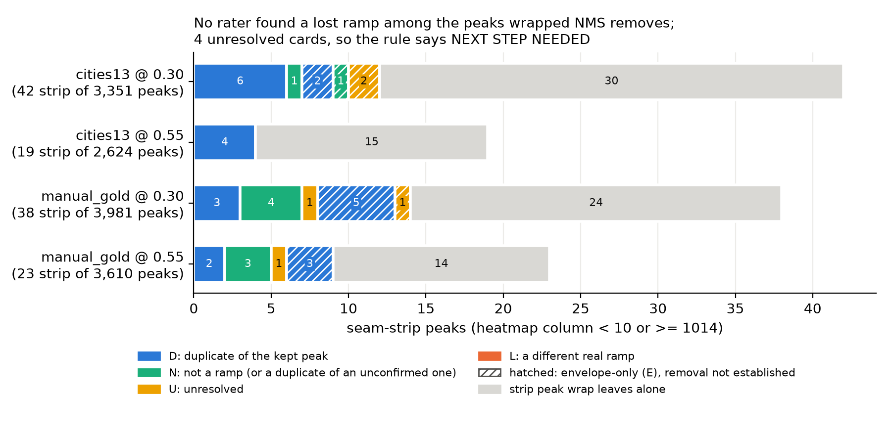

# Should seam-wrapped NMS be the default? (#248)

**Issue:** [#248](https://github.com/ProjectSidewalk/RampNet/issues/248). **Status:** in progress:
the rule's outcome is **NEXT STEP NEEDED** (section 5); the default stays off.

Sections 1-4 are the **pre-registration**, committed and pushed on 2026-11-15 (`fb158eb7`) before
any score was computed under wrapped NMS, before any card was rendered or looked at, and before any
model peak pair was joined to Jon's seam verdicts. They are unchanged since, except the one
paragraph in section 2 that the `bounds` commit appended, as the protocol said it would. The order
of the later commits is the evidence of the order of work: `bounds` (`5e2bbcb1`), the AI verdicts
(`104ef849`), the deck key (`a5bfe016`), the calibration (`c54be1e9`), then the report
(`6436f4d1`).

Plan: written by Fable 5.2 (`claude-fable-5-2`) and revised after an adversarial review by Opus 5.5
(`claude-opus-5-5`), both on 2026-11-15. Implementation and AI pre-rating: Opus 5.5
(`claude-opus-5-5`).

## 1. Context

[PR #249](https://github.com/ProjectSidewalk/RampNet/pull/249) added
`rampnet.subcell.detect_peaks(wrap_nms=True)` (default off; [`seam_nms_248.md`](seam_nms_248.md)).
It counted straddling pairs on Run A peaks but measured no detection metric and nothing on the
published model. The open question is whether the default should flip.

The published model's peaks are already committed for both pools that matter, so tonight's study is
**CPU only, from committed files**:

| Pool | File(s) | How extracted |
|---|---|---|
| `manual_gold_tta` | `benchmark/manual_gold/records.jsonl` (`detections_meta.json`: `rampnet_stage2_hub606a1195.pth`, `tta: true`, floor 0.05, `peak_min_distance` 10) | flip TTA, `exclude_border=False`; the README-headline configuration |
| `cities13` | `analysis_out/input_res_sweep_25/cache/r2048/<split>.json` (11 splits) plus `analysis_out/op_cache/{bayonne,juneau}.json` | single pass, `threshold_sweep.peaks_to_dets(h, 0.05, 10)` |

`cities11` (the 11 r2048 splits) is reported beside `cities13`. manual_gold is never pooled with
the cities.

**What stored peaks can and cannot say.** Write `d = 10`. Without exact ties the default output is
every pixel that is the maximum of its clipped `(2d+1)` window; wrap keeps the subset with no higher
pixel in the across-seam part of the window. So, per threshold `t`:

- `C`, **certain removals**: a strip peak (heatmap column < 10 or >= 1014) with a stronger stored
  peak across the seam at wrapped Chebyshev distance <= 10 px. Exact wrap removes it for any
  heatmap, TTA included (preconditions on the committed data: no tied pairs, every pair <= 8 px).
- `E`, **envelope-only candidates**: strip peaks not in `C` with a stronger stored peak across the
  seam within 20 px. A heuristic for removals caused by the slope of a stronger peak whose maximum is
  more than 10 px away (the heatmap is an x8 bilinear upsample, so a slope is one or two coarse cells
  wide). Whether wrap removes an `E` peak is **unknown** without the heatmap. The 30-px count is
  reported as a sensitivity.
- A peak counts at `t` when it is >= `t` (its stronger partner then is too).

Scenario `lo` removes `C`; scenario `hi` removes `C` and `E`. Nothing else changes.

## 2. Everything already seen before this rule was written (section 4.0 of the plan)

Counts only. Nobody has computed TP/FP/FN, P, R, F1 or AP under wrap, joined any model pair to
`seam_verdicts__jon.json`, or looked at any crop.

Seen by the planner and, independently, by the reviewer:

| | peaks >= 0.30 | strip | pairs | `C` | 20-px env. | 30-px env. | peaks >= 0.55 | strip | pairs | `C` | 20-px | 30-px |
|---|---:|---:|---:|---:|---:|---:|---:|---:|---:|---:|---:|---:|
| cities, r2048, 11 splits (1,289 panos) | 2,880 | 36 | 7 | 7 | 12 | 13 | 2,257 | 16 | 4 | 4 | 4 | 4 |
| manual_gold TTA records (1,000 panos) | 3,981 | 38 | 8 | 8 | 14 | 15 | 3,610 | 23 | 6 | 6 | 9 | 10 |

- Pair distances (wrapped Chebyshev px): cities {4, 4, 4, 4, 4, 4, 7} at 0.30 (bend 4, 4, 7;
  budapest_district5, morgantown, paterson, richmond 4 each); manual_gold {1, 4, 4, 4, 4, 4, 7, 7}.
- Per split at 0.30, strip / pairs: annapolis 2/0, bend 7/3, budapest_district5 11/1, clovis 3/0,
  gainesville 1/0, laurens_gsv 0/0, laurens_mapillary 0/0, morgantown 5/1, paterson 3/1,
  richmond 4/1, sao_paulo 0/0. At the 0.05 floor per split, pairs: 1, 3, 10, 3, 2, 0, 0, 4, 1, 1,
  0 in the same order.
- op_caches: bayonne 39 strip / 8 pairs at the floor, 4 strip / 0 pairs at 0.30; juneau 13 / 1 at
  the floor, 2 / 0 at 0.30; laurens_mapillary 4 / 0; the other 11 files and all of `op_cache_tta`,
  0. The `C` and `E` counts for bayonne and juneau had **not** been computed when the rule was
  committed. **Appended by the `bounds` commit, before any card existed:** bayonne `C` 0 / `E` 0
  and juneau `C` 0 / `E` 0 at both 0.30 and 0.55 (at the 0.05 floor the two add 9 `C` and 5 `E`).
  So `cities13` and `cities11` hold the same 12 candidates at 0.30. `bounds` also reproduced every
  number in the table above exactly, found 3,919 manual_gold GT points, and found one pair of tied
  across-seam peaks (manual_gold, both clipped to 1.0, 23 px apart: outside the 20-px envelope, so
  it touches neither `C` nor `E`; the reviewer's "0 tied pairs" was within 10 px and holds).
- manual_gold records: 5,072 peaks, 132 strip peaks at the floor, 270 scores equal to 1.0 (one in
  the strip, unpaired). r2048: 33 raw scores >= 1.0, none in the strip. 0 tied pairs.
- City `benchmark/*/records.jsonl` (labeler output): 0 strip peaks in all 13 splits.
- Also seen: PR #249's Run A counts, the labeler's Laurens counts, and Jon's verdict totals from
  [`seam.md`](seam.md) (10 `one` pairs at 2.95 to 12.81 px, 4 `two` pairs at 17.28 to 25.06 px).
- Seen by the implementer before this commit, beyond the above: the schema (keys only) of the input
  files, and `imagery_manifest.py --verify --panos-root D:/Git/RampNet`, which reported all 14 local
  splits byte-identical to their manifests (2026-11-15, 21 s). No verdict value of Jon's was read.

What this means for blindness: the size of the removal sets was known when the rule was written, so
the rule does not gate on any count of duplicates. It gates only on the ratings, which do not exist
yet.

## 3. Rating protocol (blinded, calibrated)

**Cards.** One card per member of `C` or `E` at 0.30 in `cities13` and `manual_gold_tta`, except a
manual_gold card that inherits Jon's existing verdict (below), plus **14 calibration cards**: Jon's
adjudicated GT seam pairs (`benchmark/manual_gold/seam_verdicts__jon.json`, marks `a` and `b`). All
in one deck, shuffled with seed 248, each with an opaque id.

**What a card shows.** Crops of the panorama rolled so the seam is at the centre, wide enough for
both marks plus context, and a zoom; two marks labelled A and B, the letters assigned at random
(seed 248). **No scores, no "removed" or "kept" label, no separation in pixels or degrees, no pool
or pano id on the card face, no GT marks.**

**Questions per card.**
1. Pair: `same` (A and B are the same physical object) / `different` / `unsure`.
2. Per mark, A and B: `ramp` / `not_ramp` / `unsure` (rubric: [`seam_review.py`](../scripts/analysis/seam_review.py)
   `RUBRIC`, version 1; a driveway is not a curb ramp; mark only what is visible).

**Files.** `analysis_out/seam_nms_default_248/review/items.json` (opaque id, deck order, seed,
sha256 of each card image) is committed with the sheet. The key (opaque id to pano, pool, which mark
is the weaker peak, set `C` / `E` / calibration) is written to `review/key.json` and **committed only
after the verdict file**, so it is not in the tree while rating. Card images and the HTML are
git-ignored and regenerate from `sheet --panos-root <checkout>`; their hashes are in `items.json`.

**The AI pre-rater (Opus 5.5).** Views each card image in deck order. Does not open `key.json`,
`seam_verdicts__jon.json`, the table in [`seam.md`](seam.md) section 2, or any pano-id lookup until
the verdict file is committed and pushed. `unsure` is a legitimate answer and costs nothing: it sends
the card to Jon. **This blinding is on the honour system** (Jon's verdict file is in the repo).
Verdicts are committed as `review/verdicts__claude-opus-5-5.json` (rubric text, version and the
item-list digest inside) **before** `report` is written or run.

**Calibration.** After the verdict commit, and before any study card is classified or any score is
computed, the AI is scored on the 14 calibration cards against Jon (agreement on the 10 `one` and on
the 4 `two`, by separation band), and that result is committed. **The AI is "calibrated" only if it
answered `different` on all 4 of Jon's `two` pairs.** If it is not, the rating route stops: the AI's
verdicts are not used, every un-inherited card counts as `U`, and the outcome follows from the rule.

**Verdict inheritance on manual_gold (the join).** A `C` or `E` card inherits Jon's existing verdict
only if its two peaks are each nearest to a **different** mark of one adjudicated pair, each within
6.5 px wrapped Chebyshev on the 1024 x 512 grid. Otherwise the card goes on the sheet, including
every card on a `two` panorama (Jon's `two` pairs are 17 to 25 px apart, every model pair is 1 to
8 px apart, so a model pair there is most likely the split of one ramp).

**Classification of a card** ("weaker" is the peak wrap would remove):

| Pair answer | Weaker mark | Class |
|---|---|---|
| `same` | any | `D` (duplicate) if the stronger mark is `ramp`, else `N` |
| `different` | `ramp` | `L` (a real ramp would be lost) |
| `different` | `not_ramp` | `N` (a non-ramp would be removed) |
| `different` | `unsure` | `U` |
| `unsure` | any | `U` |
| not rated | | `U` |

An inherited Jon verdict maps `one` to `D`, `two` to `L` (both marks are GT ramps) and `unsure` to
`U`. **Effective verdict of a card:** Jon's if he has one (inherited, or from a later
`review/verdicts__jon.json` audit); otherwise the AI's if the AI is calibrated; otherwise `U`.

## 4. Decision rule (pre-registered 2026-11-15)

### 4.1 Quantities

At threshold 0.30, over `cities13` plus `manual_gold_tta`:

- `L_jon_C`: cards in `C` classed `L` by **Jon** (inherited or audited).
- `L_opt_C`: cards in `C` classed `L` by their effective verdict.
- `L_pess`: cards in `C` or `E` classed `L` or `U`.

### 4.2 Outcomes, evaluated in this order

1. **KEEP OPT-IN AND CLOSE** if `L_jon_C >= 1`, or `L_opt_C >= 2`. Wrap certainly removes those
   peaks, and they are real, different ramps.
2. **FLIP, CONDITIONAL ON JON'S AUDIT** if the AI is calibrated and `L_pess <= 1`. The
   recommendation is "make wrap the default once Jon has rated the removal cards and the result still
   satisfies this clause". If Jon has already rated every `C` and `E` card, the outcome is simply
   **FLIP**. If `L_pess = 1`, the doc names that card first.
3. **NEXT STEP NEEDED** otherwise. The doc names the step exactly: the `k` cards Jon must rate
   (every `U`, every AI `L`, and all cards if the AI is not calibrated), and, for any `E` card
   classed `L` or `U`, the panoramas whose heatmaps an exact (GPU) tier must produce to learn whether
   wrap removes that peak at all.

An `E` card cannot cause KEEP: its removal is not established. If it is a different real ramp, the
right next step is a forward pass on that one panorama, not a verdict.

**Reported, never gating:** all score deltas (P, R, F1, paired 95% CIs; `lo` and `hi`; GT-A and
GT-B for manual_gold, where GT-B merges Jon's 10 `one` pairs in memory to their wrapped midpoint),
the `D` / `L` / `N` / `U` counts, the 0.55 versions of every quantity, and `cities11` beside
`cities13`. At these counts (at most 3 changed panoramas in any split) every per-split CI includes 0
by construction, which is not evidence of no effect. **Tripwire:** if the pooled paired dF1 under
`lo` is below -0.001 in `cities13` or in manual_gold GT-B (at 0.30 or 0.55), the doc must explain
the conflict with the ratings before stating any recommendation.

The rule deliberately has no minimum duplicate count: whether a rare, correct fix is worth moving a
published number is Jon's value judgement. Anything decided outside this rule is post hoc and will be
labelled so; if new information makes the rule unworkable, it is amended openly here and the affected
read is demoted to exploratory.

Structural point: inside the strip, wrapped NMS does what the default already does at every interior
column, which is to suppress the weaker of two peaks within 10 px. Two real ramps closer than 10 px
are already merged everywhere else in the image.

## 5. Results (2026-11-15)

### Key takeaways

1. **Wrapped NMS removes very little.** At 0.30 it certainly removes 7 of 3,351 city peaks
   (`cities13`) and 8 of 3,981 manual_gold flip-TTA peaks; the 20-px envelope adds at most 5 and
   6 more (section 5.1; `bounds.json` `pools.<pool>."0.30".C` / `.E`).
2. **No rater judged any removal to be a different real ramp** (L = 0 in every pool, set and
   threshold). Of the 26 removal cards at 0.30, 16 are duplicates of the kept peak, 6 are harmless
   for another reason, and 4 are unresolved (figure; `results.json` `class_counts`).
3. **The AI pre-rater passed its calibration bar**: `different` on all 4 of Jon's `two` seam pairs,
   and `same` on 9 of his 10 `one` pairs (the tenth `unsure`) (section 5.2; `calibration.json`
   `summary`).
4. **The rule gives NEXT STEP NEEDED**, not FLIP, because 4 cards are unresolved (`L_pess` = 4 >
   1), and not KEEP, because no certain removal is a lost ramp (`L_opt_C` = 0). The step is small:
   Jon rates **s248-09, s248-11, s248-27, s248-33**, and an exact (GPU) pass looks at the three
   panoramas behind the three envelope-only ones among them (section 5.4; `results.json`
   `reasons`).
5. **Scores agree and do not gate.** Under the certain removals, pooled paired dF1 is +0.00058
   [+0.00012, +0.00115] on `cities13` and +0.00066 [+0.00006, +0.00135] on manual_gold GT-B at
   0.30; the tripwire did not fire. Against the unmerged published GT (GT-A) it is -0.00035
   [-0.00108, +0.00039], because Jon's double-marked seam ramps there count the duplicate as a
   true positive (section 5.5; `results.json` `scores`).



*Figure: every seam-strip peak at 0.30 and 0.55, per pool. Solid segments are certain removals
(`C`) by class; hatched segments are envelope-only candidates (`E`), whose removal is not
established; grey is strip peaks wrap leaves alone. Data: `docs/data/seam_nms_default_248_figure.csv`;
regenerate with `seam_nms_default_248.py figure`. Alt text: four horizontal stacked bars; in each,
blue (duplicate) and green (harmless) dominate the coloured part, orange (lost ramp) never
appears, and yellow (unresolved) is 2 cards in cities13 at 0.30 and 1 or 2 in manual_gold.*

### 5.1 Counts (`bounds.json`)

`bounds` reproduced every number of section 2 exactly, including the reviewer's independent counts
(pinned as literals in `--check`).

| pool | t | panos | peaks | strip | pairs | `C` | `E` | 20-px env. | 30-px env. | panos touched |
|---|---:|---:|---:|---:|---:|---:|---:|---:|---:|---:|
| cities11 | 0.30 | 1,289 | 2,880 | 36 | 7 | 7 | 5 | 12 | 13 | 12 |
| cities11 | 0.55 | 1,289 | 2,257 | 16 | 4 | 4 | 0 | 4 | 4 | 4 |
| cities13 | 0.30 | 1,539 | 3,351 | 42 | 7 | 7 | 5 | 12 | 13 | 12 |
| cities13 | 0.55 | 1,539 | 2,624 | 19 | 4 | 4 | 0 | 4 | 4 | 4 |
| manual_gold | 0.30 | 1,000 | 3,981 | 38 | 8 | 8 | 6 | 14 | 15 | 14 |
| manual_gold | 0.55 | 1,000 | 3,610 | 23 | 6 | 6 | 3 | 9 | 10 | 9 |

Per split at 0.30 (strip / pairs / `C` / `E`): annapolis 2/0/0/1, bend 7/3/3/0,
budapest_district5 11/1/1/0, clovis 3/0/0/0, gainesville 1/0/0/0, laurens_gsv 0/0/0/0,
laurens_mapillary 0/0/0/0, morgantown 5/1/1/2, paterson 3/1/1/1, richmond 4/1/1/1, sao_paulo
0/0/0/0, bayonne 4/0/0/0, juneau 2/0/0/0. The largest straddling-pair distance anywhere, at the
0.05 floor, is 8 px, so no model pair lies between 9 and 15 px and a wider seam-only radius has
nothing to act on here. The audit of other files (`bounds.json` `other_files`) confirms 0 strip
peaks in every city `records.jsonl`, in 11 of 14 op_caches and in all of `op_cache_tta`.

### 5.2 Calibration (`calibration.json`)

| Jon's verdict | cards | AI agreed | AI answers |
|---|---:|---:|---|
| `two` (17.28-25.06 px apart) | 4 | 4 | `different` x 4 |
| `one`, <= 8 px apart | 3 | 3 | `same` x 3 |
| `one`, > 8 px apart | 7 | 6 | `same` x 6, `unsure` x 1 (s248-22, 10.86 px) |

The bar (all 4 `two` answered `different`) is met, so the AI's verdicts count. Caveat beside the
number: Jon's `two` pairs are 17-25 px apart and every model pair is 1-8 px apart, so calibration
on the `two` side is easier than the real cards; and the blinding was on the honour system.

### 5.3 Classification of the 26 removal cards at 0.30 (`results.json` `cards`)

Four manual_gold cards inherited Jon's existing `one` verdict through the join; the other 22 were
rated on the sheet.

| card | split | set | dist px | weak / strong score | source | verdict | class |
|---|---|---|---:|---|---|---|---|
| (inherited) | manual_gold | C | 4 | 0.403 / 0.453 | jon (inherited) | one | D |
| s248-01 | manual_gold | C | 1 | 0.752 / 0.896 | ai | same; weak ramp, strong ramp | D |
| s248-08 | manual_gold | C | 4 | 0.567 / 0.761 | ai | same; weak unsure, strong unsure | N |
| s248-13 | manual_gold | C | 4 | 0.893 / 0.917 | ai | same; weak unsure, strong unsure | N |
| s248-21 | manual_gold | C | 4 | 0.460 / 0.491 | ai | same; weak unsure, strong unsure | N |
| **s248-27** | manual_gold | C | 7 | 0.742 / 0.965 | ai | unsure | **U** |
| s248-29 | manual_gold | C | 4 | 0.782 / 0.922 | ai | same; weak ramp, strong ramp | D |
| s248-36 | manual_gold | C | 7 | 0.867 / 0.988 | ai | different; weak not_ramp, strong ramp | N |
| (inherited) | manual_gold | E | 12 | 0.357 / 0.878 | jon (inherited) | one | D |
| (inherited) | manual_gold | E | 12 | 0.685 / 0.787 | jon (inherited) | one | D |
| (inherited) | manual_gold | E | 15 | 0.893 / 0.938 | jon (inherited) | one | D |
| **s248-11** | manual_gold | E | 16 | 0.390 / 0.951 | ai | unsure; weak unsure, strong ramp | **U** |
| s248-17 | manual_gold | E | 15 | 0.524 / 0.948 | ai | same; weak unsure, strong ramp | D |
| s248-20 | manual_gold | E | 12 | 0.614 / 0.945 | ai | same; weak ramp, strong ramp | D |
| s248-26 | annapolis | E | 13 | 0.504 / 0.787 | ai | same; weak ramp, strong ramp | D |
| s248-03 | bend | C | 7 | 0.800 / 0.843 | ai | same; weak ramp, strong ramp | D |
| s248-16 | bend | C | 4 | 0.698 / 0.795 | ai | same; weak unsure, strong ramp | D |
| s248-25 | bend | C | 4 | 0.523 / 0.867 | ai | same; weak ramp, strong ramp | D |
| s248-28 | budapest_district5 | C | 4 | 0.308 / 0.471 | ai | same; weak unsure, strong unsure | N |
| s248-35 | morgantown | C | 4 | 0.337 / 0.756 | ai | same; weak ramp, strong ramp | D |
| s248-06 | morgantown | E | 16 | 0.478 / 0.974 | ai | same; weak ramp, strong ramp | D |
| **s248-33** | morgantown | E | 12 | 0.486 / 0.610 | ai | unsure; weak ramp, strong unsure | **U** |
| s248-18 | paterson | C | 4 | 0.620 / 0.760 | ai | same; weak unsure, strong ramp | D |
| **s248-09** | paterson | E | 20 | 0.366 / 0.914 | ai | different; weak unsure, strong ramp | **U** |
| s248-14 | richmond | C | 4 | 0.731 / 0.946 | ai | same; weak ramp, strong ramp | D |
| s248-15 | richmond | E | 13 | 0.335 / 0.938 | ai | different; weak not_ramp, strong ramp | N |

| pool, set | D | L | N | U | at 0.55: D / L / N / U |
|---|---:|---:|---:|---:|---|
| cities13 `C` | 6 | 0 | 1 | 0 | 4 / 0 / 0 / 0 |
| cities13 `E` | 2 | 0 | 1 | 2 | 0 / 0 / 0 / 0 |
| manual_gold `C` | 3 | 0 | 4 | 1 | 2 / 0 / 3 / 1 |
| manual_gold `E` | 5 | 0 | 0 | 1 | 3 / 0 / 0 / 0 |

`N` here is mostly "same object, ramp status unsure" (the rule classes a duplicate as `D` only when
the kept mark is a ramp). Every `N` is harmless to remove either way.

### 5.4 Outcome under the rule: NEXT STEP NEEDED

`L_jon_C` = 0 and `L_opt_C` = 0, so not KEEP. The AI is calibrated, but `L_pess` = 4 > 1, so not
FLIP. The next step, exactly:

1. **Jon rates 4 cards**: s248-09, s248-11, s248-27, s248-33, the first four cards on the audit
   page (each starts from the AI's pre-rating, to confirm or change). If at most one of them comes
   back `L` or `U`, the rule gives FLIP conditional on auditing the other 18 (all 22 rated by Jon
   gives FLIP). If s248-27 (a **certain** removal) comes back `different` with the weak mark a
   ramp, the rule gives KEEP.
2. **An exact pass for the envelope-only cards among them**, if any stays `L` or `U`: whether wrap
   removes their peak at all needs the heatmap of `paterson:iPgLrrQ5XDrWWlTXzI5MLQ` (s248-09),
   `manual_gold:R6Awyr2RqM-NKCZyeExAwQ` (s248-11) and `morgantown:1061541095152683` (s248-33).
   Three forward passes; no GPU was used for this study.

**Post hoc diagnostic (not part of the rule; written after the outcome).** The GT points at the
same cards. Removing s248-27's weak peak loses a manual_gold true positive under GT-B too: it sits
on one of Jon's `two` panoramas (`QGbpvWpeg9zLcu5HZneRbw`), where the weak peak is credited with the
second of two adjudicated ramps. Under scenario `hi`, removing s248-33 and s248-09 each loses a
city true positive (a reviewer-marked ramp). So these are the cards most likely to be real second
ramps, and the rule routed exactly them to Jon. Three other cards (s248-13, -29, -36) sit on Jon's
`one` panoramas but missed the 6.5-px inheritance join; the AI called two of them `same` and
s248-36 `different, weak not a ramp`, both harmless classes, although Jon's adjudication implies
s248-36's weak peak duplicates the ramp (`results.json` `scores.<unit>.<lo|hi>.changed_panos`).

### 5.5 Paired scores (wrap minus default; reported, never gating)

Pooled, from `results.json` `scores.<unit>.<lo|hi>.<t>`. 95% CIs: paired pano-level bootstrap
stratified by split, 2,000 replicates, seed 248. With at most 3 changed panoramas in any split,
per-split CIs include 0 by construction (or are exactly [0, 0] when no removed peak reaches t),
which is not evidence of no effect; per-split rows are in `results.md`.

| unit | scenario | t | removed >= t | P default -> wrap | R default -> wrap | dF1 [95% CI] | GT hits lost |
|---|---|---:|---:|---|---|---|---:|
| cities13 | lo | 0.30 | 7 | 0.8594 -> 0.8608 | 0.7303 -> 0.7303 | +0.00058 [+0.00012, +0.00115] | 0 |
| cities13 | hi | 0.30 | 12 | 0.8594 -> 0.8615 | 0.7303 -> 0.7298 | +0.00057 [-0.00019, +0.00140] | 2 |
| cities13 | lo | 0.55 | 4 | 0.9376 -> 0.9384 | 0.6324 -> 0.6324 | +0.00024 [+0.00000, +0.00063] | 0 |
| cities11 | lo | 0.30 | 7 | 0.8624 -> 0.8640 | 0.7498 -> 0.7498 | +0.00069 [+0.00014, +0.00135] | 0 |
| manual_gold GT-B | lo | 0.30 | 8 | 0.8950 -> 0.8966 | 0.9115 -> 0.9112 | +0.00066 [+0.00006, +0.00135] | 1 |
| manual_gold GT-B | hi | 0.30 | 14 | 0.8950 -> 0.8979 | 0.9115 -> 0.9112 | +0.00135 [+0.00055, +0.00219] | 1 |
| manual_gold GT-B | lo | 0.55 | 6 | 0.9457 -> 0.9470 | 0.8734 -> 0.8731 | +0.00046 [-0.00007, +0.00109] | 1 |
| manual_gold GT-A | lo | 0.30 | 8 | 0.8970 -> 0.8976 | 0.9112 -> 0.9099 | -0.00035 [-0.00108, +0.00039] | 5 |
| manual_gold GT-A | lo | 0.55 | 6 | 0.9474 -> 0.9478 | 0.8727 -> 0.8717 | -0.00034 [-0.00104, +0.00032] | 4 |
| manual_gold GT-A | hi | 0.55 | 9 | 0.9474 -> 0.9481 | 0.8727 -> 0.8711 | -0.00051 [-0.00136, +0.00030] | 6 |

- **GT-A at 0.55 is the README headline on raw bytes** (P 0.947 / R 0.873, flip TTA). Turning wrap
  on in `stage_two/evaluate.py` would move it to about P 0.948 / R 0.872 (certain removals) or
  R 0.871 (with the envelope). The recall drop is the unmerged GT crediting duplicates: under GT-B
  the same removals cost 1 GT hit, the s248-27 one above.
- AP (from the floor) moves by -0.00140 (GT-A, `lo`) and +0.00009 (GT-B, `lo`) on manual_gold, and
  by less than 0.005 either way on every city split (`results.md`).
- Tripwire (pooled dF1 under `lo` below -0.001 in `cities13` or GT-B, at 0.30 or 0.55): **did not
  fire**.
- Invariant asserted on every run: every pano with no removal scores identically in both arms.

### 5.6 Caveats beside the numbers

- **The envelope is a heuristic.** `E` stands in for removals caused by the slope of a stronger
  peak more than 10 px away; the exact set can differ from `C` + `E` in either direction. The
  30-px sensitivity adds one peak per pool at 0.30 (`bounds.json` `env30`).
- **AI pre-rating.** 22 of 26 cards carry an AI verdict, calibrated but not audited. The rule makes
  Jon's audit a condition of any FLIP for exactly this reason.
- **City GT is blind in the strip** (the labeler dropped it), so city score deltas cannot tell a
  duplicate from a ramp; only the cards can.
- **Frames.** Cities are single pass at 2048 x 4096 (`peaks_to_dets`, raw scores); manual_gold is
  flip TTA (`evaluate.py` convention, clipped scores). manual_gold single pass was not studied.
- **Plateau swaps are invisible** in stored peaks (wrap can keep another pixel of the same plateau,
  a few px away). They do not change which ramp a peak stands for.
- laurens_gsv's stored imagery is not its reviewed bytes, but it has no strip peak, so no card.

## 6. Deviations from the plan (all decided before any score; none changes the rule)

- **Branch** `analysis/seam-nms-default-248` (the orchestrator's name) instead of the plan's
  `seam-nms-default-248`.
- **Deck key committed after the verdicts** (`a5bfe016` after `104ef849`), the alternative the
  plan allowed, so the key was not in the tree while rating.
- **Calibration and rating were one pass over the mixed deck** (plan section 3.5); the calibration
  was scored and committed (`c54be1e9`) before any study card was classified, so "calibrate, then
  use the ratings" holds in the commit order.
- **Card images**: a 60 deg wide view and a 16 deg zoom (with and without marks), cut from the
  native-resolution panorama, instead of `seam_review.py`'s two square views. Its view B (rolled
  180 deg) is pixel-identical to a wrapping crop, so it was dropped.
- **Ties**: `bounds` found one tied pair of across-seam peaks (manual_gold, both clipped to 1.0,
  23 px apart). The `--check` literal was narrowed from "0 tied pairs" to "0 tied pairs within the
  20-px envelope", which is what the stored-peak argument needs (section 2).
- **The audit page** goes to `C:\Users\jonf\.claude-team\plans\seam-nms-default-248-audit\` (the
  orchestrator's path) instead of `...-review\`. It is interactive (one card at a time, keyboard
  verdicts, autosave, Export) and starts each card from the AI pre-rating, per the lab's
  rating-page convention.
- **AP** is reported per split and for manual_gold only, not pooled.

## 7. What a flip would touch (described only; no branch was made)

A later PR, opened only after Jon's audit, would change three defaults and pin every existing
caller:

| Surface | Change | Callers and tests to handle |
|---|---|---|
| `rampnet.subcell.detect_peaks(wrap_nms=)` | default `True` | `stage_two/demo.py:123` and `scripts/analysis/decode_e2e_221.py:388` pass `exclude_border=True`, which raises with wrap: pass `wrap_nms=False`. `stage_one/crop_model/ps_and_manual_model/evaluate.py:105` is crop space: pass `wrap_nms=False`. `decode_e2e_221.py:131,136` and `crop_decode_221.py:395` reproduce pinned outputs: pass `False`. Tests that assume the default is off: `tests/test_decode_ship_221.py`, `tests/test_seam_nms_248.py`, `tests/test_crop_decode_221.py`; the docstring example at `rampnet/subcell.py:42` |
| `stage_two/evaluate.py --wrap-nms` | default on; `--no-wrap-nms` documented as the paper setting | `stage_two/evaluation_results_new/` is the paper's artifact and is not regenerated; the headline moves by the GT-A row above (raw-bytes frame) |
| HF `RampNetModel.detect(wrap_nms=)` | default `True`, then a re-export | Jon runs the export |

`threshold_sweep.peaks_to_dets` and the analysis scripts that call `peak_local_max` directly would
stay as they are, so `evaluate.py` (wrap) and `peaks_to_dets` (no wrap) would disagree by design.
`python scripts/check_all.py --all` must show no pinned output moved
([#148](https://github.com/ProjectSidewalk/RampNet/issues/148) is the precedent to avoid). The
labeler's `--border` default is a separate decision in that repo. A flip PR must not be stacked on
this branch (a merge with `--delete-branch` closes a PR stacked on it).

## 8. Replication

Every step below except `sheet` and `audit-sheet` reads only committed files, on CPU, offline, in
about 25 s (`report`, `--check`) or under a second (the rest).

```bash
python scripts/analysis/seam_nms_default_248.py bounds        # bounds.json; asserts the reviewer literals
python scripts/analysis/seam_nms_default_248.py sheet --panos-root D:/Git/RampNet   # needs local panos
# rate review/index.html (or review/cards/<id>.jpg); save review/verdicts__<rater>.json
python scripts/analysis/seam_nms_default_248.py calibrate     # calibration.json
python scripts/analysis/seam_nms_default_248.py report        # results.json, results.md
python scripts/analysis/seam_nms_default_248.py figure        # docs/figures/seam_nms_default_248.png/.svg + CSV
python scripts/analysis/seam_nms_default_248.py audit-sheet   # review/audit_jon.html (needs the cards)
python scripts/analysis/seam_nms_default_248.py --check       # re-derive everything and compare; writes nothing
pytest -q tests/test_seam_nms_default_248.py
```

- **Inputs** (committed): `analysis_out/input_res_sweep_25/cache/r2048/*.json` (pinned by that
  directory's `SHA256SUMS`, sha256 `58db5d4e314156c1...`), `analysis_out/op_cache/bayonne.json`
  (`01b1b24c9571af76...`) and `juneau.json` (`b401ea101e2d07d5...`),
  `benchmark/manual_gold/records.jsonl` (`c3728e78e4633c25...`) with `detections_meta.json`,
  `manual_labels/` (GT-A), `benchmark/manual_gold/seam_verdicts__jon.json`
  (`c2f32cc903c1a20c...`), and the AI verdicts `review/verdicts__claude-opus-5-5.json`
  (`21873c7b21be0c0d...`).
- **Model**: `projectsidewalk/rampnet-model` (the r2048 caches and op_caches) and checkpoint
  `rampnet_stage2_hub606a1195.pth` (manual_gold records, `detections_meta.json`). No inference was
  run for this study.
- **Card images** are cut by `sheet` from `benchmark/<split>/panos`, a local copy of the published
  `projectsidewalk/rampnet-benchmark` (the two laurens splits are not on the Hub). They are
  git-ignored; `items.json` holds each image's sha256, and a regeneration on 2026-11-15 matched all
  36 hashes and the key byte for byte. `imagery_manifest.py --verify --panos-root D:/Git/RampNet`
  passed on all 14 splits first.
- **Environment**: Windows desktop, Python 3.12.10, numpy 2.5.1, scipy 1.18.0, scikit-image 0.26.0,
  Pillow 12.3.0, matplotlib 3.11.1. Seeds: deck shuffle and A/B letters 248; bootstrap 248.
- **Cost**: no GPU and no paid call, so no ledger row.

## 9. Where each number lives

| Number | File | Key |
|---|---|---|
| peaks, strip, pairs, `C`, `E`, envelopes per pool and threshold | `analysis_out/seam_nms_default_248/bounds.json` | `pools.<pool>.<t>` |
| the same per split | same | `per_split.<split>.<t>` |
| every candidate (weak / strong peak, distance, set) | same | `candidates` |
| tied pairs within 30 px | same | `tie_distances_within_30px` |
| strip peaks in records / op_caches | same | `other_files` |
| calibration agreement and the bar | `analysis_out/seam_nms_default_248/calibration.json` | `summary` |
| each card's verdict, source and class | `analysis_out/seam_nms_default_248/results.json` | `cards` |
| D / L / N / U counts | same | `class_counts.<t>` |
| the outcome; `L_jon_C`, `L_opt_C`, `L_pess`; cards for Jon; panoramas for an exact pass | same | `outcome`, `reasons` |
| tripwire | same | `tripwire` |
| P, R, F1, dF1 and CIs, GT flips | same | `scores.<unit>.<lo or hi>.<t>` |
| AP per split and for manual_gold | same | `scores.<unit>.<lo or hi>.ap_*` |
| panos whose TP / FP change | same | `scores.<unit>.<lo or hi>.changed_panos` |
| GT-B merges and their distances | same | `gt_b_merges` |
| figure data | `docs/data/seam_nms_default_248_figure.csv` | one row per pool and threshold |
| deck order, image hashes | `analysis_out/seam_nms_default_248/review/items.json` | `cards` |
| card id to pano, set, which mark is weaker | `analysis_out/seam_nms_default_248/review/key.json` | `cards.<id>` |

## 10. Not done

- **The exact tier** (GPU heatmaps): not run (CPU-only scope; the local GPU was held by another
  session). It is needed only for the envelope-only cards that stay `L` or `U` after Jon rates them
  (section 5.4), and for the exact manual_gold numbers a flip PR would quote.
- **Jon's audit**: not done; the audit page is ready (section 5.4).
- **manual_gold single pass**: no committed post-fix peaks; not studied.
- **The manual_gold GT merge** is applied in memory only (GT-B); `manual_labels/` is unchanged.
- **No default was changed**, and no flip branch exists.
