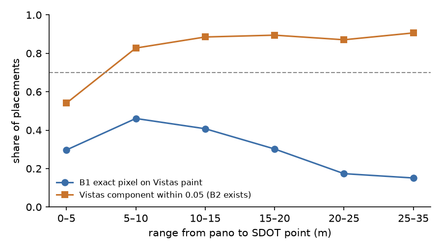

# Stage 1 for crosswalks from SDOT: Seattle pilot (#274)

The paper's Stage 1 turned government curb-ramp inventories into auto-labelled GSV panos. This pilot does the
same for crosswalks on one city. Seattle's SDOT "Marked Crosswalks" layer supplies the locations. It is
GT-grade inside its coverage under the amended rule on branch `crosswalk-inventory-274`. GSV supplies the
pixels. Two placers put each crosswalk into the pano:

- **B1:** the SDOT point projected into the pano. The bearing is `download_dataset.py`'s; the dip comes from
  a 2.5 m camera height.
- **B2:** B1 snapped to the nearest Mapillary Vistas crosswalk component within 0.05 of the pano width,
  using the Phase 0 probe's checkpoint and code.

Written 2026-11-03; fork A of [`stage1_label_type_274.md`](stage1_label_type_274.md) is decided as A1. Numbers
are in `analysis_out/stage1_crosswalk_sdot_274/report.md`.

## Findings

**0. Stage 1's pano search is dead.** Google has decommissioned `GeoPhotoService.SingleImageSearch`, the
endpoint `stage_one/dataset_generation/search_panos.search_panoramas` calls. Its answer is "decommissioned and
turned down". `generate_dataset_meta.py` therefore cannot discover panos as written. The pilot discovers
through streetlevel's z17 coverage tiles plus `find_panorama_by_id` for historical captures, as the labeler
does. GetMetadata (heading, date) and the tile fetch in `rampnet.gsv.fetch_panorama` still work. On all 937
panos fetched, the production heading equals streetlevel's.

**1. Yield is large because historical captures count.** The median is 21 panos per crosswalk within 10 m
and 56 within 20 m, from captures between 2007 and 2026. 10,646 unique panos were found for 200 crosswalks;
0.687 pass the clean-pano rule. Most failures (2,930 panos) have OSM paint within 35 m that SDOT doesn't
record. The pixel arms ran on at most 6 clean panos per crosswalk, spread over capture dates: 937 panos and
2,890 placements.

**2. B1 alone is not a placer.** By the pre-registered rule the city-wide run does not proceed: B1's exact
pixel is on Vistas paint for 0.371 [0.35, 0.39] of placements within 20 m, against a bar of 0.70. B1 is
usually near the paint but not on it:

| reading (within 20 m) | share |
|---|---|
| exact pixel on paint | 0.371 [0.35, 0.39] |
| paint within 0.022 width (RampNet's matcher radius) | 0.771 [0.75, 0.79] |
| a component within 0.05 (B2 exists) | 0.830 [0.81, 0.84] |

The exact-pixel test was too strict for a thin band seen at a grazing angle: at 20–35 m it is 0.16 while the
tolerance reading stays 0.83. It is still the rule that was written down, and the verdict stands.

**3. B2 passes as the default placer.** Where a component exists, the B1→B2 shift is ≤ 0.05 of the pano width
in 0.816 [0.80, 0.83] of cases, against 0.80; the median shift is 0.021. The eyeball shows what it fixes:
- B1 lands on a car parked over the crosswalk, and B2 moves to the visible paint.
- B1 falls between two adjacent crosswalks, and B2 picks one. Which one is ambiguous.

**4. Temporal misalignment is real but moderate.** SDOT is a 2026 snapshot and ~94% of its points are undated.
The exact-pixel hit is 0.28 for captures up to 2015, 0.37 for 2016–2020 and ~0.47 from 2021 on. The secondary
reading (pre-declared, captures from 2021 on) is 0.473, which would not pass either. The "component exists"
rate moves less, 0.78–0.89 across years.

**Failure modes seen in the gallery:**
- **SDOT lists a crosswalk with no visible paint** in a 2022 residential capture.
- **The pano is in a tunnel or underpass** within 20 m horizontally of the crosswalk, so the projection lands
  on a wall. A grade-separation filter is needed before a city-wide run.

## What this means for the next step

- **Projection needs Vistas.** SDOT projection is a usable *bearing*, as the inventory was for ramps, but
  only with B2 as the placer. A crosswalk with no Vistas component should be an ignore region, not
  background.
- **Better first training set: crowd labels on stored panos.** Prefer the crowd Crosswalk labels on Project
  Sidewalk's stored panos (makelab2 `sidewalk_panos/Panoramas/seattle-wa/`, ~170k native-res panos). 3,292 of
  the 3,301 Seattle panos with a crowd Crosswalk label are there, and 4,810 of those labels have an SDOT
  crosswalk within 10 m. A person clicked paint in that exact pano, so neither the date nor the placement is
  in doubt. B2 then labels the other SDOT crosswalks in the same pano.

## Replication

```bash
P=scripts/analysis/stage1_crosswalk_sdot_274/pilot.py; OUT=analysis_out/stage1_crosswalk_sdot_274
INV=<crosswalk-inventory-274>/analysis_out/crosswalk_inventory_274
python $P sample --inventory $INV --out $OUT [--phase1-sheet <crosswalk-gt-phase1>/analysis_out/crosswalk_gt_phase1_274/sheet.csv]
python $P meta --inventory $INV --census <Phase 0 census OUT> --out $OUT    # network: streetlevel tiles + metadata
python $P fetch --out $OUT                                                  # network: GSV pixels (~1 GB/100 panos)
python $P place --out $OUT                                                  # GPU: Vistas, ~25 min on an RTX 3070
python $P report --out $OUT && python $P figures --out $OUT && python $P gallery --out $OUT
python -m pytest tests/test_sdot_source_274.py && python -m doctest stage_one/dataset_generation/sdot_source.py
```

Needs RampNet's environment plus `streetlevel==0.12.10` (its `pyequilib` dependency pulls a newer CPU torch on
Windows; reinstall `torch==2.6.0+cu126` after it). `search_cache.jsonl` is the network record, and coverage
churns, so a fresh `meta` moves the yield numbers.

| number | lives in |
|---|---|
| sample, strata | `sample.csv`, `sample_meta.json` |
| yield | `discovery.csv` |
| clean rule, drop reasons | `dataset.jsonl` |
| the pixel-arm subset | `fetch_selection.txt` |
| on-paint, B2, shifts, per-year table | `placements.csv`, `report.md` §2–4b |
| figures | `docs/figures/stage1_crosswalk_sdot_274/` (`yield_hist.png`, `range_hit_rate.png`) via `pilot.py figures` |
| gallery (local, untracked: it points into `views/`) | `gallery.html` via `pilot.py gallery` |


