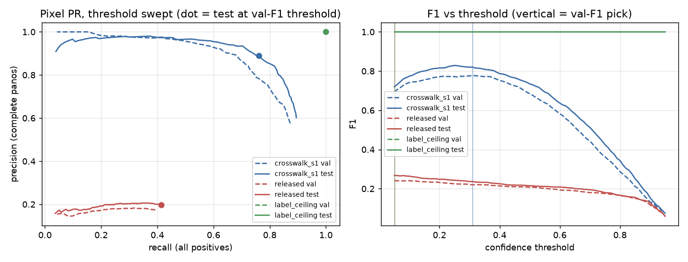

# Stage 1 for crosswalks from SDOT: Seattle pilot (#274)

The paper's Stage 1 turned government curb-ramp inventories into auto-labelled GSV panos. This pilot does the
same for crosswalks on one city. Seattle's SDOT "Marked Crosswalks" layer supplies the locations. It is
GT-grade inside its coverage under the amended rule on branch `crosswalk-inventory-274`. GSV supplies the
pixels. Two placers put each crosswalk into the pano:

- **B1:** the SDOT point projected into the pano. The bearing is `download_dataset.py`'s; the dip comes from
  a 2.5 m camera height.
- **B2:** B1 snapped to the nearest Mapillary Vistas crosswalk component within 0.05 of the pano width,
  using the Phase 0 probe's checkpoint and code.

Written 2026-11-03; fork A of [`stage1_label_type_274.md`](stage1_label_type_274.md) is decided as A1. Numbers
are in `analysis_out/stage1_crosswalk_sdot_274/report.md`.

## Findings

**0. Stage 1's pano search is dead.** Google has decommissioned `GeoPhotoService.SingleImageSearch`, the
endpoint `stage_one/dataset_generation/search_panos.search_panoramas` calls. Its answer is "decommissioned and
turned down". `generate_dataset_meta.py` therefore cannot discover panos as written. The pilot discovers
through streetlevel's z17 coverage tiles plus `find_panorama_by_id` for historical captures, as the labeler
does. GetMetadata (heading, date) and the tile fetch in `rampnet.gsv.fetch_panorama` still work. On all 937
panos fetched, the production heading equals streetlevel's.

**1. Yield is large because historical captures count.** The median is 21 panos per crosswalk within 10 m
and 56 within 20 m, from captures between 2007 and 2026. 10,646 unique panos were found for 200 crosswalks;
0.687 pass the clean-pano rule. Most failures (2,930 panos) have OSM paint within 35 m that SDOT doesn't
record. The pixel arms ran on at most 6 clean panos per crosswalk, spread over capture dates: 937 panos and
2,890 placements.

**2. B1 alone is not a placer.** By the pre-registered rule the city-wide run does not proceed: B1's exact
pixel is on Vistas paint for 0.371 [0.35, 0.39] of placements within 20 m, against a bar of 0.70. B1 is
usually near the paint but not on it:

| reading (within 20 m) | share |
|---|---|
| exact pixel on paint | 0.371 [0.35, 0.39] |
| paint within 0.022 width (RampNet's matcher radius) | 0.771 [0.75, 0.79] |
| a component within 0.05 (B2 exists) | 0.830 [0.81, 0.84] |

The exact-pixel test was too strict for a thin band seen at a grazing angle: at 20–35 m it is 0.16 while the
tolerance reading stays 0.83. It is still the rule that was written down, and the verdict stands.

**3. B2 passes as the default placer.** Where a component exists, the B1→B2 shift is ≤ 0.05 of the pano width
in 0.816 [0.80, 0.83] of cases, against 0.80; the median shift is 0.021. The eyeball shows what it fixes:
- B1 lands on a car parked over the crosswalk, and B2 moves to the visible paint.
- B1 falls between two adjacent crosswalks, and B2 picks one. Which one is ambiguous.

**4. Temporal misalignment is real but moderate.** SDOT is a 2026 snapshot and ~94% of its points are undated.
The exact-pixel hit is 0.28 for captures up to 2015, 0.37 for 2016–2020 and ~0.47 from 2021 on. The secondary
reading (pre-declared, captures from 2021 on) is 0.473, which would not pass either. The "component exists"
rate moves less, 0.78–0.89 across years.

**Failure modes seen in the gallery:**
- **SDOT lists a crosswalk with no visible paint** in a 2022 residential capture.
- **The pano is in a tunnel or underpass** within 20 m horizontally of the crosswalk, so the projection lands
  on a wall. A grade-separation filter is needed before a city-wide run.

## What this means for the next step

- **Projection needs Vistas.** SDOT projection is a usable *bearing*, as the inventory was for ramps, but
  only with B2 as the placer. A crosswalk with no Vistas component should be an ignore region, not
  background.
- **Better first training set: crowd labels on stored panos.** Prefer the crowd Crosswalk labels on Project
  Sidewalk's stored panos (makelab2 `sidewalk_panos/Panoramas/seattle-wa/`, ~170k native-res panos). 3,292 of
  the 3,301 Seattle panos with a crowd Crosswalk label are there, and 4,810 of those labels have an SDOT
  crosswalk within 10 m. A person clicked paint in that exact pano, so neither the date nor the placement is
  in doubt. B2 then labels the other SDOT crosswalks in the same pano.

## First crosswalk detector: training set and pre-registered evaluation (fixed 2026-11-04, before any checkpoint)

**Training set** (`export_stage2.py build`, `analysis_out/stage1_crosswalk_crowd_274/stage2_build/manifest.json`):
- 5,145 panos with 10,410 positive points: train 3,601, val 1,029, test 515. The split is `split_dataset.py`'s
  60 m groups, seed 42.
- Sources:
  - Seattle arm C. Complete panos train as `dense_ignore`; incomplete panos that have positives train as
    `sparse`.
  - 543 Vistas-verified empty Seattle panos (`verified_empty`).
  - Teaneck, Amsterdam and Burnaby crowd labels that pass the adopted confirmer `O&P`. These are all `sparse`.
- Dropped:
  - 340 panos within 35 m of a Phase 1 GT node (all in Amsterdam);
  - 2,386 incomplete panos with no positive;
  - 55 negatives where Vistas saw paint.
- Teaneck's yield under `O&P` is low: 546 of 3,251 candidates. The cause is OSM, not the crowd. Only 28% of
  Teaneck clicks are within 10 m of an OSM-marked crossing, against 86% in Amsterdam and 94% in Burnaby, while
  the exact-pixel paint rate is similar (0.58 vs 0.56–0.71). The rule's yield depends on local OSM tagging.

**Run.** `stage_two/run_finetune_crosswalk_274.slurm`, a single run, set up as follows:
- Initialisation: from the released RampNet weights (Hub 606a119, sha256 `f2119e3b…`).
- Schedule: seed 1, 1,000 optimizer steps at global batch 16 (about 4.4 epochs), LR 1e-5 constant.
- Loss: `--loss-mask --mask-norm pixels`.
- Only the final checkpoint is scored. No checkpoint is picked on val or test.

**Evaluation.** Detections are heatmap peaks via `peak_local_max`, as Stage 2 inference does. Each detection is
then held to the reading below that applies to it.

- **(a) Pixels, test split.** Matching is one-to-one with RampNet's matcher (seam wrap) at radius 0.05, Phase
  0's crosswalk radius.
  - Recall is over all 515 test panos' positives.
  - Precision is over complete panos only (`dense_ignore` and `verified_empty`). A detection inside an ignore
    region counts as neither TP nor FP. On `sparse` panos, unmatched detections are not scored, because their
    background is unverified.
  - Confidence threshold: the one that maximises F1 on the **val** split, applied unchanged to test.
  - Reported overall, per city, per supervision mode, and per capture year (≤2018, 2019–2022, 2023+).
  - The released curb-ramp weights, scored the same way, give the floor.
- **(b) Per OSM node, Seattle test split, against the map-only baseline.**
  - Nodes: the rows of `baseline_nodes.csv` (inside SDOT coverage) within 25 m of a test-split Seattle pano.
  - Prediction: a node is predicted marked when some detection, ground-raycast at 2.5 m camera height (the
    pilot's B1 geometry) and kept only within 25 m range, lands within 10 m of it.
  - Truth: a current SDOT point within 10 m, as in the baseline.
  - Compared with `osm_marked_signal` **on the same node subset**, not with the city-wide 0.846.
  - **Passes** if the detector's node F1 is ≥ the baseline's on that subset. Also reported:
    detector OR `osm_marked_signal`, and the detector on nodes OSM leaves untagged (where a detector adds most).
- **(c) Phase 1 GT** (Jon's blind ratings across four cities, none of it trained on). Pre-registered separately
  once the ratings are in. The ratings are not looked at before then.

### Scoring implementation (fixed 2026-11-04, after training, before any score was read)

`scripts/analysis/stage1_crosswalk_sdot_274/score_274.py`. The text above left these choices open. They are fixed
here, in the commit that adds the scorer, before it read any model output.
1. **Peaks.** RampNet's frozen benchmark extractor (`operating_point_curve.py extract` via `threshold_sweep`):
   - resize to 2048×4096, ImageNet normalisation, fp32, no flip-TTA (the deployed labeler runs none);
   - `peak_local_max(min_distance=10, exclude_border=False)` down to a 0.05 floor, argmax decode, no seam NMS.
2. **Ignore regions.** Matching gives GT priority. An unmatched detection on a complete pano is ignored when
   either:
   - it is within the match radius (0.05) of an ignore point, as `detection_eval.score_pano` does; or
   - it falls inside one of the pano's `ignore_boxes`.
3. **Precision counts only complete panos**, TPs included. A TP on a `sparse` pano counts toward recall only.
4. **Threshold.**
   - Picked on a 0.05–0.95 grid in steps of 0.01, by F1 on val; ties go to the lowest threshold.
   - Each model gets its own val-chosen threshold, the released curb-ramp floor included.
5. **(b) geometry.**
   - Detections at the model's val threshold are inverted through the pilot's B1 projection (`pilot.project`,
     a round trip pinned by a doctest).
   - Pano position and heading come from streetlevel (`crowd_meta.jsonl`, the frame the SDOT arm projected in),
     else Project Sidewalk's record (`ps_meta.jsonl`, `negatives/neg_meta.jsonl`).
   - Node coordinates come from the Phase 0 census tiles that `baseline_nodes.csv` was built from.
   - "Untagged" means `osm_class == unknown`.
   - A node bootstrap of the F1 difference is reported as exploratory and is not part of the pass rule.
6. **A label-ceiling row.** The training labels themselves, scored as detections (`score_274.py oracle`), show
   what the geometry allows. Checked on the plumbing run:
   - pixels P = R = 1;
   - nodes F1 0.914 against `osm_marked_signal`'s 0.898, on the same 463 Seattle test nodes (315 true).
   So (b)'s bar sits 0.016 below the best a perfect pixel detector could score through this geometry.

### Results (scored 2026-11-05)

The run used the checkpoint `final_step_1000.pth` (sha256 `6f467ff4…`). Inference was klone job 42861556, A100,
0.63 s per pano. Full tables are in `analysis_out/stage1_crosswalk_detector_274/report.md`.

**(a) Pixels: a large lift over the curb-ramp floor.** Each model is scored on test at its own val-F1 threshold:

| model | threshold | precision (complete panos) | recall (all positives) | F1 |
|---|---|---|---|---|
| fine-tune `crosswalk_s1` | 0.31 | 0.889 [0.861, 0.912] | 0.761 [0.736, 0.785] | 0.820 |
| released curb-ramp weights | 0.05 (grid floor) | 0.198 [0.178, 0.220] | 0.413 [0.386, 0.442] | 0.268 |

- **Per city**, recall is Amsterdam 0.786, Burnaby 0.839, Seattle 0.752 and Teaneck 0.730 (37 positives). Only
  Seattle has complete panos, so precision exists only there.
- **By capture year**, F1 is 0.771 for ≤2018 (30 panos), 0.821 for 2019–2022 and 0.823 for 2023+.
- **On the 31 verified-empty test panos**, the fine-tune makes no detection at all.
- Test F1 (0.820) is above val F1 (0.778).

**(b) Per node: FAILS as pre-registered.**

| | P / R / F1 |
|---|---|
| detector | 0.832 / 0.927 / 0.877 |
| `osm_marked_signal` | 0.854 / 0.946 / 0.898 |
| detector OR OSM | F1 0.895 |

- The scores are over 463 Seattle test nodes, 315 of them marked.
- On the 38 nodes OSM leaves untagged (9 marked), the detector scores 0.889 / 0.889 / 0.889 against OSM's
  0.625 / 0.556 / 0.588.

**Post hoc, explaining (b) without re-deciding it.**
- **The node subset is not the city.** 68% of these nodes are marked, against 30% city-wide, and OSM tags 74% of them
  marked, against 33%. The cause is that the test panos were chosen where the crowd clicked crosswalks, which is
  OSM's easiest case. Saying yes at every node already scores F1 0.810 here, against 0.459 city-wide.
- **The ceiling is tight.** The label ceiling is 0.914, so (b) has 0.016 of headroom.
- **No threshold rescues it.** The detector's node F1 peaks at 0.885, at threshold 0.25.
- **Where the two disagree** (at the val threshold):
  - the detector alone is right on 13 marked nodes that OSM misses;
  - OSM alone is right on 19;
  - the detector alone says yes on 18 nodes that are not marked, and OSM alone on 10.

Proposed next test: (b′) below, pending Jon's approval.



### Human audit of the (a) test cards (2026-11-05, post hoc)

Jon rated every test false positive, the seeded sample of 60 misses and the 30 sampled true positives in
`score_274.py gallery`'s rating page. Each card asked about one item. The verdicts are in
`analysis_out/stage1_crosswalk_detector_274/ratings_jon_2026-11-05.csv`. These numbers explain (a); they do not
replace its pre-registered result.

- **Precision 0.889 → 0.990.** 58 of the 64 false positives are on real crosswalks the labels lack. The 6 real
  errors are crosswalk look-alikes: red bus lanes (2), a rail track, a hatched no-parking area, the sidewalk
  beside a crosswalk, and one with no paint. These are the hard negatives to add next.
- **The misses are real.** 57 of 60 are real crosswalks the model missed, and 3 are unsure (all far away). None
  is a wrong label. Some are very faded.
- **True positives:** 29 of 30 are crosswalks, and 1 is unsure (between two crosswalks).
- **Recall 0.761 → about 0.79–0.80 once duplicate labels are merged.** One crosswalk often carries two or three
  labels, and only one of them can match. Merging labels within 0.01 / 0.015 / 0.02 of each other leaves
  1,132 / 1,114 / 1,097 crosswalks, with recall 0.786 / 0.798 / 0.808. In 9 of the 60 sampled misses, a twin
  label on the same crosswalk did match, so the crosswalk was found.

**Why the labels have gaps and duplicates: B2 snap collisions in `crowd_arm.py`.** Crowd labels are never exhaustive
per pano; a crosswalk labelled in one pano need not be labelled again. Completeness therefore rests on SDOT points
placed by B2, plus Vistas-unexplained paint as ignore. B2 can snap an SDOT point onto paint that is already labelled,
by a crowd click or by another SDOT point. That point's own crosswalk then has no label, and its detections score
as false positives. The paint it lands on gets a duplicate label, which scores as a miss. Across arm C, 63 panos
have two or more SDOT points snapped together, 33 of them marked complete. The same errors are in the training
labels, which teach those crosswalks as background. Fixed and counted (187 points) in the v2 amendment below.

**Point matching also misreads long and crowded crosswalks.** A detection at one end of a long crosswalk can fall
outside the 0.05 radius of a label at the other end. At a busy intersection the radius spans neighbouring
crosswalks, so a detection can match the wrong crosswalk's label. Matching to the crosswalk's paint extent would fix
both; that would be an open amendment, reported beside the pre-registered numbers.

### Amendment: arm C labels v2, snap collisions fixed (2026-11-05)

This amendment re-scores the same model on corrected labels. It sits beside the pre-registered (a) and (b) and
does not replace them. Nothing was retrained.

**What changed in `crowd_arm.py place`:**
- **Collisions** (`sdot_collisions`). An SDOT point now becomes `sdot_ignore` at its B1 (`collided = 1`) when its
  B2 lands on paint that is already labelled. That means its B2 is either:
  - within `COLLIDE_R` = 0.02 (matcher metric) of a crowd click or of an earlier SDOT B2, or
  - on the paint component under a crowd click.

  SDOT points claim in order of how little B2 moved them. Its own crosswalk is then neither rewarded nor
  penalised. 0.02 was read off v1's placements: of 12 collisions inspected near that distance, 11 were the same
  crosswalk.
- **A first try was discarded.** It claimed paint grouped by dilation and re-snapped displaced points. That
  flagged 393 points, 244 of them ≥ 0.02 from every other mark, because grouping merged whole intersections.
  Good v1 labels moved onto other crosswalks.
- **`explained()` is tighter.** Paint counts as explained only by a mark that the export writes at that spot:
  - within 0.01 of the component's centroid, or
  - inside its own x/y extent, padded by 0.01.

  It used to be within 0.05 of the centroid, or inside the x extent with a ±0.04 vertical band, and a crowd
  click's B2 or an SDOT B1 also counted as a mark. That let a far crosswalk's click explain the near crosswalk
  on the same heading. Over-tight only adds ignore regions.
- **`export_stage2.py build --keep-split`.** Every pano keeps its train/val/test split. None moved, none was
  added or dropped.

**Label changes:**

| | v1 | v2 |
|---|---|---|
| `sdot_b2` positives (all arm C) | 2,837 | 2,650 (187 collided: 108 onto a crowd click, 79 onto another SDOT point; 169 panos) |
| `sdot_ignore` | 307 | 494 |
| `vistas_unexplained` ignore boxes | 53,600 | 87,338 (more on 2,710 panos, mostly zebra stripes beside a click) |
| Stage 2 positives, train / val / test | 7,185 / 2,047 / 1,178 | 7,072 / 1,997 / 1,154 |

Every other mark is identical to v1. Vistas outputs match row for row, and incompleteness reasons are unchanged.

**(a) re-scored on v2 labels** (`analysis_out/stage1_crosswalk_detector_274/v2_labels/`):

| labels | threshold | precision (complete panos) | recall | F1 | FP |
|---|---|---|---|---|---|
| v1 (pre-registered) | 0.31 (v1 val pick) | 0.889 | 0.761 | 0.820 | 64 |
| v2 | 0.31 (same threshold) | 0.914 | 0.775 | 0.839 | 48 |
| v2 | 0.21 (v2 val pick) | 0.850 [0.820, 0.875] | 0.845 [0.823, 0.865] | 0.847 | 100 |

- Val F1 is nearly flat between the two thresholds: 0.803 at 0.21, 0.801 at 0.31. The new pick is close to a tie.
- At 0.31, the 17 v1 false positives that v2 no longer counts were all rated "crosswalk" in the human audit.
  Every rated look-alike (bus lanes, rail, hatching) is still counted.
- **(b) still fails:** node F1 0.881 at 0.21, against `osm_marked_signal`'s 0.898. The label ceiling stays 0.914.
- The released curb-ramp floor: 0.220 / 0.370 / 0.276 at its own 0.10.

**Re-rating.** With `--prefill`, the rating page keeps every already-rated card still present, so only new items
need a verdict:
- at 0.31: 5 new cards (1 FP, 4 misses);
- at 0.21: 75 new cards (53 FPs, 22 misses).

The kept misses are close to, but not exactly, a uniform draw from the v2 misses.

**Human audit at 0.31 on v2 labels** (`v2_labels/ratings_jon_2026-11-05_t0.31.csv`). Jon rated the 5 new cards
on 2026-11-05. The other 133 carry his earlier verdicts.
- **Precision 0.914 → 0.989.** 42 of the 48 false positives are real crosswalks. The 6 real errors are the same
  look-alikes as before. The new false positive is a crosswalk.
- **The misses are real.** 57 of 60 are real crosswalks, and 3 are unsure (far away). None is a wrong label, so
  recall stays 0.775.
- **True positives:** 29 of 30 are crosswalks, and 1 is unsure.
- **Duplicates remain.** 67 pairs of test positives still sit within 0.02 of each other, mostly several crowd
  clicks on one crosswalk. The SDOT fix does not touch these. Merging them or matching by instance is the next
  amendment.

**Human audit at 0.21 (the v2 val pick) on v2 labels** (`v2_labels/ratings_jon_2026-11-05_t0.21.csv`). Jon rated
the 71 new cards on 2026-11-05: 52 false positives with confidence 0.21–0.31, and 19 misses.

| threshold | precision, as scored → audited | recall, as scored → audited | F1 audited |
|---|---|---|---|
| 0.31 | 0.914 → 0.989 | 0.775 → 0.775 | 0.869 |
| 0.21 | 0.850 → 0.980 | 0.845 → ≈0.85 | 0.908 |

- **Precision.** Of the 100 false positives at 0.21, 87 are real crosswalks, 11 are look-alikes and 2 are
  unsure. Audited precision is 652/665, counting the unsure as errors.
- **New look-alikes in the 0.21–0.31 band:**
  - parking-lot stall lines that line up like zebra stripes (3, one possibly a sign);
  - a bike-lane crossing;
  - a painted rectangle in the road, possibly scooter parking.
- **Recall.** Of the 60 sampled misses, 52 are real misses, 7 are unsure and 1 is not a crosswalk.
  - Several unsure or real verdicts note that the crowd click sits on the curb ramp or on a sign beside the
    crosswalk, not on its paint. That is click placement, not a model error.
  - One bad label in 60 moves recall by under 0.01.
- **Reading.** Once the missing labels are counted, the lower threshold costs 0.009 of precision and buys 0.07 of
  recall. So the val pick of 0.21 is the better operating point.

### (b′) A representative Seattle node sample (fixed 2026-11-05 before any (b′) inference)

Why: (b)'s nodes came with the test panos, which were picked where the crowd clicked crosswalks. The question (b)
asks, whether a street-level detector beats the free map at a Seattle crossing, needs Seattle's nodes as they
are. This is a new test. It does not re-decide (b), which stands as failed.

- **Population.** A node is eligible when all of these hold:
  - it is in `baseline_nodes.csv` (inside the regions and inside SDOT coverage);
  - it is more than 60 m from every Seattle train/val pano;
  - some Project Sidewalk store pano lies within 25 m of it.

  That leaves 13,550 eligible nodes. Of the 22,020, 6,455 were dropped as near train/val and 2,015 for having no
  store pano. 27% of the eligible nodes are marked, against 30% city-wide.
- **Sample.** `score_274.py bprime-sample`, seed 274: 150 nodes per (OSM class × SDOT truth) cell, or all of a
  smaller cell. Untagged-and-marked has 126.
  - 876 nodes on 793 panos (`analysis_out/stage1_crosswalk_detector_274/bprime/sample.csv`, `sample.json`).
  - Each node carries the weight `eligible ÷ sampled` of its cell.
  - Truth-stratified sampling is valid because the weights restore the population. It gives every cell enough
    nodes to read both recall and false positives.
- **Pano.** Each node is scored from one pano: the newest Project Sidewalk store pano within 25 m, ties to the
  nearest.
  - Position, heading and date come from `sidewalk_seattle.pano_data`, exported read-only on 2026-11-05.
  - Pixels are the makelab2 store copy, written at 4096×2048 exactly as the training root was
    (`bprime-prep` → `export_stage2.write_image`).
- **Prediction.** The fine-tune at its pre-registered val threshold 0.31 (the released weights at theirs, 0.05),
  with the frozen extractor. Detections on the node's own pano go through (b)'s B1 inversion (2.5 m, ≤ 25 m).
  The node is called marked when one lands within 10 m. Truth is a current SDOT point within 10 m, as before.
- **Metrics.** P, R, F1 and MCC, population-weighted, for:
  - the detector;
  - `osm_marked_signal`;
  - detector OR OSM;
  - always-yes.

  95% intervals come from a within-cell bootstrap (2,000 draws, seed 274). Also reported: per-cell call rates,
  and recall on marked nodes by the pano's capture year.
- **Pass rule (adopted 2026-11-05 with Jon's go-ahead, before any (b′) inference).**
  - **Primary:** "does the detector improve the map?" Weighted F1 of detector OR `osm_marked_signal` exceeds
    weighted `osm_marked_signal` F1, and the 95% within-cell bootstrap interval of the difference lies above 0.
  - **Secondary, reported:** weighted detector F1 ≥ weighted `osm_marked_signal` F1, (b)'s rule.
  - The thresholds are the pre-registered val picks; nothing is tuned on (b′).
- **Plumbing check** (a truth oracle, no model output): weighted F1 is 0.854 for OSM (city-wide 0.846) and 0.424
  for always-yes. The test has headroom where (b) had 0.016.

#### (b′) results (klone job 42902924, scored 2026-11-05): FAILS both rules

`analysis_out/stage1_crosswalk_detector_274/bprime/report.md`. Population-weighted, 876 nodes:

| predictor | P | R | F1 | MCC |
|---|---|---|---|---|
| `osm_marked_signal` | 0.814 | 0.898 | 0.854 | 0.799 |
| detector (val threshold 0.31) | 0.745 | 0.636 | 0.686 | 0.586 |
| detector OR OSM | 0.732 | 0.940 | 0.823 | 0.758 |
| always-yes | | | 0.424 | |

- **Primary fails:** the OR − OSM F1 difference is −0.031, with 95% interval [−0.059, −0.004].
- **Secondary fails:** the detector − OSM difference has interval [−0.224, −0.115].
- **The released curb-ramp weights:** detector F1 0.463.

Per cell (unweighted), the detector finds crosswalks OSM misses:
- 37% of the marked nodes OSM tags unmarked (OSM: 0%);
- 63% of the marked untagged nodes (OSM: 40%).

But it also says yes at 6% and 4% of those classes' unmarked nodes. Those classes hold 6,959 and 2,198 unmarked
nodes, against 296 and 126 marked, so the false alarms outweigh the finds. OSM-marked nodes that SDOT does not
mark draw a yes 39% of the time.

**Post hoc (explains, never re-decides):**
- **Using the detector only where OSM is silent.**
  - OSM, plus a detector yes on untagged nodes: weighted F1 0.850.
  - The detector's call replacing OSM on untagged nodes: 0.849.
  - Neither beats OSM alone (0.854).
- **Recall dropped from (b)'s 0.927 to 0.636. About half of that is the 10 m match, not missed paint.**
  - Of 192 missed marked nodes, 81 have no detection ≥ 0.31 on the pano.
  - The other 111 do, but the nearest lands a median 13.2 m from the node (74 within 15 m).
  - The pano–node distance does not explain the misses (median 6.7 m for misses, 8.3 m for hits).
- **Recall on marked nodes by pano capture year:** 0.59 for 2019–2022, 0.45 for ≤2018, 0.41 for 2023+ (56
  nodes).

**Reading.** At Seattle's crossing nodes, OSM is already strong (F1 0.85), and only about 4% of the nodes OSM
calls unmarked or leaves untagged are marked. Any per-node false alarm therefore costs more than a find gains. So
this detector does not improve Seattle's map through a node-level rule. Its demonstrated value is per-pano
labelling, (a).

### Retrain on v2 labels, `crosswalk_s2` (pre-registered 2026-11-05, before the job was submitted)

Why: the v2 labels fix SDOT duplicates and stop unlabelled near paint from training as background (amendment
above). This run measures what that buys the model. Only the labels change.

- **Data.** The v2 root has the same 5,145 panos, splits and images as the first run, with the v2 JSONs: train
  3,601, val 1,029, test 515. It is staged on klone as `crosswalk274/root_v2`, and its images are hard links to
  the first root's.
- **Recipe.** Identical to `crosswalk_s1`: `stage_two/run_finetune_crosswalk_274.slurm`, from the released
  weights, seed 1, 1,000 steps at global batch 16, LR 1e-5 constant, `--loss-mask --mask-norm pixels`. Only the
  final checkpoint is scored.
- **Hard negatives are left out on purpose.** Every look-alike rated so far is a test pano. Mining training
  look-alikes is a separate, later run.
- **Scoring.**
  - `score_274.py` as in (a) and (b), on the v2 labels (`v2_labels/`). Label `crosswalk_s2`, at its own val-F1
    threshold.
  - Inference uses `score_274.slurm` with `FT_LABEL=crosswalk_s2`.
- **Comparison.** (a) test F1 of `crosswalk_s2` against `crosswalk_s1` on the same v2 labels (0.847 at its
  threshold 0.21).
  - `crosswalk_s2` becomes the working model if its F1 is ≥ 0.847.
  - With one seed per model there is no estimate of seed noise, so a difference under 0.01 reads as no change.
- **Also reported, not deciding:**
  - per-city / mode / year breakdowns;
  - (b) node F1 against `osm_marked_signal`;
  - (b′), with the same weighted rules, from a second inference pass (`BPRIME=1`).
- **Human audit (post hoc).** A rating page with every earlier verdict prefilled, so only new cards need one.
  The audited precision and recall are reported beside the as-scored numbers.
- **Phase 1 GT (c)** stays unread.

#### `crosswalk_s2` results (klone jobs 42951523 train, 42957626 / 42957627 infer; scored 2026-11-05): no change

The run trained cleanly: 1h35m, no requeue, checkpoint sha256 `bfdd0f93…` (in `preds/crosswalk_s2/meta.json`).

| model, v2 labels | val-F1 threshold | val F1 | test P | test R | test F1 | FP |
|---|---|---|---|---|---|---|
| `crosswalk_s2` | 0.31 | 0.804 | 0.897 [0.870, 0.918] | 0.807 [0.783, 0.829] | **0.849** | 63 |
| `crosswalk_s1` | 0.21 | 0.803 | 0.850 [0.820, 0.875] | 0.845 [0.823, 0.865] | 0.847 | 100 |

- **Rule outcome: no change.** 0.849 clears 0.847 by 0.002, under the 0.01 pre-registered as noise.
  `crosswalk_s1` stays the working model.
- **The two models trace the same curve.** At matched thresholds (exploratory, `threshold_sweep.csv`) test F1 is
  0.842 vs 0.847 at 0.21, 0.845 vs 0.854 at 0.25, and 0.849 vs 0.839 at 0.31; neither model leads across the
  band. `crosswalk_s2` picked a higher threshold on val, which trades recall for precision; that move, not a
  better model, is where most of the difference between the two rows comes from.
- **Non-Seattle recall drops** at the picked thresholds: Amsterdam 0.840 → 0.748, Burnaby 0.874 → 0.816, Teaneck
  0.757 → 0.676. Same threshold effect; the cities are all `sparse` and small (37–131 positives).
- **(b) still fails:** node F1 0.868 vs OSM 0.898 (`crosswalk_s1` 0.881).
- **(b′) still fails both rules** (`v2_labels/bprime/`): detector weighted F1 0.727 vs OSM 0.854; detector OR OSM
  0.841, interval for OR − OSM [−0.037, 0.009]. `crosswalk_s1` at its v2 threshold 0.21 scores 0.716 / OR 0.812
  here, so on this sample `crosswalk_s2` is the better OR partner, but neither beats the map.
- **What it means.** Fixing the labels changed what the scorer counts (the amendment above); retraining on them
  did not measurably change the model. The next lever is data, not label cleanup: hard negatives mined from train
  panos, or more panos.
- **Human audit page.** `score_274.py gallery --label crosswalk_s2 --threshold 0.31` with all 230 earlier
  verdicts prefilled (`prefill_all.csv`, outside the repo): 154 cards, 83 prefilled, 71 new (52 FP, 19 TP). 23 of
  the new FPs sit within 0.01 of an FP already rated on the `crosswalk_s1` pages: the same paint, with the peak
  moved, which an exact card id does not carry over.

**Human audit of `crosswalk_s2` at 0.31 (post hoc)** (`v2_labels/ratings_jon_2026-11-06_s2_t0.31.csv`). Jon rated
the 71 new cards on 2026-11-06.

| model @ threshold, v2 labels | precision, as scored → audited | recall, as scored → audited | F1 audited |
|---|---|---|---|
| `crosswalk_s1` @ 0.31 | 0.914 → 0.989 | 0.775 → 0.775 | 0.869 |
| `crosswalk_s2` @ 0.31 (its val pick) | 0.897 → 0.975 | 0.807 → ≈0.81 | 0.883 |
| `crosswalk_s1` @ 0.21 (its val pick) | 0.850 → 0.980 | 0.845 → ≈0.85 | **0.908** |

- **Precision.** Of the 63 false positives, 48 are real crosswalks, 10 are not and 5 are unsure. Audited precision
  is 594/609, counting the unsure as errors.
- **The look-alikes are the same kinds as before:**
  - bus-lane paint (3);
  - parking markings (3): lot stall lines, a hatched no-parking zone, a scooter-parking box;
  - a green bike-lane zebra, rail track, sidewalk, and one spot with no marking at all.
  - The unsure cards are 2 on white stripes running the wrong way for a crosswalk, 2 too far to judge, 1 on a pole.
- **Recall.** No new miss cards; the 61 sampled misses carry earlier verdicts (53 real, 7 unsure, 1 not a
  crosswalk), so recall moves by under 0.01.
- **Rater consistency.** 20 of the 21 new FPs that sit on paint already rated on a `crosswalk_s1` page got the same
  verdict. The one change is crosswalk → unsure ("too far to see").
- **Reading.** Audited, at each model's own val pick, `crosswalk_s1` leads by 0.025 F1, the reverse of the
  as-scored order. At the same threshold `crosswalk_s2` sits further along one curve: more recall, less precision,
  and 15 real errors against `crosswalk_s1`'s 6. The audit therefore confirms the rule outcome: `crosswalk_s1`
  stays. Retraining on cleaner labels did not remove a single look-alike class, which supports hard negatives as
  the next lever.

### Hard negatives, `crosswalk_s3` (planned 2026-11-06)

**Why.** Every look-alike class survived the label fix. But the test set can barely show a precision gain: audited
precision at 0.21 is already 0.980, because test panos were crowd-picked intersections. The case for hard negatives
is deployment, where most panos are not. So Step 0 measures deployment precision first.

**Plan.**
- **Source A.** `crosswalk_s1`'s own detections on **train** panos where training gives no background signal:
  `sparse` panos (1,540 in four cities) and the ignore regions of `dense_ignore` panos. Test, val and (b′) are never
  mined.
- **Source B, only if A yields under 150 negatives.** Fresh Seattle store panos near OSM rail, bus-lane,
  surface-parking and cycleway features, at least 60 m from every val, test, (b′) and Phase 1 pano.
- **Verification.** A blind AI pre-screen, then Jon. Only Jon's "not crosswalk" verdicts become negatives, because
  most unlabelled "false positives" are real crosswalks (48 of `crosswalk_s2`'s 63).
- **Trainer.** A new `supervision.negative_points` key: background discs that train in any supervision mode.
- **Run.** The same recipe as `crosswalk_s1`. The pre-registration is fixed before training.

#### Step 0: deployment baseline on (b′) panos (rated by Jon 2026-11-06)

`score_274.py bprime-audit` drew 120 of the 793 (b′) panos (seed 274). Every `crosswalk_s1` detection at or above
0.21 on them is a card: 260 cards on 78 panos. The other 42 drawn panos have no detection. The draw's panos were
picked for their OSM crossing nodes, so they sit at or near intersections, not mid-block.

Jon rated the cards blind: no confidence, city or model on the card, order shuffled. A second stratum, `node_fa`,
holds every detection on the 21 panos behind `crosswalk_s1`'s (b′) false alarms at nodes SDOT calls unmarked and
OSM tags unmarked or leaves untagged. That stratum explains the false alarms and never enters the rates.

| `random` stratum, `crosswalk_s1` @ 0.21 | value | 95% interval (bootstrap over panos) |
|---|---|---|
| detections: crosswalk / not / unsure | 237 / 16 / 7 | |
| precision (unsure counted as error) | **0.912** | [0.858, 0.956] |
| precision (unsure left out) | 0.937 | [0.899, 0.969] |
| look-alikes per 100 panos | 13.3 | [6.7, 20.8] |
| errors (not + unsure) per 100 panos | 19.2 | [9.2, 31.7] |

- **Gate passed.** Look-alikes are 16 of 260 detections (6.2%), above the 3% stop line, so the run continues.
- **Deployment precision is well below test.** It is 0.912 here against 0.980 audited on test, so errors are about
  4× as common away from crowd-picked panos.
- **The look-alikes are the familiar classes:**
  - parking markings (lot stall lines, hatched no-parking zones);
  - bike-lane lines, parallel or dashed;
  - tree and lamp shadows, and a stop line.
- **Near-camera clutter.** One pano (`kK0bPFgBK0uFm2M72rg8yw`) carries 5 of the 23 errors, all near the bottom of the
  frame (y 0.66–0.76, just above the 49° rig mask), rated "too zoomed in to tell".
- **`node_fa`: 40 detections, 20 crosswalk / 16 not / 4 unsure.** About half of (b′)'s detector false alarms at
  SDOT-unmarked nodes are look-alikes, chiefly bike lanes, green bike zebras and parking-lot markings. The other half
  are real crosswalks the node truth does not count.
- **What s3 has to beat.** 13.3 look-alikes per 100 panos, with a wide interval: halving it moves the point estimate
  to about the interval's lower edge. The pre-registration therefore fixes the cut on this same draw, with the same
  bootstrap, before training.

#### The negatives (Jon, 2026-11-06)

- **Mined.** `score_274.py mine` took `crosswalk_s1`'s detections at or above 0.21 on train panos where training
  gives no background signal (`mine/`). A blind AI pre-screen sorted them, using numbered contact sheets
  (`prescreen/`).
- **Rated by Jon in two pages**, with the dashed disc a negative trains drawn on every card. The disc rule: a card
  is "not crosswalk" only if no crosswalk paint lies anywhere inside the disc.
  - Page 1: 459 cards, plus 9 that Claude flagged for re-review.
  - Page 2: 200 cards, with a large view on click.
  - The AI's "not crosswalk" calls held up far less often than expected, so Jon's verdict alone decides.
- **Assembled** by `export_stage2.py add-negatives`:
  - the ratings are read in order (page 1, the 9 re-reviews, page 2), and a later verdict wins;
  - three cards are left out under the disc rule (`drop_disc_rule.csv`).
- **Result:** 166 negatives on 145 train panos. None is within `NEGATIVE_MIN_DIST` of a positive.

| city, mode | negatives |
|---|---|
| Amsterdam, sparse | 73 |
| Seattle, sparse | 38 |
| Teaneck, sparse | 32 |
| Burnaby, sparse | 19 |
| Seattle, dense_ignore (in ignore regions) | 4 |

- **`root_v3`** is `root_v2` with `supervision.negative_points` on those 145 train JSONs. Every other file is byte
  for byte v2, val and test included. The JPEGs are hard links.
  - Label digest: `005d6f76d15f…` (`hardneg/root_v3/manifest.json`).
  - `check_root_negatives.py` runs every JSON through the trainer's parser and every negative through
    `EquiHeatmapDataset`: weight 1 and target 0 at each.
- **Dose.** 1,000 steps at batch 16 is about 4.4 passes over the 3,601 train panos, so each negative trains about
  four times.
- **City mismatch.** Only 42 of the 166 negatives are Seattle, but the deployment draw is all Seattle. Whether the
  learned "not this" transfers across cities is part of what s3 tests.

#### `crosswalk_s3` pre-registration (fixed 2026-11-06: Jon approved it before the job was submitted)

The 20-step smoke run on `root_v3` (job 43016471) completed cleanly and is never scored.

- **Data.** `root_v3` (above). Splits, images and every val/test label are identical to `root_v2`.
- **Recipe.** Identical to `crosswalk_s1` and `crosswalk_s2`: released weights, seed 1, 1,000 steps at global batch
  16, LR 1e-5 constant, `--loss-mask --mask-norm pixels`. Only the final checkpoint is scored. A 20-step smoke run
  comes first; it is never scored.
- **Threshold.** `crosswalk_s3`'s own val-F1 pick, as for the earlier runs. Matched-threshold numbers at 0.21 are
  also reported, but they are exploratory, because `crosswalk_s2` showed that a threshold move can pass for a model
  change.
- **Primary: look-alikes on the Step 0 draw.**
  - Same 120 (b′) panos (seed 274), via `bprime-audit --label crosswalk_s3`.
  - Every `crosswalk_s3` detection at its threshold is a card. A card within 0.01 of a Step 0 card inherits that
    verdict; Jon rates the rest blind, on a page built like Step 0's.
  - The statistic is the **paired difference** in look-alikes per 100 panos, s3 minus s1, on the `random` stratum.
    Its 95% interval comes from a bootstrap over the 120 panos (2,000 draws, seed 274).
  - **s3 reduces look-alikes** if the interval's upper end is below 0.
  - The primary and guard 2 are implemented as `score_274.py audit-compare`, committed before training. Run on
    `crosswalk_s1` against itself, it returns 13.3 look-alikes per 100 panos, a difference of 0 and retention
    237/237.
- **Guards (all must hold for s3 to replace s1):**
  1. **Test F1.** On the v2 labels, as scored at s3's threshold: ≥ 0.837 (s1's 0.847 minus the 0.01 noise band).
  2. **Retention on the draw.** Of the 237 Step 0 detections Jon confirmed as crosswalks, at least 95% have a
     `crosswalk_s3` detection within 0.05 (matcher units). This catches a threshold hike that buys precision with
     recall.
  3. **(b′) marked-node recall.** It drops by no more than 0.03 against s1's.
- **Outcomes.**
  - Primary met and all guards hold: `crosswalk_s3` becomes the working model.
  - Point estimate down but the interval reaches 0: **promising, not established**. s1 stays, and the next step is
    a larger draw or more negatives.
  - A guard fails: s1 stays, whatever the primary says.
- **Power, stated before the result.** s1 has 16 look-alikes on this draw. Removing about half of them probably
  clears the rule, but not certainly. A smaller effect will not.
- **Also reported, not deciding:**
  - errors (not crosswalk plus unsure) per 100 panos, and precision on the draw;
  - the `node_fa` stratum: how many of its 16 look-alikes s3 still fires on;
  - look-alikes by class;
  - test audited precision, and per-city recall;
  - (b) and (b′) F1 against OSM.
- **Phase 1 GT (c)** stays unread.

#### `crosswalk_s3` result (2026-11-08): primary met, retention guard failed, so `crosswalk_s1` stays

Training job 43017597 (1,000 optimizer steps, 1 h 14 min); final checkpoint `32f93561…`. Inference ran as jobs
43035893 (val/test) and 43035894 (b′). Jon rated the 65 new cards on the s3 page blind; 189 cards carried his Step 0
verdicts. Ratings: `hardneg/s3_audit/ratings_jon_2026-11-08_s3.csv`.

| | `crosswalk_s1` (0.21) | `crosswalk_s3` (0.29) | rule | |
|---|---|---|---|---|
| **Primary**: look-alikes per 100 panos, Step 0 draw | 13.3 | 5.0 | paired diff upper end < 0 | **met**: −8.3 [−14.2, −3.3] |
| Guard 1: test F1 (v2 labels) | 0.847 | 0.849 | ≥ 0.837 | holds |
| Guard 2: retention of the 237 Step 0 crosswalks | — | 224 / 237 = 0.945 | ≥ 0.95 | **fails** (226 needed) |
| Guard 3: (b′) weighted marked-node recall | 0.720 | 0.736 | drop ≤ 0.03 | holds |

By the pre-registered rule a failed guard keeps `crosswalk_s1` as the working model, whatever the primary says.

**Also reported, not deciding:**

- Errors (not crosswalk plus unsure) per 100 panos: s1 19.2, s3 6.7; paired difference −12.5 [−23.3, −4.2].
- Precision on the draw: s1 0.912 [0.858, 0.956], s3 0.966 [0.941, 0.987].
- `node_fa` stratum: s1 had 16 look-alikes on 21 panos; s3 has 7 on 11 panos (20 detections, 11 crosswalk, 2 unsure).
- (b′): detector F1 s3 0.752, s2 0.727, s1 0.716 vs OSM 0.854. False alarms at unmarked crossings fall from 7.3%
  to 5.3% of sampled nodes, and at unknown-class crossings from 6.7% to 2.0%.
- Test: precision 0.858 vs 0.850, recall 0.840 vs 0.845.

**Why retention failed (exploratory).** All 13 crosswalks s3 drops at 0.29 were among s1's weakest detections (s1
confidence 0.21–0.25). s3 still produces a peak on every one of them, at 0.15–0.29, just under its own threshold.
Retention by s3 threshold: 0.945 at 0.29, 0.983 at 0.25, 0.987 at 0.21, 1.000 at 0.15. This is the "threshold hike
buys precision with recall" pattern the guard was written to catch: s3's val-F1 pick sits 0.08 above s1's. On the
draw, s3 also finds 10 crosswalks that s1 had no detection near. Any re-test at a lower s3 threshold is a new
pre-registration on fresh panos, because the Step 0 draw has now been used to see this result. At 0.21, s3 makes 44
more detections on the draw than at 0.29, and none of them has been rated.

#### `crosswalk_s3` confirmation pre-registration (fixed 2026-11-08: Jon rated the page against this text, unchanged)

Jon asked (2026-11-08) for the strongest detector, so s3 is re-tested rather than dropped. The Step 0 draw is
spent: it showed the retention failure, so a threshold chosen on it would be circular. Everything below is fixed
before any card is rated and before s3's test or (b′) numbers at the new threshold are computed.

- **Models and thresholds.**
  - `crosswalk_s1` at 0.21, its val-F1 pick, unchanged.
  - `crosswalk_s3` at **0.27**, by a rule that uses val only: the highest grid threshold at which s3's val recall
    is at least s1's val recall at s1's pick (`score_274.py match-threshold`; s3 0.810 at 0.27 against s1 0.806 at
    0.21). s3's val F1 is flat there (0.807 at 0.27, 0.809 at its 0.29 pick).
  - Scored with `score --fixed-threshold crosswalk_s3=0.27` into `v2_labels/s3_t027/`, so the val-pick results
    stay as committed.
- **Seattle draw (decides).** 120 (b′) panos, draw seed 275, from the 654 panos in no earlier draw (Step 0 and
  the s3 audit), `draw --exclude-panos`. No `node_fa` stratum.
- **City draws (report only, Jon 2026-11-08).** Same seed 275, drawn from each run's processed panos:
  - Juneau: 120 of 5,333 (Mapillary: 4,999 Trimble MX7 from the original run, 334 GoPro Max from the 2026-11
    expansion).
  - Laurens, Mapillary arm: 80 of 4,495 (GoPro Max, 2025-11).
  - Laurens, GSV arm: 80 of 2,137 (2024-09), the same footprint as the Mapillary arm.
  - Panos fetched by `export_benchmark.py --out`, then made 4096×2048 by `bprime-prep` exactly as the training root.
- **One blind page.** Each model's detections on each draw (`bprime-audit`) are merged by `merge-cards`: two
  detections within 0.01 on the same pano are one card. Captions are blind, and Seattle, Juneau and Laurens cards
  are shuffled together, so the rater cannot tell model or city from the page. `carry` turns the export back into
  one ratings file per model and draw. None of these panos has been rated before, so nothing is prefilled.
- **Primary.** On the Seattle draw, the paired difference in look-alikes per 100 panos, s3 − s1, with a 95%
  bootstrap over the 120 panos (2,000 draws, seed 274). Met if the interval's upper end is below 0
  (`audit-compare`).
- **Guards (all must hold):**
  1. Test F1 on the v2 labels at 0.27: ≥ 0.837.
  2. Retention on the Seattle draw: at least 95% of the s1 detections Jon confirms as crosswalks have an s3
     detection at ≥ 0.27 within 0.05 (matcher units).
  3. (b′) weighted marked-node recall at 0.27: drops by no more than 0.03 against s1's.
- **Outcomes.** Primary met and all guards hold: `crosswalk_s3` at 0.27 becomes the working model. Point estimate
  down but the interval reaches 0: promising, not established; s1 stays. A guard fails: s1 stays.
- **Power, stated before the result.** On Step 0, s3 at 0.29 removed 8.3 look-alikes per 100 panos [3.3, 14.2].
  At 0.27 s3 makes somewhat more detections, so the expected cut is a little smaller; a cut of about half of s1's
  look-alikes probably clears the rule on 120 panos.
- **Reported per city, deciding nothing:** look-alikes per 100 panos, errors per 100 panos, precision, the paired
  s3 − s1 difference with its interval, and retention, for each of Juneau, Laurens Mapillary and Laurens GSV. The
  two Laurens arms compare the camera on the same streets. Recall in Juneau and Laurens comes later, from an
  intersection page (OSM road graph, not OSM crossing tags; Jon 2026-11-08).
- **Seed replicates (reported, deciding nothing).** Seeds 2 and 3 of s1 (v1 labels) and s3 (`root_v3`), klone
  jobs 43057106–43057109: test F1 and (b′) detector F1 per run, at each run's val pick and at its recall-matched
  threshold, to show how much of the s1/s3 difference is seed noise.

#### `crosswalk_s3` confirmation result (2026-11-08): promising, not established; `crosswalk_s1` stays

Jon rated all 446 cards blind (`hardneg/confirm_s3/page/ratings_jon_2026-11-08_confirm.csv`, 71 with notes);
`carry` gives each model its cards. Seattle decides:

| Seattle draw (120 fresh panos) | `crosswalk_s1` (0.21) | `crosswalk_s3` (0.27) | rule | |
|---|---|---|---|---|
| **Primary**: look-alikes per 100 panos | 10.0 [4.2, 18.3] | 7.5 [2.5, 15.0] | paired diff upper end < 0 | **not met**: −2.5 [−7.5, 1.7] |
| Guard 1: test F1 (v2 labels) | 0.847 | 0.849 | ≥ 0.837 | holds |
| Guard 2: retention of s1's 216 confirmed crosswalks | — | 207 / 216 = 0.958 | ≥ 0.95 | holds |
| Guard 3: (b′) weighted marked-node recall | 0.720 | 0.750 | drop ≤ 0.03 | holds |

The point estimate is down and the interval reaches 0: by the pre-registered rule, **promising, not established**,
and `crosswalk_s1` stays the working model. Precision on the draw is 0.935 (s1) and 0.948 (s3); errors per 100 panos
fall by 2.5 [−7.5, 2.5]. Across the two Seattle draws s3 had fewer look-alikes both times (16 → 6 at 0.29 on
Step 0, 12 → 9 at 0.27 here), and the effect shrank on fresh panos; the two draws are not pooled, because no pooled
test was pre-registered.

**Cities (report only).**

| draw | panos | model | detections | crosswalk | look-alikes | unsure | precision | look-alikes / 100 panos |
|---|---|---|---|---|---|---|---|---|
| Juneau (Mapillary) | 120 | s1 | 70 | 59 | 7 | 4 | 0.843 | 5.8 [1.7, 10.8] |
| | | s3 | 64 | 58 | 3 | 3 | 0.906 | 2.5 [0.0, 5.8] |
| Laurens, Mapillary (GoPro Max) | 80 | s1 | 33 | 0 | 33 | 0 | 0.000 | 41.2 [27.5, 56.2] |
| | | s3 | 38 | 0 | 38 | 0 | 0.000 | 47.5 [32.5, 62.5] |
| Laurens, GSV | 80 | s1 | 10 | 0 | 10 | 0 | 0.000 | 12.5 [6.2, 20.0] |
| | | s3 | 5 | 0 | 5 | 0 | 0.000 | 6.2 [1.2, 12.5] |

- **Juneau** (109 of the 120 panos are Trimble MX7) works about as well as Seattle, and s3 is cleaner there
  (paired diff −3.3 [−9.2, 1.7]). Retention 52/59.
- **Laurens Mapillary: a new false-positive class, the top of the capture car** (Jon's finding). 50 of the 54
  Laurens Mapillary cards carry his note "top of the capture car"; the rest are shadows and parking-lot lines.
  Every car-top card is a GoPro Max pano, including the 3 in Juneau's GoPro expansion area; none of Juneau's
  109 Trimble panos has one. The car tops sit at y 0.52–0.79, so the labeler's curb-ramp nadir mask
  (`NADIR_MASK_DEG` 49°, y > 0.772) would remove only 6 of them. s3 does not help here (41 → 48 per 100 panos):
  its hard negatives came from GSV-style panos only.
- **Laurens has no true positive on either arm.** The town has few marked crosswalks, and the random 80 panos
  missed most of them. PS prod holds 20 live Crosswalk labels in Laurens (Jon 18, Mikey 2) on 10 Mapillary panos,
  and 5 in Juneau on 3 panos (`hardneg/confirm_s3/ps_labels/`, read-only, 2026-11-08). One of the Laurens panos
  is in the draw, and neither model has any peak, even at the 0.05 score floor, near its 3 labeled crosswalks.

**Recall probe on PS prod's crosswalk labels (exploratory, 2026-11-08).** Both models were run on the 13 panos
carrying live Crosswalk labels in Laurens and Juneau (one Laurens pano, `859136893217435`, is not in our run and was
not fetched). A label is hit when the model has a detection at its threshold within 0.05
(`hardneg/confirm_s3/ps_labels/probe_hits.csv`):

| | labels | `crosswalk_s1` (0.21) | `crosswalk_s3` (0.27) |
|---|---|---|---|
| Juneau (Trimble MX7) | 5 | 5 | 4 (one at 0.23) |
| Laurens (GoPro Max) | 16 | 0 | 0 |

On the Laurens panos neither model puts a peak of even 0.05 within 0.05 of 15 of the 16 labels; their only
detections there are car tops. Two crops show why the miss is not only the camera. One is a **brick
(paver) crosswalk** with no white paint; the other is two **faded parallel lines on concrete**. Both styles are rare
in the training cities, where Seattle's ladder and zebra paint dominates. Whether brick crosswalks count as
"marked" for this detector is a definition question for Jon. The page's rule so far is "painted pedestrian crossing
markings".

**Brick crosswalks on PS (2026-11-08, read-only prod census).** Jon (2026-11-08): brick-style positives matter,
and PS has a tag for them. The Crosswalk tag is `brick/cobblestone`. Across 58 live city schemas
(`hardneg/s4_inputs/brick_crosswalk_census_2026-11-08.csv`, from `prod_brick_census.sh`):

- **Labels:** Chicago 530, Cuenca 372, Columbia 261, Columbus 156, Gainesville 150, Amsterdam 85, Seattle 65,
  Pittsburgh 56; every other city has fewer than 30.
- **Crowd-validated with a stored pano (agree > disagree, `prod_brick_backups.sh`):** Chicago 172 panos,
  Columbia 102, Cuenca 87, Seattle 22, Gainesville 22, Columbus 15, Pittsburgh 15, Knox 7, Maywood 8, Oradell 6.
  That is about 450 panos in all.
- **Validators often disagree:** Columbus 112 of 156 brick labels, Amsterdam 81 of 85. The tag may mark a
  cobblestone road surface rather than a brick crosswalk, so the positives need a human look before training.

**s4 step 1: brick-crosswalk positives (2026-11-08).** `brick_positives.py select` takes the census's Crosswalk
labels tagged `brick/cobblestone` (gsv; not voted incorrect by majority; outside the root's cities and every audit
draw): 923 labels on 584 panos (Chicago 259, Cuenca 155, Gainesville 68, Columbus 33, Pittsburgh 26, ...). The panos
were streamed read-only from the PS store and prepped like the training root. Four blind AI readers sorted the 77
contact sheets (`hardneg/s4_inputs/brick/ai_parts/`, `prescreen.csv`):

| AI call | labels |
|---|---|
| crosswalk, brick band with white edge lines | 431 |
| crosswalk, brick band without edge lines | 66 |
| crosswalk, paint (Cuenca's cobblestone zebras, mostly) | 228 |
| unsure | 121 |
| not a crosswalk (a cobblestone road, plaza or sidewalk) | 77 (50 in Cuenca) |

**Jon's confirmation page, rule fixed before he rates** (`brick_positives.py page`, seed 274; `cards
--definition paint_brick`). It shows every AI not/unsure card (198) plus a seeded sample of the AI's crosswalk calls:
120 brick-styled and 40 painted, 358 cards in all. Only Jon's "crosswalk" verdicts become positives. For each style,
if Jon agrees with at least 95% of the sampled AI crosswalk calls, that style's unsampled AI crosswalk calls become
positives without a second look. Otherwise he rates them too.

**Result (Jon rated all 358 on 2026-11-08; `ratings_jon_2026-11-08_brick.csv`, `brick_positives.py tally` ->
`positives.csv`, `tally.json`).** Both styles pass the trust rule: Jon agreed with 120 of 120 sampled brick calls
and 39 of 40 sampled paint calls (the one exception he marked unsure: "more on a curb ramp than it is on the
crosswalk"). So **893 of the 923 labels are positives, on 559 panos**: 328 by Jon's verdict and 565 trusted AI calls
(377 brick, 188 paint). 30 are dropped (Jon: 10 not a crosswalk, 20 unsure, most "too zoomed in to tell").

| AI call | Jon: crosswalk | not | unsure |
|---|---|---|---|
| crosswalk (sample of 160) | 159 | 0 | 1 |
| unsure (121) | 114 | 0 | 7 |
| not a crosswalk (77) | 55 | 10 | 12 |

The AI readers were reliable when they said crosswalk but far too strict otherwise: Jon called 55 of their 77
rejections crosswalks (mostly Cuenca's faded paint on cobblestone). The tag itself is precise: at most 30 of 923
crowd labels (3%) fail Jon's look. By city: Chicago 424, Cuenca 246, Gainesville 88, Columbus 44, Pittsburgh 39,
Knox 15, Maywood 11, and 26 more across 12 cities. Positions are the crowd label's.

#### Seed replicates (reported, deciding nothing; scored 2026-11-08)

Seeds 2 and 3 of s1 (v1 labels) and s3 (`root_v3`), with the recipe otherwise unchanged. Training ran as klone jobs
43057106–43057109, and inference as 43063208–43063215. Everything is scored on the v2 labels:
- `v2_labels/seeds/`: each run at its own val pick.
- `v2_labels/seeds_matched/`: each s3 run at the recall-matched threshold against the s1 run with the same seed
  (`match-threshold`).

Seed 1 reproduces the committed scores exactly.

| seed | s1 threshold | s1 test F1 | s1 (b′) F1 | s3 val pick: test F1 / (b′) F1 | s3 recall-matched: threshold, test F1 / (b′) F1 |
|---|---|---|---|---|---|
| 1 | 0.21 | 0.847 | 0.716 | 0.29: 0.849 / 0.752 | 0.27: 0.849 / 0.756 |
| 2 | 0.24 | 0.836 | 0.731 | 0.39: 0.840 / 0.752 | 0.39: 0.840 / 0.752 |
| 3 | 0.22 | 0.828 | 0.740 | 0.31: 0.824 / 0.708 | 0.24: 0.813 / 0.739 |

**Readings.**
- **Seed noise on test F1 is about ±0.01**, with a range of 0.019 across the three s1 seeds. That is as large as the
  0.01 noise band in the test-F1 guards, so two of the three s1 seeds would themselves fail "≥ 0.837".
- The s3 − s1 test-F1 difference is +0.002, +0.004 and −0.004 by seed at the val pick: within seed noise.
- On (b′) at the recall-matched threshold, s3 − s1 is +0.040, +0.021 and −0.001: never worse, usually better, but
  the size varies with the seed.

#### `crosswalk_s4` pre-registration (fixed 2026-11-08: Jon approved this text before any Step A card was built)

**Goal.** Three gaps the confirmation found, fixed in one retrain without losing Seattle:
- brick and paver crosswalks (0 of 16 Laurens labels hit);
- the GoPro Max car top (41 look-alikes per 100 Laurens Mapillary panos);
- too little open imagery in training (every positive so far is GSV).

**Inputs on PS prod (read-only, 2026-11-08, `s4_prod_probe.sh`).**
- Crosswalk labels on non-GSV panos: Richmond, Mapillary 91 on 51 panos; Laurens, Mapillary 20 on 11; Juneau,
  Mapillary 5 on 3; Bayonne, Panoramax 9 on 6. The two infra3d cities are not open imagery and are not used.
- Columbia SC, `brick/cobblestone` Crosswalk labels: 261 on 157 panos, of which 214 on 131 panos are not voted
  incorrect by majority. All 131 panos have a stored image. They were captured 2014-09 to 2025-10, all GSV.

**Step A: label pages, rated by Jon before any s4 checkpoint exists.** One blind page, with cards shuffled,
definition `paint_brick`, and the question "Is the outlined cross on a crosswalk?" for every card:
1. **Columbia SC brick (the test set, never trained on):** all 214 kept labels. Only Jon's "crosswalk" verdicts
   count as ground truth.
2. **Richmond Mapillary (training positives):** the 89 labels on 49 panos not voted incorrect by majority (the
   same rule as Columbia; 2 of the 91 are). Only Jon's "crosswalk" verdicts become positives.
3. **Laurens car-top mining (training negatives):** 300 Laurens Mapillary panos, draw seed 276. They are drawn
   from the run's 4,495 panos minus the confirmation draw's 80 and the 11 panos with PS Crosswalk labels.
   - Natives come read-only from the run's archive, prepped like the root.
   - Every `crosswalk_s1` detection at ≥ 0.21 on them is a card (about 125 expected).
   - Only Jon's "not crosswalk" verdicts become negatives, under the disc rule of s3.
- About 430 cards in all. No AI pre-screen: it was wrong on 55 of 77 rejections in step 1, and Jon rates every
  card anyway.

**Training data, `root_v4`.** `root_v3`, plus new train panos only. Every val, test and (b′) file stays byte for
byte the same.
- The 893 brick positives on 559 panos (above), as `sparse`.
- Jon's confirmed Richmond Mapillary positives, as `sparse`.
- Jon's car-top negatives, as `supervision.negative_points` on their Laurens panos, which carry no positives.
- **Excluded and kept for testing:** Columbia SC, the four confirmation draws, the 14 Laurens and Juneau panos
  with PS labels, and Bayonne. A new pano within 35 m of a Phase 1 GT node is dropped, as for the root.
- `export_stage2.py` gets an `add-panos` step. `check_root_negatives.py` is extended to every new JSON.
- **Built 2026-11-09** (`hardneg/root_v4/manifest.json`, `new_panos.csv`). There are 693 new train panos:
  - 548 brick panos (11 of the 559 dropped within 35 m of a Phase 1 GT node, in Chicago and Columbus);
  - 49 Richmond panos;
  - 96 Laurens negative-only panos.

  They carry 962 positives and 124 negatives, plus 680 ignore points. The ignore points are every other census
  Crosswalk label on a new positive pano. Each Phase 1 distance is measured from the pano's own position in
  prod (`prod_s4_pano_positions.sh` → `s4_inputs/pano_positions_2026-11-09.csv`), never from a label's.
  - All 5,145 `root_v3` JSONs are byte-identical in `root_v4`: train 3,601 → 4,294, val 1,029, test 515.
  - `check_root_negatives.py <root_v4> new_panos.csv` passes: 290 negatives at weight 1 with target about 0, and
    962 positives at weight 1 with target ≥ 0.9.

**Recipe.** Identical to s1 and s3: released weights, seed 1, 1,000 steps at batch 16, LR 1e-5,
`--loss-mask --mask-norm pixels`, final checkpoint only, and a 20-step smoke run first.
- The train set grows by about 20%, so each pano trains about 3.7 times instead of 4.4. The step count is kept,
  so only the data changes.
- **Epoch trim (added 2026-11-09, before training).** 4,294 train panos give 1,073 per rank at world size 4. That
  is not a multiple of the 4-step accumulation, and `train.py` refuses such a multi-epoch run. A new opt-in flag,
  `--trim-epoch-to-accum` (`TRIM_EPOCH=1` in the slurm script), trims each per-rank epoch to 1,072: one
  micro-batch per rank per epoch is dropped from the end of that epoch's shuffle, so about 4 panos per epoch,
  a different 4 each time. `drop_last` already dropped 2. It changes nothing for a run the trainer used to accept,
  s1 and s3 included (900 per rank). `tests/test_resume_skip_sampler.py` pins this.

**Threshold.** The recall-matched rule of the confirmation, computed on val only: the highest grid threshold at
which s4's val recall is at least s1's at 0.21. s4's own val pick is also reported.

**Comparison.** s4 against `crosswalk_s1` at 0.21, the working model. s3 at 0.27 is reported alongside.

**Primaries.** Two, so each interval is 97.5% (Bonferroni), bootstrapped over panos with 2,000 draws and seed 274.
- **P1, brick recall on Columbia SC.** Over the labels Jon confirms in Step A, a label is hit when the model has a
  detection at its threshold within 0.05. The statistic is the paired difference s4 − s1. Met if the interval's
  lower end is above 0.
- **P2, car-top look-alikes on the Laurens Mapillary confirmation draw** (80 panos). This is the paired difference
  in look-alikes per 100 panos, s4 − s1, via `audit-compare`. Met if the interval's upper end is below 0.
  - s4 cards within 0.01 of an already rated card inherit its verdict. Jon rates the rest blind (Step B).

**Guards (all must hold).**
1. Test F1 on the v2 labels at s4's threshold: at least 0.837.
2. **Seattle, on the confirmation draw** (120 panos, prefilled as in P2):
   - retention: at least 95% of s1's 216 confirmed crosswalks have an s4 detection within 0.05;
   - look-alikes: the paired s4 − s1 point estimate is no more than +2.5 per 100 panos, which is 3 extra
     look-alikes.
3. (b′) weighted marked-node recall: drops by no more than 0.03 against s1's.

**Amendment to guard 1 and the recipe (Jon, 2026-11-09, before any s4 training).** The seed replicates (above)
put seed-to-seed noise on test F1 at about ±0.01, the width of guard 1's band: s1's own seeds 2 and 3 score 0.836
and 0.828, so they would fail "≥ 0.837". Guard 1 is restated so that it does not turn on one seed's luck:
- s4 trains at seeds 1, 2 and 3, each with the recipe above.
- Each s4 seed's threshold is recall-matched on val to the s1 seed with the same number. Those s1 seeds sit at
  0.21, 0.24 and 0.22, their own val picks.
- **Guard 1:** the mean test F1 of the three s4 seeds is at least 0.827. That is the mean of s1's three seeds,
  0.837 (0.847, 0.836, 0.828), minus 0.01.
- Everything else uses seed 1 only: the primaries, guards 2 and 3, Step B, and the model adopted. Seeds 2 and 3
  enter guard 1 alone.

**Outcomes.**
- **Adopt:** all guards hold and at least one primary is met. s4 becomes the working model, and both primaries are
  reported.
- **Promising, not established:** both point estimates move the right way, but neither interval clears. s1 stays.
- **s1 stays:** any guard fails, whatever the primaries say.

**Step B, after inference: one blind page.** It holds s4's new cards on the Seattle, Juneau, Laurens Mapillary and
Laurens GSV confirmation draws, merged and blind as before. The cards from Step A come first, so P1's ground truth
never sees a model.

**Power, stated before the result.**
- **P1** has about 200 labels on about 130 panos. On Laurens, s1 hit 0 of 16 brick and faded crosswalks, so a lift
  to about 0.3 would clear. A small lift would not.
- **P2:** s1 has 33 look-alikes on the 80 panos. Removing half of them clears the rule.

**Reported, deciding nothing:**
- Juneau and Laurens GSV draws, on the same metrics as the confirmation.
- Recall on the 25 held-out Laurens and Juneau PS labels, and on Bayonne's 9 Panoramax labels.
- Test per city, and (b′) F1 against OSM.
- The seed replicates, for scale.

**Step A inputs (2026-11-08, `hardneg/s4_inputs/stepA/`).**
- `ps_s4_labels_2026-11-08.csv`, from `prod_s4_labels.sh` (read-only):
  - Columbia: 214 labels on 131 panos, all with a stored image.
  - Richmond Mapillary: 89 labels on 49 panos. 80 labels have a stored image.
- `laurens_mine_draw.txt`: the 300 Laurens panos (`score_274.py draw --draw-seed 276`, excluding the confirmation
  draw and the PS-labelled panos). All 4,495 run panos are in the PS store.
- `store_list.txt`: the 480 store paths, streamed read-only from makelab2 as one tar (sha256 `5ef58f52fb28…`).
  All 480 are present, including the 9 Richmond labels' panos that prod lists without a backup flag.
- **Two pages, not one (amended before any card was rated).** The car-top cards need the dashed disc that a
  negative trains, as in s3 ("not crosswalk" only if no crosswalk lies inside the disc). That rule must not apply
  to crowd-label cards, so the 303 crowd cards (`crowd_candidates.csv`, `brick_positives.py crowd-candidates`;
  Columbia 214, Richmond 89) get their own page, `rate_s4_crowd.html`. The Laurens cards follow, with `--neg-disc`,
  after `crosswalk_s1`'s inference on the 300 panos (klone job 43063884).
- **Car-top page** (`laurens_mine/`, `bprime-audit --draw-seed 276 --city laurens-ia --mode laurens_mine` at 0.21):
  124 cards on 96 of the 300 panos, rated on `rate_s4_carTop.html` with `--neg-disc`.

#### `crosswalk_s4` results so far (2026-11-09; P2 and guard 2 wait on Step B)

**Runs.** Training: klone jobs 43075000 (20-step smoke) and 43075001–43075003 (seeds 1–3), all 1,000 steps with no
restarts. Final checkpoints are in `/gscratch/makelab/jonf/crosswalk274/v4_s{1,2,3}/`, sha256 `ebad379b…`,
`48a9928f…` and `6f143e48…`. Inference: 43076556–43076564 and 43076586–43076588.

**Thresholds** (`match-threshold` on `v2_labels/s4/threshold_sweep.csv`): each s4 seed against the s1 seed with
the same number gives 0.23 (s1 0.21), 0.30 (s1 0.24) and 0.13 (s1 0.22). s4's own val picks are 0.33, 0.31 and
0.24 (`v2_labels/s4/`). Seed 1 runs at **0.23** for everything below.

| | `crosswalk_s1` (0.21) | `crosswalk_s4` (0.23) | rule | |
|---|---|---|---|---|
| **P1**: Columbia brick recall, 210 labels on 127 panos | 164 = 0.781 | 183 = 0.871 | paired diff, 97.5% lower end > 0 | **met**: +0.090 [0.041, 0.149] |
| P2: Laurens Mapillary look-alikes per 100 panos | 41.2 | — | paired diff, 97.5% upper end < 0 | waits on Step B |
| Guard 1: mean test F1 of three seeds (v2 labels) | 0.837 | 0.836 (0.830, 0.840, 0.837) | ≥ 0.827 | holds |
| Guard 2: Seattle retention / look-alikes | — | — | ≥ 95% / ≤ +2.5 per 100 | waits on Step B |
| Guard 3: (b′) weighted marked-node recall | 0.720 | 0.728 | drop ≤ 0.03 | holds |

- P1 (`hardneg/s4_eval/columbia/`, `label-recall`): s3 at 0.27 is −0.029 [−0.075, 0.016] against s1.
- Guard 1 (`v2_labels/s4_matched/`): at 0.23, seed 1's test P is 0.815 and R 0.846 (s1: 0.850, 0.845).
- Guard 3 (`v2_labels/s4_matched/bprime/`): (b′) detector F1 rises from 0.716 to 0.759, mostly on precision
  (0.712 → 0.794). s3 at 0.27 scores 0.756.

**Reported, deciding nothing** (`label-recall --ci 0.95`; a label is hit by a detection at the model's threshold
within 0.05):
- PS prod's live Crosswalk labels (`hardneg/s4_eval/ps_labels/`): Laurens GoPro Max 3 of 16 for s4, against 0 for
  s1 and s3; Juneau Trimble 5 of 5 (s1 5, s3 4).
- Bayonne Panoramax, 9 live labels on 6 panos (`hardneg/s4_bayonne/`, pulled read-only with
  `prod_bayonne_labels.sh`; panos streamed read-only from the store): s4 9 of 9, s1 9, s3 8
  (`hardneg/s4_eval/bayonne/`).

**Step B page** (`hardneg/s4_stepB/`). `bprime-audit` with the s3 confirmation's arguments, checked to reproduce s3's
committed audits byte for byte, gives s4 at 0.23 245 detections on the Seattle draw, 103 on Juneau, 10 on Laurens
Mapillary and 11 on Laurens GSV (`confirm_s3/<draw>/s4/`). `merge-cards` makes 369 cards. 200 lie within 0.01 of a
card Jon rated on the confirmation page and inherit its verdict. The other 169 are rated blind on `rate_s4_stepB.html`
(Seattle 93, Juneau 55, Laurens GSV 11, Laurens Mapillary 10). The page uses the `paint_brick` definition, the s4
definition, because a brick crossing that s4 finds must not count as a look-alike. None of the inherited verdicts'
notes mention brick.

## Draft issue for Jon to post (not posted)

> **Title:** Stage 1 pano discovery is broken: `GeoPhotoService.SingleImageSearch` has been decommissioned
>
> `stage_one/dataset_generation/search_panos.search_panoramas` calls
> `maps.googleapis.com/maps/api/js/GeoPhotoService.SingleImageSearch`. Since at least 2026-11-03 every call
> returns HTTP 200 with the body
> `[[5,"generic","GeoPhotoService.SingleImageSearch is decommissioned and turned down."]]`, which
> `extract_panoramas` turns into an `IndexError`. `generate_dataset_meta.py` catches it per row and prints
> "Error processing row", so a run looks like it worked while discovering nothing.
>
> Still working: `GetMetadata` (`get_pano_heading`, `get_date_of_panorama`) and the tile fetch in
> `rampnet.gsv.fetch_panorama`.
>
> Replacement used by the crosswalk pilot (`scripts/analysis/stage1_crosswalk_sdot_274/pilot.py meta`):
> - streetlevel 0.12.10 `get_coverage_tile` (z17) for the current panos near a point;
> - `find_panorama_by_id` for each pano's historical captures, and for each capture's own position, heading
>   and date.
>
> On 937 panos the production `get_pano_heading` equals streetlevel's heading exactly. Two side effects:
> - Discovery then includes every historical capture, about 56 panos per point within 20 m in Seattle.
> - streetlevel's `pyequilib` dependency pulls a newer CPU torch on Windows.
>
> Also worth knowing: the panos Project Sidewalk already stores (makelab2 `sidewalk_panos/`) cover the crowd's
> labelled panos almost completely (3,292 of 3,301 in Seattle). GSV no longer serves metadata for about half of
> them, but the PS server's `/backupImage/<id>/metadata` does.
>
> 🤖 Generated with [Claude Code](https://claude.com/claude-code) — Opus 5.5, claude-opus-5-5

## Archive (images, checkpoints, logs, rating pages)

The repo holds the code, predictions, scores, verdicts and this doc. Everything else the study needs is archived on
the lab share, which CSE IT backs up, readable from makelab1 and makelab2:

    /projects/makeabilitylab/RampNet/archives/stage1_crosswalk_detector_274/

`scripts/analysis/stage1_crosswalk_sdot_274/archive_274.py` builds it. Its source table records where each piece
came from, and `manifest.json` repeats the source, size and sha256 for every file. Staged 2026-11-06: 22,882 files,
14.7 GB unique, plus 8,691 native store panos (94.8 GB).

| directory | holds | size |
|---|---|---|
| `stage2_root/images/<split>/` | the 4096×2048 JPEGs every model trained and was scored on (5,145) | 10.2 GB with labels |
| `stage2_root/labels_v1/`, `labels_v2/` | each label version's JSONs (v3 joins with `crosswalk_s3`) | |
| `bprime/images_4096/` | the (b′) panos as inferred (793) | 1.6 GB |
| `checkpoints/<label>/` | `final_step_1000.pth`, its sha256, TensorBoard `runs/` | 0.7 GB |
| `logs/slurm/` | every #274 train and score job's stdout/stderr | |
| `rating_pages/<audit>/` | the HTML pages Jon rated (crops embedded, open offline) and his exports | 50 MB |
| `work/`, `inputs/` | arm C working files, prefill CSVs, the read-only `pano_data` export, Phase 0 census, store listings | 1.3 GB |
| `worktree_untracked/` | gitignored #274 outputs at their repo paths (SDOT pilot pixels and views, thumbs, logs) | 1.9 GB |
| `store_natives/<city>/` | the native PS-store panos the study read, copied on makelab2 from the store and checked against the sha256 of the copy the study read | 94.8 GB |

Verify a copy with `sha256sum -c SHA256SUMS` and `sha256sum -c store_natives.SHA256SUMS`. To rebuild a training
root, copy `stage2_root/images/<split>/` plus one `labels_*/<split>/` into `root/<split>/`; the archive README has
the loop. Re-running `archive_274.py stage` adds new artefacts (the s3 run's) and refuses a changed one.

## Replication

```bash
P=scripts/analysis/stage1_crosswalk_sdot_274/pilot.py; OUT=analysis_out/stage1_crosswalk_sdot_274
INV=<crosswalk-inventory-274>/analysis_out/crosswalk_inventory_274
python $P sample --inventory $INV --out $OUT [--phase1-sheet <crosswalk-gt-phase1>/analysis_out/crosswalk_gt_phase1_274/sheet.csv]
python $P meta --inventory $INV --census <Phase 0 census OUT> --out $OUT    # network: streetlevel tiles + metadata
python $P fetch --out $OUT                                                  # network: GSV pixels (~1 GB/100 panos)
python $P place --out $OUT                                                  # GPU: Vistas, ~25 min on an RTX 3070
python $P report --out $OUT && python $P figures --out $OUT && python $P gallery --out $OUT
python -m pytest tests/test_sdot_source_274.py && python -m doctest stage_one/dataset_generation/sdot_source.py
# first crosswalk detector (scores): inference on klone, then CPU scoring anywhere
S=scripts/analysis/stage1_crosswalk_sdot_274/score_274.py; D=analysis_out/stage1_crosswalk_detector_274
RAMPNET_ENV=<conda prefix> sbatch scripts/analysis/stage1_crosswalk_sdot_274/score_274.slurm   # -> $D/preds (committed)
python $S oracle --root <Stage 2 root> --preds $D/preds
python $S score --root <Stage 2 root> --preds $D/preds --labels crosswalk_s1,released,label_ceiling \
    --baseline-nodes <crosswalk-inventory-274>/analysis_out/crosswalk_inventory_274/baseline_nodes.csv \
    --census <Phase 0 census out> --out $D
python $S figures --out $D && python $S gallery --root <root> --preds $D/preds --scores $D --label crosswalk_s1 --out <outside the repo>
python -m doctest $S
# amendment: arm C labels v2 (snap collisions). The crowd_arm `place` step is GPU (~3 h on an RTX 3070).
C=scripts/analysis/stage1_crosswalk_sdot_274/crowd_arm.py; A=analysis_out/stage1_crosswalk_crowd_274
python $C place ... --out $A && python $C export --out $A && python $C report --out $A
python scripts/analysis/stage1_crosswalk_sdot_274/export_stage2.py build <as above> --root <root> --out $A/stage2_build --keep-split
cp -r $D/preds/crosswalk_s1 $D/preds/released $D/v2_labels/preds/ && python $S oracle --root <root> --preds $D/v2_labels/preds
python $S score --root <root> --preds $D/v2_labels/preds --labels crosswalk_s1,released,label_ceiling <as above> --out $D/v2_labels
python $S figures --out $D/v2_labels --fig-dir docs/figures/stage1_crosswalk_detector_274/v2_labels
python $S gallery ... --scores $D/v2_labels --threshold 0.31 --prefill $D/ratings_jon_2026-11-05.csv --out <outside the repo>
python -m doctest $C
# retrain on v2 labels (crosswalk_s2): train on klone, infer, then score both models on CPU
DATA_ROOT=<root_v2> RUNDIR=<rundir> COPY_DEST=<durable dir> SEED=1 EXPECT_TRAIN=3601 EXPECT_VAL=1029 sbatch stage_two/run_finetune_crosswalk_274.slurm
FT_LABEL=crosswalk_s2 FT_CKPT=<COPY_DEST>/final_step_1000.pth FT_SHA=bfdd0f93… RELEASED=0 ROOT=<root_v2> PREDS=<dir> sbatch scripts/analysis/stage1_crosswalk_sdot_274/score_274.slurm
...the same with BPRIME=1 for (b′)   # copy each crosswalk_s2/ into $D/v2_labels/preds/ and $D/v2_labels/bprime/preds/
python $S score --root <root> --preds $D/v2_labels/preds --labels crosswalk_s2,crosswalk_s1,released,label_ceiling <as above> --out $D/v2_labels
cp $D/bprime/{sample.csv,sample.json,pano_files.txt} $D/v2_labels/bprime/ && cp -r $D/bprime/preds/* $D/v2_labels/bprime/preds/
python $S bprime-score --bprime $D/v2_labels/bprime --scores $D/v2_labels --pano-data <seattle_pano_data.psv> --labels crosswalk_s2,crosswalk_s1,released
python $S gallery ... --scores $D/v2_labels --label crosswalk_s2 --threshold 0.31 --prefill <all verdicts so far> --out <outside the repo>
# hard negatives, Step 0: the (b') deployment audit (CPU; the draw is seeded, so it reproduces exactly)
H=$D/hardneg/step0_audit
python $S bprime-audit --ids-file $D/bprime/pano_files.txt --sample $D/bprime/sample.csv --nodes $D/v2_labels/bprime/nodes.csv --preds-file $D/v2_labels/bprime/preds/crosswalk_s1/bprime.jsonl --label crosswalk_s1 --threshold 0.21 --out $H
python $S cards --candidates $H/candidates.csv --label hardneg_step0 --pano-dir <bprime_4096> --preds-file $D/v2_labels/bprime/preds/crosswalk_s1/bprime.jsonl --threshold 0.21 --blind --no-big --out <outside the repo>
python $S audit-summary --panos $H/panos.csv --ratings $H/ratings_jon_2026-11-06_step0.csv --out $H
# hard negatives: mine train panos, blind AI pre-screen, Jon's pages, root_v3 (crosswalk_s1's train.jsonl from score_274.slurm SPLITS=train)
N=$D/hardneg
python $S mine --root <root_v2> --preds-file $N/mine_preds/crosswalk_s1/train.jsonl --out $N/mine
C="--candidates $N/mine/candidates.csv --root <root_v2> --split train --preds-file $N/mine_preds/crosswalk_s1/train.jsonl --threshold 0.21 --blind"
python $S cards $C --no-big --label hardneg_mine --crops-out <crops> --no-page --out <outside the repo>
python $S sheets --crops <crops> --out <sheets>      # AI agents read the sheets blind -> $N/prescreen/ai_parts/ai_part_{1..8}.csv
python $S prescreen-merge --sheets <sheets> --verdicts $N/prescreen/ai_parts/*.csv --flag-verdicts not_crosswalk --candidates $N/mine/candidates.csv --full-cities seattle-wa --n-other 200 --out $N/prescreen
python $S cards $C --neg-disc --no-big --only $N/prescreen/jon_selection.csv --label hardneg_confirm --out <page 1>       # -> ratings_jon_2026-11-06_confirm.csv
python $S cards $C --neg-disc --only $N/prescreen/claude_review_of_jon_negatives.csv --no-big --zoom 1.2 --label hardneg_review9 --out <re-review>   # -> ..._review9.csv
python $S select --prescreen $N/prescreen/prescreen.csv --candidates $N/mine/candidates.csv --exclude $N/prescreen/ratings_jon_2026-11-06_confirm.csv --ai not_crosswalk --strata sparse_bg --cities amsterdam,burnaby,teaneck-nj --n 200 --out $N/prescreen/jon_selection_2.csv
python $S cards $C --neg-disc --only $N/prescreen/jon_selection_2.csv --label hardneg_confirm2 --out <page 2>   # -> ..._confirm2.csv (a rebuilt card matches the page byte for byte)
P=$N/prescreen
python scripts/analysis/stage1_crosswalk_sdot_274/export_stage2.py add-negatives --ratings $P/ratings_jon_2026-11-06_confirm.csv $P/ratings_jon_2026-11-06_review9.csv $P/ratings_jon_2026-11-06_confirm2.csv --drop $P/drop_disc_rule.csv --src-root <root_v2> --root <root_v3> --out $N/root_v3
python scripts/analysis/stage1_crosswalk_sdot_274/check_root_negatives.py <root_v3>
# crosswalk_s3: train, infer, score, then the Step 0 draw re-audited at s3's val pick (0.29)
DATA_ROOT=<root_v3> RUNDIR=<rundir> COPY_DEST=<durable dir> SEED=1 EXPECT_TRAIN=3601 EXPECT_VAL=1029 sbatch --job-name=crosswalk274_s3 stage_two/run_finetune_crosswalk_274.slurm
FT_LABEL=crosswalk_s3 FT_CKPT=<COPY_DEST>/final_step_1000.pth FT_SHA=32f93561… RELEASED=0 ROOT=<root_v3> PREDS=<dir> [BPRIME=1 BPRIME_PREDS=<dir>] sbatch scripts/analysis/stage1_crosswalk_sdot_274/score_274.slurm
python $S score --root <root_v2> --preds $D/v2_labels/preds --labels crosswalk_s3,crosswalk_s2,crosswalk_s1,released,label_ceiling <as above> --out $D/v2_labels
python $S bprime-score --bprime $D/v2_labels/bprime --scores $D/v2_labels --pano-data <seattle_pano_data.psv> --labels crosswalk_s3,crosswalk_s2,crosswalk_s1,released
python $S bprime-audit <as Step 0> --preds-file $D/v2_labels/bprime/preds/crosswalk_s3/bprime.jsonl --label crosswalk_s3 --threshold 0.29 --out $N/s3_audit
python $S cards --candidates $N/s3_audit/candidates.csv --label hardneg_s3 --pano-dir <bprime_4096> --preds-file $D/v2_labels/bprime/preds/crosswalk_s3/bprime.jsonl --threshold 0.29 --blind --prefill $N/step0_audit/ratings_jon_2026-11-06_step0.csv --out <outside the repo>
# crosswalk_s4: three seeds on root_v4, inference, then guard 1, P1, guard 3 and the Step B page
DATA_ROOT=<root_v4> RUNDIR=<rundir> COPY_DEST=<durable dir> SEED=<1|2|3> EXPECT_TRAIN=4294 EXPECT_VAL=1029 TRIM_EPOCH=1 sbatch stage_two/run_finetune_crosswalk_274.slurm
FT_LABEL=crosswalk_s4[_seed2|_seed3] FT_CKPT=<COPY_DEST>/final_step_1000.pth FT_SHA=<its .sha256> RELEASED=0 ROOT=<root_v4> PREDS=<dir> sbatch scripts/analysis/stage1_crosswalk_sdot_274/score_274.slurm
...seed 1 also with BPRIME=1, and BPRIME=1 IDS_FILE=<ids> BPRIME_PANOS=<prepped dir> SPLIT_NAME=<cities|ps_labels|columbia|bayonne>
L=crosswalk_s4,crosswalk_s4_seed2,crosswalk_s4_seed3,crosswalk_s1,crosswalk_s1_seed2,crosswalk_s1_seed3,crosswalk_s3,released,label_ceiling
python $S score --root <root_v2> --preds $D/v2_labels/preds --labels $L <as above> --out $D/v2_labels/s4
python $S match-threshold --sweep $D/v2_labels/s4/threshold_sweep.csv --base crosswalk_s1[_seedN] --new crosswalk_s4[_seedN]   # 0.23, 0.3, 0.13
python $S score ... --labels $L --fixed-threshold crosswalk_s4=0.23 crosswalk_s4_seed2=0.3 crosswalk_s4_seed3=0.13 crosswalk_s3=0.27 --out $D/v2_labels/s4_matched
python $S bprime-score --bprime $D/v2_labels/bprime --scores $D/v2_labels/s4_matched --pano-data <seattle_pano_data.psv> --labels crosswalk_s4,crosswalk_s1,crosswalk_s3,released --out $D/v2_labels/s4_matched/bprime
E=$N/s4_eval
python $S label-recall --labels $N/s4_inputs/stepA/columbia_gt.csv --base crosswalk_s1=$E/columbia/preds/crosswalk_s1/columbia.jsonl@0.21 --new crosswalk_s4=$E/columbia/preds/crosswalk_s4/columbia.jsonl@0.23 --also crosswalk_s3=$E/columbia/preds/crosswalk_s3/columbia.jsonl@0.27 --out $E/columbia
python $S label-recall --ci 0.95 --labels $N/confirm_s3/ps_labels/labels.csv ... --out $E/ps_labels   # and --labels $N/s4_bayonne/labels.csv ... --out $E/bayonne
python $S bprime-audit <the s3 confirmation's arguments, per draw> --preds-file <s4 preds> --label crosswalk_s4 --threshold 0.23 --out $N/confirm_s3/<draw>/s4
python $S merge-cards --candidates sea_s4=... jun_s4=... lmly_s4=... lgsv_s4=... --out $N/s4_stepB
python $S cards --candidates $N/s4_stepB/candidates.csv --label s4_stepB --pano-dir <page panos> --preds-file $N/s4_stepB/context.jsonl --threshold 0 --blind --prefill $N/confirm_s3/page/ratings_jon_2026-11-08_confirm.csv --definition paint_brick --out <outside the repo>
# archive (staging on D:, then Jon copies it to the lab share)
A=scripts/analysis/stage1_crosswalk_sdot_274/archive_274.py
python $A stage --out <staging> && python $A natives --out <staging>
```

Needs RampNet's environment plus `streetlevel==0.12.10` (its `pyequilib` dependency pulls a newer CPU torch on
Windows; reinstall `torch==2.6.0+cu126` after it). `search_cache.jsonl` is the network record, and coverage
churns, so a fresh `meta` moves the yield numbers.

| number | lives in |
|---|---|
| sample, strata | `sample.csv`, `sample_meta.json` |
| yield | `discovery.csv` |
| clean rule, drop reasons | `dataset.jsonl` |
| the pixel-arm subset | `fetch_selection.txt` |
| on-paint, B2, shifts, per-year table | `placements.csv`, `report.md` §2–4b |
| figures | `docs/figures/stage1_crosswalk_sdot_274/` (`yield_hist.png`, `range_hit_rate.png`) via `pilot.py figures` |
| gallery (local, untracked: it points into `views/`) | `gallery.html` via `pilot.py gallery` |
| detector predictions (peaks >= 0.05, per pano) | `analysis_out/stage1_crosswalk_detector_274/preds/<label>/{val,test}.jsonl` + `meta.json` (sha256) |
| (a) thresholds, overall / per-group P-R-F1 | `report.md`, `scores.json`, `threshold_sweep.csv`, `pixel_breakdown.csv` |
| (b) per-node calls, post-hoc node sweep and agreement | `nodes.csv`, `scores.json` (`nodes`, `nodes_exploratory`) |
| detector figures | `docs/figures/stage1_crosswalk_detector_274/` via `score_274.py figures` |
| detector gallery (local, untracked: embeds imagery) | `score_274.py gallery` |
| human audit verdicts | `analysis_out/stage1_crosswalk_detector_274/ratings_jon_2026-11-05.csv` |
| v2 labels: collisions, box counts | `analysis_out/stage1_crosswalk_crowd_274/placements.csv` (`collided`), `report.md` §1, `stage2_build/manifest.json` |
| v2 re-score (amendment) | `analysis_out/stage1_crosswalk_detector_274/v2_labels/` (`report.md`, `scores.json`, `threshold_sweep.csv`), figures in `docs/figures/stage1_crosswalk_detector_274/v2_labels/` |
| `crosswalk_s2` (retrain) scores, (b) | the same `v2_labels/` files, rows `crosswalk_s2`; predictions in `v2_labels/preds/crosswalk_s2/` |
| `crosswalk_s2` (b′) | `v2_labels/bprime/` (`report.md`, `scores.json`, `nodes.csv`, `preds/crosswalk_s2/`) |
| `crosswalk_s2` human audit at 0.31 | `v2_labels/ratings_jon_2026-11-06_s2_t0.31.csv` (audited P = (546 complete TP + 48 real FPs) / (546 + 63)) |
| hard negatives Step 0: the draw, cards, verdicts | `hardneg/step0_audit/` (`panos.csv`, `candidates.csv`, `audit_meta.json`, `ratings_jon_2026-11-06_step0.csv`) |
| Step 0 rates and intervals, per-pano counts | `hardneg/step0_audit/audit_summary.json`, `per_pano.csv` |
| mined candidates, counts by city and reason | `hardneg/mine/candidates.csv`, `mine_meta.json`; predictions `hardneg/mine_preds/crosswalk_s1/` |
| AI pre-screen, page selections | `hardneg/prescreen/` (`prescreen.csv`, `prescreen_meta.json`, `jon_selection*.csv`, `ai_parts/`) |
| Jon's negative verdicts, disc-rule drops | `hardneg/prescreen/ratings_jon_2026-11-06_{confirm,review9,confirm2}.csv`, `drop_disc_rule.csv` |
| the 166 negatives, root_v3 counts and label digest | `hardneg/root_v3/negatives.csv`, `manifest.json` |
| images, label versions, checkpoints, logs, rating pages, natives | the lab-share archive (section "Archive"); per-file sha256 in its `manifest.json` |


